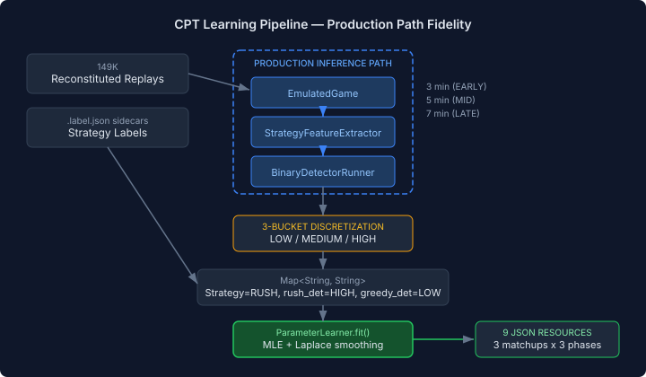
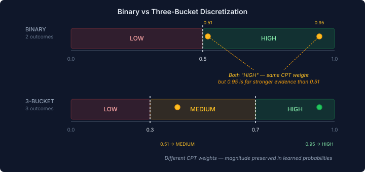

# Teaching the Network to Count

The BJT network now has MAP inference and explanation traces. It can give a coherent joint classification and tell the coach exactly which detectors shifted the posterior. There's one problem: the probabilities driving all of this are made up.

Every detector in the network uses the same CPT: 0.8 if it's a positive indicator for a strategy, 0.2 if it isn't. The early rush detector and the mid-game air tech detector have identical conditional probability tables despite detecting fundamentally different things with different accuracy profiles. A detector that fires on 90% of actual rushes gets the same weight as one that fires on 55%.

This matters more than it sounds. The MAP inference I wrote about in the last entry finds the single most coherent joint assignment across all variables. But if the CPTs feeding that inference are uniform guesses, "most coherent" is doing arithmetic on fiction. The network has the right topology — the right questions — but the wrong answers.

## From Guesses to Counts

We have 149K labelled replays with strategy labels from the heuristic classifier, and ONNX detector models trained on this data. The neocortex library already has `ParameterLearner.fit()` — closed-form MLE with Laplace smoothing. The inputs exist. The machinery exists. The gap was a pipeline to connect them.

The key design decision was production-path fidelity. We could have run the Python feature extractor and Python ONNX inference over the reconstituted replays — faster to build, and the training pipeline already exists. But the learned CPTs would reflect the Python inference path, not the Java production path. The two should agree, but "should" is a weasel word when you're calibrating the probabilities that drive real-time strategy classification.

So the pipeline runs Java end to end: reconstituted replay → EmulatedGame → StrategyFeatures → BinaryDetectorRunner (the same ONNX inference code that runs during live games) → observations. The CPTs learn from exactly the same signal path they'll serve at runtime.

## Three Buckets, Not Two

The original plan was binary discretization: detector output ≥ 0.5 maps to HIGH, below to LOW. Simple. But the production inference path doesn't use binary evidence — `DetectorOrchestrator.classify()` feeds continuous soft evidence to the BJT. A detector scoring 0.95 produces very different posteriors from one scoring 0.51, even though both would be "HIGH" in training.

Three buckets — LOW, MEDIUM, HIGH — capture the distinction between confident detection, borderline detection, and confident absence. The learned CPTs model P(HIGH | RUSH), P(MEDIUM | RUSH), P(LOW | RUSH) separately. At inference time, a piecewise linear function maps the continuous score to a 3-element likelihood vector, preserving the magnitude information that binary discretization destroys.

There's a risk: if detector outputs are bimodal (clustering near 0.0 and 1.0, as binary classifiers often do), the MEDIUM bucket is nearly empty and adds noise instead of signal. The export pipeline logs per-detector bucket distributions. If MEDIUM is below 5% of observations, the pipeline reverts to binary — data decides, not us.

## The Fallback Question

The spec's original acceptance criterion said "hand-tuned CPTs used if learned data unavailable." I pushed back on this during design. If the uniform 0.8/0.2 values were good enough, we wouldn't need parameter learning at all. Silently falling back to known-bad CPTs is worse than failing — the system looks like it's classifying, but the numbers driving the classification are fiction. No error, no warning, just quietly wrong.

The compromise: profile-gated fallback. In production profiles (`%sc2`, `%emulated`, `%coach`), missing learned CPTs throw an `IllegalStateException` at startup. Classification quality matters in those contexts and silent degradation is dangerous. In dev and test profiles, the fallback fires with a WARN log — classification accuracy is incidental there and hard failures would just add friction.

## Where It Stands

The infrastructure is in place. `CatalogLabelMapper` validates replay labels against the detector catalog. `DetectorOrchestrator` now accepts learned networks with 3-outcome detector variables and selects the right evidence mapping based on the network's outcome count. `LearnedCptLoader` deserializes `NetworkSpec` JSON resources at startup with semantic validation — CPT row sums, label consistency, detector name alignment. The wiring through `CascadingPatternClassifier` is done.

What remains is the batch pipeline itself — `CptLearningExportTest`, the report test that runs 149K replays through the production inference path, calls `ParameterLearner.fit()`, and writes the nine JSON resource files (one per matchup × phase). That's where the 0.8/0.2 guesses finally get replaced by what the data actually says.
