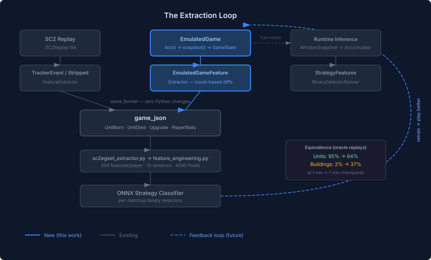

# Closing the Extraction Loop

The ONNX strategy classifier trains on feature vectors extracted from replays. The replay extractors — `TrackerEventFeatureExtractor` for tournament games with tracker events, `StrippedReplayFeatureExtractor` for the 151K stripped ladder replays — produce a standard `game_json` format that the Python pipeline consumes. But there was no path from `EmulatedGame` to that same format. Emulated games could run, but they couldn't produce training data.

This matters because the end goal is a closed loop: play games, extract features, retrain the classifier, play better games. Without the extraction bridge, the loop stays open.

## The Shape of the Problem

EmulatedGame already tracks everything the feature vector needs: unit counts by type, building counts, upgrades, and economy stats via `PlayerEconomyStats`. The runtime Java path — `DroolsScoutingTask.buildSnapshot()` feeding `TemporalWindowAccumulator` — already works on any `GameState` regardless of origin. So the runtime inference path was free.

The gap was the training data path. The Python pipeline expects `game_json`: timestamped tracker events (`UnitBorn`, `UnitDied`, `Upgrade`, `PlayerStats`) that `sc2egset_extractor.py` processes into per-second feature arrays. EmulatedGame has full state at every tick, but no code to convert that state into the event timeline format.

## Count-Based Diffs

The approach is straightforward: diff consecutive `GameState` snapshots by type counts and emit synthetic events for the deltas. Unit type count went up by 2? Emit 2 `UnitBorn` events. Building count decreased? Emit `UnitDied`. New upgrade appeared in the set? Emit `Upgrade`.

This is deliberately simpler than what the replay extractors do. `StrippedReplayFeatureExtractor` (1340 lines) reconstructs events from game commands — parsing CmdEvents, tracking selection state, simulating production multiplication, handling warp-ins, auto-spawning Larva. EmulatedGame doesn't need any of that. It has the ground truth at every tick.

The count-based approach loses individual unit identity — if a Marine dies and a Marine is born on the same tick, the net delta is zero and no events are emitted. But the Python pipeline only consumes per-type counts at each second, not individual unit timelines, so nothing is lost downstream.

## The Name Mapping Problem

The Java domain uses `UPPER_SNAKE_CASE` enum names: `COMMAND_CENTER`, `DARK_TEMPLAR`, `CYBERNETICS_CORE`. The Python pipeline expects PascalCase SC2 API names: `CommandCenter`, `DarkTemplar`, `CyberneticsCore`. A generic converter handles most cases — split on underscore, capitalise each word — but several types have irregular names.

`SCV` stays `SCV`, not `Scv`. `MULE` stays `MULE`. `HELLBAT` maps to `HellionTank` (the Python name for the transformed Hellion). `VIKING` maps to `VikingFighter`. And `TEMPLAR_ARCHIVES` maps to `TemplarArchive` — singular, not plural. Claude caught that last one during code review — the generic converter produced `TemplarArchives` which silently missed the Python feature slot.

`PlayerStats` events also had a subtlety: in tracker events, `foodMade` and `foodUsed` are *not* scaled by 1000×, while all other economy fields are. The tracker extractor confirms this — lines 105–106 pass those two fields through raw while multiplying everything else.

## Validation

Three tiers. The shape validation runs a controlled EmulatedGame scenario and checks the output: 13 stat fields present, correct event keys, name conversions match across all types. The runtime pipeline validation feeds EmulatedGame snapshots through the full `WindowSnapshot` → `TemporalWindowAccumulator` → `StrategyFeatures` path and confirms non-zero feature vectors with correct dimensions.

The equivalence characterisation is the interesting one. It runs 20 oracle replays through `ReplayValidationHarness`, reconstructs `GameState` from the emulated tick snapshots, and compares against ground truth at 1/3/5/7 minute checkpoints. Current numbers: units start at 95% accuracy at 1 minute and decay to 64% at 7 minutes. Buildings are at 2%→37% — expected, since EmulatedGame doesn't yet produce buildings from extracted commands. That's the calibration work in the parallel pipeline (#384), not an extraction bug.

The extractor faithfully converts whatever EmulatedGame produces. When EmulatedGame accuracy improves, the training data quality improves automatically — no extraction changes needed.

## What This Opens Up

The extraction bridge is one piece of the Phase 4 training loop. With it, any EmulatedGame run — whether from autonomous play, from scripted scenarios, or from replayed games — can produce training data in exactly the same format as the replay-based pipeline. The Python training code doesn't need to know where the data came from.

The next piece is autonomous play (#359): EmulatedGame running full games without replay input, generating novel game states the classifier hasn't seen before. Once that's working, the loop closes: play → extract → train → play better.
