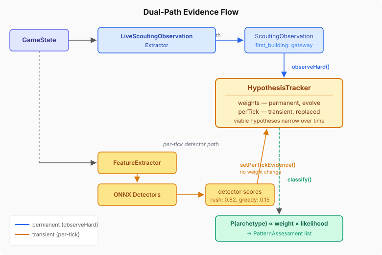

# Closing the Observation Loop

_Continues from [Replacing the Star with a Tracker](2026-10-27-mdp01-replacing-the-star-with-a-tracker.md)._

The standalone classes work. The tracker builds from learned priors, observations shift weights, detectors feed per-tick evidence without compounding. Phase 2 proved the mechanics. But proving mechanics in isolation is easy — the interesting question is what happens when they meet the live game loop.

## The vocabulary gap nobody warns you about

The first thing that broke was army composition classification. The live extractor needs to categorise enemy units as light, armored, or air — the same buckets the Phase 1 replay pipeline used to train the observation CPTs. The obvious approach: call `SC2Data.unitAttributes()` and check for `LIGHT` or `ARMORED`. Except `unitAttributes(ZERGLING)` returns an empty set. Zerglings have no LIGHT attribute in the game data. But the training pipeline — which ran against replay tracker events, not the Java enum — classified them as light by unit name.

This is the kind of mismatch that produces silent wrong answers. The extractor runs, observations flow, the tracker updates — but the observation states don't match the CPT vocabulary, so the conditional probabilities are all wrong. No error, no exception, just increasingly confused posteriors.

The fix is straightforward: explicit unit type sets matching the replay extractor's classification, not the game data attributes. `ZERGLING`, `MARINE`, `ZEALOT` → light. `ROACH`, `SIEGE_TANK`, `STALKER` → armored. It's ugly to maintain two parallel classification schemes, but the CPTs were trained on one of them. The live system must speak the same language.

Building names had the same shape of problem. `BuildingType.SPAWNING_POOL` needs to become `"spawningpool"` — no underscores — because the replay pipeline lowercased raw tracker event names. A `.toLowerCase().replace("_", "")` call. Trivial once you know. Invisible until your `first_building` observations never shift any weights.

## Two paths through the same tracker

The wiring itself is architecturally clean because the design separates concerns precisely. Each game tick, two things happen in sequence:

The `LiveScoutingObservationExtractor` reads the `GameState` and produces discrete `ScoutingObservation` records — seven variables matching the Phase 1 vocabulary: `first_building`, `gas_timing`, `expansion_timing`, `tech_path`, `army_composition`, `worker_saturation`, `aggression_timing`. One-shot observations (first building, gas timing) fire once and never re-emit. Continuous observations (army composition, worker saturation) re-emit when the state changes.

These observations hit the tracker through `observeHard()` — permanent weight updates. A scout sees barracks early with no gas? The tracker shifts weight toward bio rushes and away from mech builds. That shift persists for the rest of the game.

Then the ONNX binary detectors run against the current feature vector, and their scores flow through `setPerTickEvidence()` — transient, replaced every tick, no weight accumulation. The final assessment combines both: `P(archetype) ∝ weight × perTickLikelihood`. Permanent scouting intelligence narrows the field; per-tick detector evidence refines within it.

## The cascade stays the same shape

The `CascadingPatternClassifier` still runs three tiers: Drools → Bayesian fusion → LLM fallback. The only change is what sits behind tier 2. A config flag (`quarkmind.classifier.fusion.mode`) switches between the old `DetectorOrchestrator` and the new `HypothesisTrackerFusion`. Both implement the same shape: initialise, select which detectors to evaluate, run them, classify. The cascade doesn't know which backend it's talking to.

I also killed a dual-track inconsistency that had been bothering me. `DroolsScoutingTask` was resolving game phase through the injected `PhaseResolver` (which considers game state), while `CascadingPatternClassifier` was using a static `resolvePhase(frame)` (which only looks at the frame number). Both now use the same injected resolver. When the scouting task says "we're in MID phase", the cascade agrees.

## The prior advantage

The calibration numbers were more dramatic than I expected. Running both paths against the same neutral feature vectors across all nine race-phase combinations: the old `DetectorOrchestrator` produced zero assessments. The new `HypothesisTrackerFusion` produced assessments for all nine — meaningful ones, with the learned prior distribution giving each race-phase combination a sensible starting shape.

This makes sense once you think about it. The old path starts from uniform priors and needs detector evidence to differentiate. With neutral features, everything looks equally likely, and nothing crosses the confidence threshold. The new path starts from priors learned across 28K replays. Before a single detector fires, the tracker already knows that `TERRAN_FAST_EXPAND` is more common than `TERRAN_BC_TRANSITION` in early game. That prior knowledge alone is enough to produce a ranked assessment.

That's the payoff of Phase 1's data pipeline. The replays aren't just training data for the detectors — they're training data for the hypothesis space itself. The tracker doesn't start from ignorance. It starts from the frequency distribution of 28,000 games.
