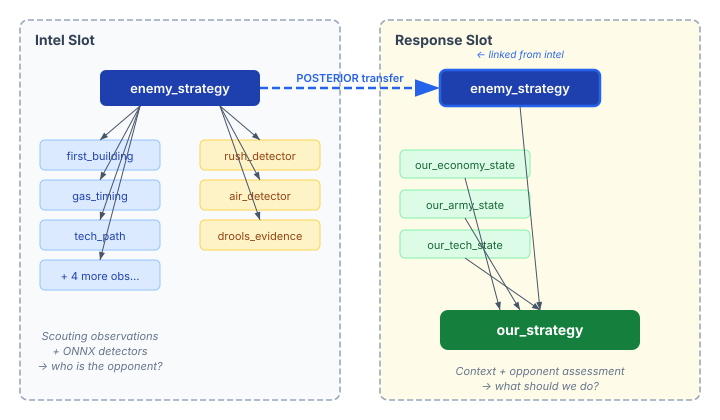
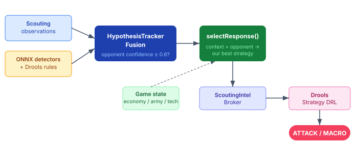

# When the Tracker Talks Back

_Continues from [Closing the Observation Loop](2026-10-27-mdp02-closing-the-observation-loop.md)._

Until now, the HypothesisTracker answered one question: *what is the opponent doing?* It narrowed hypotheses as scouting observations arrived, eliminated dead paths, and produced a ranked assessment. Useful, but one-directional. The tracker observed. It never recommended.

Phase 4 closes the loop. The tracker now answers a second question: *given what the opponent is doing, what should we do about it?*

## Two networks, one composition

The mechanism is a second Bayesian network — a response slot — linked to the existing intel slot through a shared variable. Both live inside the same `NetworkComposition`, connected by a posterior transfer on `enemy_strategy`.



The intel slot does what it always did: scouting observations and detector scores flow in, hypothesis weights shift, and a posterior over opponent archetypes emerges. The response slot takes that posterior as input — along with three context variables describing our current game state — and produces a distribution over our available strategies.

The composition API makes this surprisingly clean. One `CompositionBuilder` call chains two slots with a link, and the `HypothesisTracker` propagates evidence through the junction tree DAG automatically. Each hypothesis gets its own `CompositionInstance`, so the per-hypothesis response marginals reflect that hypothesis's specific opponent belief. The final recommendation blends across viable hypotheses weighted by their current probability.

## What 149,000 games teach about winning

The response network needs priors: P(our_strategy | opponent_strategy, win). What strategy do winning players actually use against each opponent archetype?

The answer comes from the same 149K labelled replays that trained the opponent priors. Each replay has both players' strategy labels and a win/loss outcome. Extracting response priors is a conditional frequency computation — count the winning strategies per opponent archetype, apply Laplace smoothing, normalise.

Some results are satisfying in their obviousness. Against Zergling Rush, the top winning response is Banshee Harass at 40%. That's textbook SC2 — Zerglings can't shoot air. Against Terran macro builds, the winning distribution is flatter: Marine Rush and Proxy Barracks each appear at 23%, with Fast Expand close behind at 21%. When the opponent is playing standard, there's no single correct counter.

These priors are tiled into a joint CPT across 27 context combinations — economy (behind/even/ahead) × army (smaller/even/larger) × tech (behind/even/ahead). In this phase, the context dimensions are uniform: every row for the same opponent strategy is identical regardless of game state. The structure is there for Phase 5 to learn context-dependent responses. The values aren't — yet.

## The routing conflation

I expected the hardest design question to be about the response network itself. It wasn't. It was about where the recommendation lands.

The first design had response recommendations influencing the `SC2StrategyRouterTask` — the component that selects which `StrategyTask` implementation to run. The reasoning seemed obvious: the router already blends CBR and trust signals for implementation selection, so a response recommendation would be "just another signal."

A decision review caught the conflation. The router answers "which implementation should run" — a plumbing question. The response network answers "what strategy should we play" — a game-theory question. These are orthogonal. Injecting strategy recommendations into the implementation router is like asking the load balancer which database query to run.

The cleaner separation: response recommendations flow through the `ScoutingIntelBroker` as a domain signal, consumed by `StrategyTask` implementations within their own `execute()` logic. The DRL rules in `DroolsStrategyTask` fire on a `ResponseRecommendationFact` — if the response archetype is a rush or timing attack with confidence ≥ 0.7, the strategy shifts to ATTACK. If it's a macro archetype, MACRO. Defensive rules at higher salience still override: a nexus under attack or an all-in posture trumps any Bayesian recommendation.



## The floor guarantee

Expert overrides are multiplicative: if the learned prior for "fast expand vs cannon rush" is 0.001 and the expert says 3× that, the adjusted prior is 0.003. Still negligible against archetypes with priors above 0.15. Multiplication can't rescue rare-data matchups.

The fix is a floor guarantee. When an expert override specifies a preferred response, the adjusted prior is `max(floor, learned × multiplier)`. A floor of 0.05 means expert knowledge can push a rare matchup to 5% of the distribution before renormalisation — enough to register as a meaningful alternative instead of rounding to noise.

The overrides live in a YAML file:

```yaml
vs_protoss:
  - when_opponent: CANNON_RUSH
    preferred_response: MACRO
    prior_multiplier: 3.0
    floor: 0.05
```

## What the context variables are waiting for

The response network has three context inputs — economy, army, and tech state relative to the opponent. In this phase, they're structurally present but functionally inert. Setting hard evidence on them has no effect because the CPT rows are identical across all 27 combinations.

This is deliberate. Learning context-dependent CPTs — P(our_strategy | enemy_strategy, economy, army, tech) — requires extracting game state snapshots at strategy-decision points from replays. That's a data pipeline step beyond what the opponent prior extraction provides. The network structure supports it without modification; only the CPT values change.

The calibration test confirms the expectation: identical responses regardless of context. Behind and ahead produce the same recommendation. The response network is currently a lookup table from opponent archetype to counter-strategy, which is already more informed than no response selection at all. Context sensitivity will make it adaptive.

The loop from observation to recommendation is closed. The tracker sees what the opponent is doing, and tells us what to do about it.
