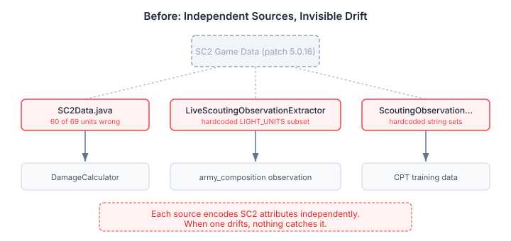
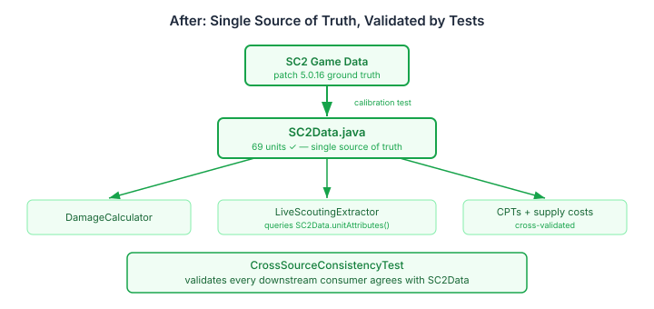

# Trust but Verify Your Game Data

A Zergling is Light and Biological. Every StarCraft player knows this. `SC2Data.unitAttributes(ZERGLING)` returned an empty set.

That gap was discovered during live scouting work — the Bayesian network classified an army composition wrong because it couldn't tell a Zergling was a light unit. The workaround was a hardcoded `LIGHT_UNITS` set in the observation extractor. The fix was filed as an issue and forgotten. Which is exactly the problem.

## The Drift Nobody Sees

When the same domain fact is encoded in multiple places independently, drift is invisible. SC2Data had unit attributes. The observation extractor had its own LIGHT/ARMORED classification sets. The replay extractor had string-based equivalents. Supply costs lived in a JSON file. CPT variables encoded detector names. Each source was written at a different time, by a different session, against a different understanding of the game data.

The Zergling wasn't the only gap. It was the one we noticed.



Sixty of sixty-nine unit types had wrong or missing attributes. Observer was listed as Armored when it's Light. Immortal had Massive when it doesn't. Ghost was missing Light — an attribute it gained in patch 5.0.15. Every Protoss air unit was `Set.of()`: empty. Every Terran ground unit except Marine and Marauder: empty.

The hand-maintained map had been filled in for the units someone happened to need at the time. Everything else was left as placeholder empty sets that passed the "not null" check and silently produced wrong classifications downstream.

## Ground Truth from Game Data

The fix has two layers. First: calibrate SC2Data against an authoritative source. We used starcraft2.ai's unit reference, pinned to patch 5.0.16, cross-checked against Liquipedia and the SC2 patch notes for units whose attributes changed recently.

The calibration test defines the expected attributes for every unit type and compares against `SC2Data.unitAttributes()`:

```java
map.put(UnitType.ZERGLING,    Set.of(LIGHT, BIOLOGICAL));
map.put(UnitType.GHOST,       Set.of(LIGHT, BIOLOGICAL, PSIONIC));
map.put(UnitType.SENTRY,      Set.of(MECHANICAL, PSIONIC));
map.put(UnitType.ARCHON,      Set.of(PSIONIC, MASSIVE));
// ... 69 entries total
```

Sentry is Mechanical and Psionic but neither Light nor Armored. Archon is Psionic and Massive but neither Biological nor Mechanical. The SC2 attribute system has more exceptions than most players realise, and a hand-maintained map will get them wrong.

On mismatch, the test prints a delta report and generates the corrected Java source — paste it in and re-run:

```
OBSERVER    MISMATCH missing=[LIGHT], extra=[ARMORED]
IMMORTAL    MISMATCH extra=[MASSIVE]
GHOST       MISMATCH missing=[LIGHT, BIOLOGICAL, PSIONIC]
```

## The Real Fix: One Source of Truth

Calibrating SC2Data is necessary but not sufficient. The observation extractor still had hardcoded `LIGHT_UNITS` and `ARMORED_UNITS` sets that duplicated — and contradicted — what SC2Data already knew:

```java
// Before: hardcoded subset, drifts independently
private static final Set<UnitType> LIGHT_UNITS = EnumSet.of(
    UnitType.MARINE, UnitType.ZERGLING, UnitType.ZEALOT,
    UnitType.ADEPT, UnitType.HELLION);
```

Five units out of twenty-plus that are actually Light. The classification worked for the common cases and silently failed for everything else. A Hydralisk, a Mutalisk, a Phoenix — all Light units, all invisible to this classifier.

The fix replaces the hardcoded sets with SC2Data queries:

```java
// After: derives from SC2Data — stays correct as game data changes
var attrs = SC2Data.unitAttributes(u.type());
if (attrs.contains(UnitAttribute.LIGHT)) light++;
else if (attrs.contains(UnitAttribute.ARMORED)) armored++;
```

Now there's one place that defines unit attributes, and everything downstream reads from it.



## Cross-Source Validation

The second test — `CrossSourceConsistencyTest` — validates that every downstream consumer agrees with SC2Data. It checks four dimensions:

- **Observation extractors** — the replay extractor's string-based LIGHT/ARMORED sets must contain only units that SC2Data classifies with those attributes
- **Supply costs** — the JSON file consumed by the Python classifier must match `SC2Data.supplyCost()` for every unit type
- **CPT variables** — every variable in the learned Bayesian network CPTs must have a matching entry in the detector catalog
- **Coverage report** — flags SC2Data LIGHT combat units not covered by the extractor's subset (twelve currently, including Ghost, Dark Templar, and Banshee)

The coverage gap is informational, not a failure. The replay extractor deliberately uses a subset for army composition classification. But seeing the gap printed on every report run means someone eventually asks whether Banshee should count as light air — which it should.

## Why Tests Beat Documentation

The protocol that said "calibrate from game data" was written the day before the test. Within a session, it would have been forgotten. The test runs every time someone touches the report suite. It doesn't care whether the developer read the protocol, remembers the issue, or has context from the session that wrote it.

Documentation records intent. Tests enforce it.
