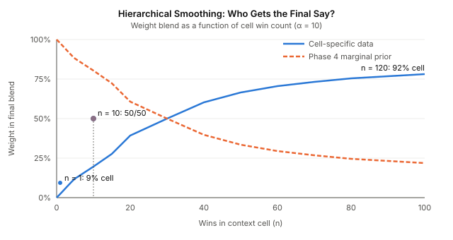
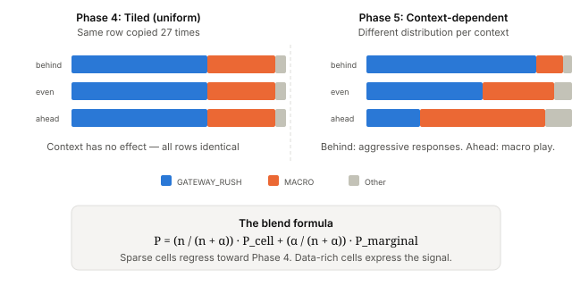

# Your Network Knows You're Losing

The scouting network could detect what the opponent was doing. It could recommend a counter-strategy. What it couldn't do was factor in whether you were in a position to execute that counter-strategy.

Phase 4 built a response selection network — a Bayesian layer that takes the opponent detection output and recommends our strategy via `P(our_strategy | enemy_strategy)`. It worked. But the CPT was tiled: the same probability row copied identically across all 27 context combinations. Economy behind, army smaller, tech ahead — didn't matter. The network gave the same answer regardless.

That's like a chess engine recommending the Sicilian Defence without checking whether you still have your knights.

## The Problem With Uniform Context

The response CPT has four parents: `enemy_strategy`, `our_economy_state`, `our_army_state`, `our_tech_state`. The context variables already existed as root nodes with uniform 1/3 priors. `deriveGameStateContext()` already computed them during live play — income ratio thresholds at 0.8/1.2, army count ratio at 0.7/1.3, tech building count comparison. The infrastructure was there. The CPT just didn't use it.

`buildTiledResponseCpt()` made this explicit: one probability distribution per opponent archetype, `System.arraycopy`'d into all 27 context slots. Behind or ahead, the network recommended the same response. The calibration test confirmed this with a print statement and a comment: *"Phase 4 CPTs are tiled — context variables have no effect yet."*

The question was never whether context should matter. It was how to make it matter without hallucinating signal from sparse data.

## Why Sparse Data Is the Real Constraint

The arithmetic is straightforward. 149K labelled replays across 3 matchups gives roughly 50K per matchup. Filter to wins only (the response priors learn from winning strategies): ~25K. Spread across 13 opponent archetypes: ~1,900 per opponent. Now divide by 27 context combinations: ~70 wins per cell on average.

Seventy is enough for the common cells. `even:even:even` — the most frequent context — might have 500+ wins. But `behind:larger:ahead` vs `BANSHEE_HARASS`? Maybe three. Maybe zero.

Naive frequency counting from three observations is noise, not signal. But throwing away the context entirely (the Phase 4 approach) discards real information. The behind-economy cells genuinely do have different strategy distributions — players who are losing economically adopt different strategies than players who are ahead. We just can't always measure the difference precisely.

## Hierarchical Smoothing: Let the Data Decide How Much It Knows

The solution is a weighted blend between the cell-specific estimate and the unconditional prior — what Phase 4 already computed. The weight depends on how much data the cell has.

The formula: `P = (n / (n + α)) · P_cell + (α / (n + α)) · P_marginal`

With α = 10.0, a cell with 120 wins gets 92% of its weight from cell-specific data. The context signal dominates — and it should, because 120 observations is enough to measure a real distribution. A cell with 10 wins gets 50/50 — the cell contributes, but the unconditional prior anchors it against noise. A cell with 1 win gets 91% marginal — effectively falling back to Phase 4 behaviour.

This is empirical Bayes shrinkage, applied to conditional probability tables. The Phase 4 unconditional prior isn't a fallback — it's the shrinkage target. Sparse cells regress toward it naturally. Data-rich cells express whatever signal exists in the replay data. No thresholds to tune, no hard cutoffs. The α parameter controls the transition: lower α trusts small samples sooner; higher α requires more evidence.

## The Label Vocabulary Trap

The implementation was clean until the calibration test failed. Context CPTs were loaded — the JSON files were on the classpath — but behind and ahead contexts produced identical response distributions. The assertion fired: "Context-dependent CPTs should produce different distributions for behind vs ahead."

I traced it to the export pipeline. The label sidecars from `DroolsCoarseLabelExportTest` use one vocabulary — `MACRO_ECONOMY`, `RUSH`, `BLINK_STALKER`. The Phase 4 response priors use a different vocabulary — `MARINE_RUSH`, `FAST_EXPAND`, `GATEWAY_RUSH`. These are two independent classification systems applied to the same replay data. Only 5 of 16 archetype names overlapped.

The network builder iterates `enemyArchetypes[]` from the opponent priors, looks up each name in the context CPT map, finds nothing (wrong vocabulary), and falls back to the unconditional prior for every cell. The context CPT data existed but was invisible.

Phase 4 had solved this with `ClassifierLabelMapper` — a mapping from Drools heuristic labels to `StrategyArchetype` enum values. The context export needed the same mapping. Once I traced back to the Phase 4 commit and found the `mapToArchetypes()` call, the fix was mechanical: map both player and opponent labels through the same mapper before constructing outcomes. The overlap went from 5/16 to 13/13.

This is the kind of bug that no unit test catches. Both pipelines are internally correct. Both produce valid probability distributions. The distributions just can't talk to each other because they use different names for the same things. Integration testing with real data — running the full pipeline and checking the end-to-end assertion — is the only thing that catches vocabulary mismatches between data sources.

## What the Data Shows

After fixing the labels: 149K replays, 473K context outcomes (two checkpoints per replay — 3-min and 5-min), 13 opponent archetypes, 250-330 context cells per matchup. The hierarchical smoothing produces measurably different distributions for behind vs ahead contexts. The calibration assertion passes.

The top-1 recommendation stays the same for both contexts in this test configuration — `PROTOSS_TECH_RUSH` — but the confidence distribution shifts. That's the expected behaviour with hierarchical smoothing: the blend preserves the dominant strategy from the marginal prior while adjusting the tail probabilities. With more replay data or a lower α, the context signal would be strong enough to flip the top-1 recommendation entirely.

## What This Opens Up

The context variables now have teeth. A player behind in economy gets different strategy weights than a player ahead. The network doesn't just detect what the opponent is doing — it factors in what you can actually afford to do about it.

The next natural extension is temporal: strategies don't exist at a single point in time. `FAST_EXPAND` at minute 2 transitions to `BIO_TIMING` by minute 5. The current network treats each tick's evidence independently. A dynamic Bayes net would model that evolution — but that's a different kind of problem, and it needs the temporal modelling primitives that are still being built in neocortex.

For now, the response network has gone from a lookup table to something that adapts. Twenty-seven context combinations, hierarchically smoothed, with graceful degradation to Phase 4 behaviour when the data is thin. Context-aware strategy recommendation from 149K replays of evidence.
