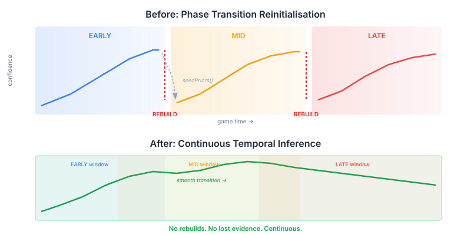
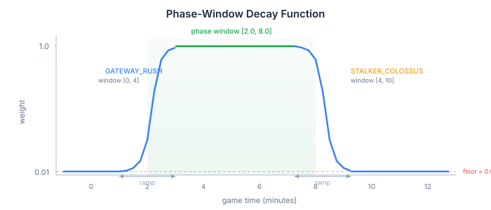

# Stop Rebuilding Your Classifier Every Time the World Changes

The hypothesis tracker had a dirty secret. Every time the game crossed a phase boundary — early to mid, mid to late — the entire Bayesian network was torn down and rebuilt from scratch. The old tracker's posterior weights were snapshotted, stuffed into the new tracker's priors via `seedPriors()`, and the accumulated evidence from dozens of observations was reduced to a handful of floating-point numbers.

It worked. But it was a lie about how strategies actually evolve.

## The phase-transition trap

A StarCraft strategy doesn't snap from GATEWAY_RUSH to STALKER_COLOSSUS at minute 5. It morphs. The opponent's early aggression gradually transitions into a midgame composition, with intermediate ticks where the evidence is genuinely ambiguous — they might still be rushing, they might be transitioning to tech, the detectors aren't sure yet. Those ambiguous ticks are exactly when temporal context matters most.

The rebuild destroyed exactly that context. At the transition boundary, the tracker went from "80% confident this is a Gateway Rush based on 30 observations" to "here are some borrowed prior weights in a fresh network with zero observation history." The junction tree evidence, the per-tick detector fusion, the scouting observations — all gone. Replaced by a seed value that carried the conclusion without the reasoning.



This is a general pattern, not a StarCraft-specific problem. Any system that classifies changing state over time faces the same choice: discrete bins with reinitialisation, or continuous inference with temporal smoothing. Fraud detection systems that reset monthly. Network anomaly detectors that reinitialise per shift. Medical monitors that treat each visit independently. The discrete approach creates artificial discontinuities at exactly the moments where continuity matters most.

## The unified archetype set

The fix was surprisingly simple once I stopped thinking in phases. Instead of maintaining separate archetype sets per phase (EARLY has rush types, MID has composition types, LATE has endgame types), we built a single tracker with every archetype for the enemy race — about 23 hypotheses instead of the 15-20 per phase.

The obvious objection: prior dilution. With 23 uniform priors, each archetype starts at ~4.3% — compared to ~6-7% with a 15-archetype phase-filtered network. That's a meaningful difference for the Bayesian inference. You need more evidence to shift a 4.3% prior to decision-relevant levels than a 6.7% one.

The solution is phase-window decay — a sigmoid function that weights each archetype's prior by how much the current game time falls within its phase window:



At minute 2, only EARLY archetypes have full weight. The 14 MID and LATE archetypes are suppressed to a floor of 0.01. The effective prior for each active EARLY archetype concentrates to ~11-17% — better than the old per-phase network. But unlike the old approach, there's no cliff. As the game approaches minute 4, MID archetypes gradually ramp up while EARLY archetypes gradually ramp down. Evidence smoothly transfers between them.

The sigmoid ramp is configurable but defaults to 1 minute on each side of the window boundary. Fast enough to be responsive, slow enough to avoid the kind of one-tick classification flips the old system also suffered from.

## Transition-aware temporal blending

Phase windows handle the "which archetypes are plausible now" question. But strategies don't just exist in time — they transition to specific successors. A Gateway Rush at minute 3 is more likely to become a Colossus Push than a Carrier fleet. The taxonomy already models 14 hand-authored transition paths, and the replay data reveals more.

We added a transition learning pipeline — a `@Tag("report")` test that processes reconstituted replays at five checkpoints (1, 3, 5, 7, 10 minutes), records which strategy was classified at each point, and computes P(strategy_t | strategy_{t-1}) transition matrices per matchup. Hierarchical smoothing prevents zero probabilities. Taxonomy transitions get a prior count boost to ensure they dominate when data is sparse. Discovered transitions above a 5% frequency threshold are included alongside the hand-authored ones.

The temporal blending formula at each tick:

```
smoothed[j] = (1 - decay) * raw[j] + decay * Σᵢ prev[i] * P(j|i)
```

With `decay = 0.3`, 70% of the weight comes from current evidence and 30% from the transition-weighted previous posterior. If the previous tick's leader was MARINE_RUSH and the transition matrix says P(BIO_TIMING | MARINE_RUSH) = 0.4, then BIO_TIMING gets a meaningful temporal boost even before the detectors pick up the first Factory.

## What this replaces

The old `TemporalAssessmentTracker` used a sliding window of 5 posteriors with arithmetic averaging. ADR-0010 deliberately chose windowing over exponential decay for "temporal stability." That was the right call when temporal smoothing was the only mechanism preventing classification flips. But with phase-window decay and transition-aware priors now providing structural temporal awareness, the simpler decay blending is sufficient — and more appropriate. In strategy evolution, recent evidence should matter more than evidence from 5 ticks ago. Equal-weight windowing assumes the opposite.

The `DetectorOrchestrator` now uses inline decay blending instead of the separate tracker. The `HypothesisTrackerFusion` gains `initializeUnified()` — called once at game start with all archetypes — and `classifyUnified()` which applies phase weights, evidence fusion, and transition blending in a single pass.

## The general principle

If your classifier reinitialises when its environment changes state, you're discarding the temporal context that makes the transition itself informative. The fix is always the same pattern: unify the hypothesis space, use a decay function to concentrate probability mass on the currently-plausible subset, and let learned transition probabilities provide the temporal prior. The reinitialisation was never adding information — it was destroying it and pretending the loss didn't matter.
