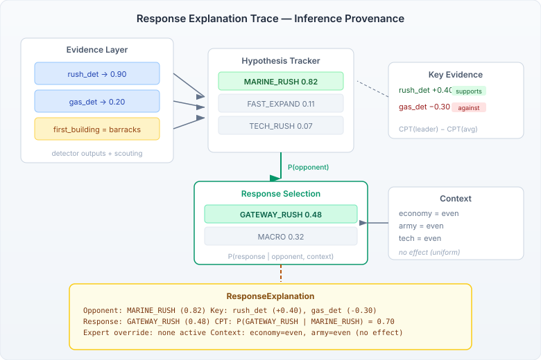

# Show Your Working

The response selection pipeline had a credibility problem. It could recommend `PROTOSS_GATEWAY_RUSH at 0.48 confidence` and be right — but it couldn't tell you why. The recommendation was the output of a marginalisation across a composed Bayesian network, and the reasoning was trapped inside posterior distributions that no human would read.

For debugging, this was irritating. For coaching — where the whole point is to explain AI reasoning to a human player — it was disqualifying.



The fix is a structured explanation trace that follows the reasoning chain: which detectors drove the opponent identification, what the response CPT says about the recommended counter, whether an expert override is active, and whether the game state context shifted the distribution. Not a natural language summary — a machine-readable record that coaching, logging, and debugging can each consume in their own way.

## What the trace captures

The trace breaks down into four layers, each answering a different question:

**Opponent rationale — why this opponent archetype?** The hypothesis tracker holds posterior weights for every viable enemy strategy. The explanation reports the leader, its weight, and the key evidence that pushed it there. "Key evidence" is computed from CPT likelihood ratios: for each detector, how much does its conditional probability for the leader archetype exceed the average across all archetypes? A detector with `P(fires | MARINE_RUSH) = 0.90` and `P(fires | average) = 0.50` has an influence of `+0.40` — it's strongly supporting the identification. A detector where the leader's CPT is below average has negative influence — it's actually evidence against, but being outweighed.

**Response rationale — why this counter-strategy?** The response network marginalises across all viable opponent hypotheses to produce a distribution over our own strategies. The trace reports the recommended archetype, its confidence, and the raw CPT value `P(response | opponent)` from the leader hypothesis alone. That last number is the purest signal: it's what the learned response priors say the correct counter is, before any context adjustment.

**Expert override — is a human rule in play?** Expert overrides are hard-coded response preferences: "when facing MARINE_RUSH, prefer GATEWAY_RUSH with 2x prior weight." The trace reports whether one is active and which response it boosts. This matters because an override can push the recommendation away from what the CPT alone would suggest — and if you're tuning the system, you need to know whether the network or the override is driving the recommendation.

**Context effect — did game state shift the distribution?** The response network conditions on three game state variables: economy, army, and tech posture (each behind/even/ahead). When all three are "even," the context layer is uniform and has no effect. When a player is behind on economy and army, the distribution shifts — and the trace says so.

## The format

The `format()` method renders the trace in a human-readable form that game logs and the coaching workbench can display directly:

```
Response: GATEWAY_RUSH (0.48)
  Opponent: MARINE_RUSH (0.82 weight)
    Key evidence: rush_det (+0.40), gas_det (-0.30)
  Response CPT: P(GATEWAY_RUSH | MARINE_RUSH) = 0.70
  Expert override: none active
  Context: economy=even, army=even, tech=even (no effect)
```

Every line earns its place. A coach can point at the key evidence and say "the AI thinks you're rushing because it saw barracks first — if that's wrong, here's what to scout next." A developer tuning CPTs can see immediately whether the response is being driven by the network or by an expert override. And anyone debugging a bad recommendation can trace backward from the output to the specific evidence that caused it.

## What this isn't

The neocortex library already has `ExplanationEngine` — a proper leave-one-out influence engine that computes KL divergence for each evidence variable and traces message paths through the junction tree. It's the right tool for deep single-network analysis. But the response selection pipeline uses a composed `HypothesisTracker` — one `CompositionInstance` per hypothesis, each with multiple slot networks. The explanation engine operates at a lower level than the tracker exposes.

Rather than tunnelling through three abstraction layers to get at the raw `BayesInstance`, the response explanation computes influence from the CPT values directly. It's fast (no leave-one-out recomputation), it's transparent (the influence formula is `CPT(leader) - CPT(average)`), and it gives the same intuition: which detectors are pushing the identification, and by how much. If deeper causal analysis is ever needed — counterfactual reasoning, confounding detection — the ExplanationEngine is there. The structured `ResponseExplanation` record is designed to carry that richer data when the tracker API eventually exposes it.

## What it opens up

The explanation trace is a record, not a string. Downstream consumers get structured access: the coaching pipeline can highlight which scouting observations would change the recommendation. The workbench can render the trace alongside the game state. The game log gets a machine-parseable audit trail. And the response CPT value — `P(GATEWAY_RUSH | MARINE_RUSH) = 0.70` — is the kind of number that lets you have a real conversation about whether the learned priors are right.

The harder question is whether explanation traces change how humans interact with game AI recommendations. A number like `0.48 confidence` is meaningless without context. The same number with "because it saw barracks first and no gas" is something a player can evaluate, challenge, and learn from.
