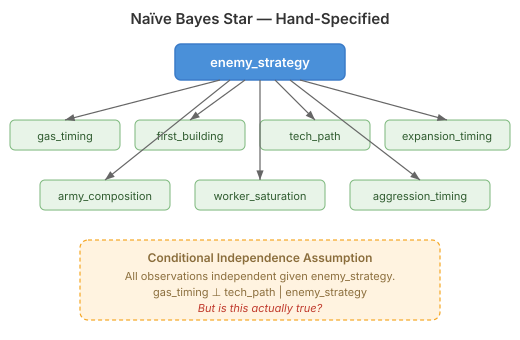
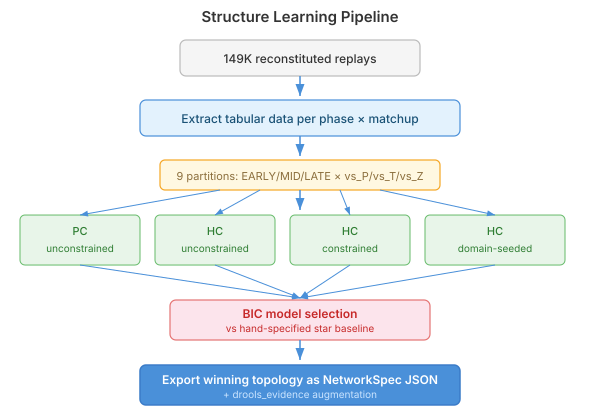
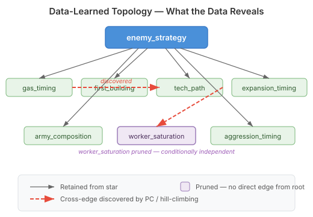

# Let the Replays Decide Your Network Topology

QuarkMind's scouting system classifies the opponent's strategy from partial information — gas timing, first building scouted, tech path chosen, expansion pace. Seven observation variables feed a Bayesian network whose root represents the enemy strategy, and the network's job is to update beliefs as evidence arrives.

The topology of that network was hand-specified. A naïve Bayes star: every observation directly connected to the strategy variable, every observation conditionally independent of every other observation given the strategy.



The assumption behind this star is strong. It says that once you know the opponent is going for a cannon rush, knowing their gas timing tells you nothing additional about their first building. That might be true for some matchups. For others, it is almost certainly wrong — a Protoss player who opens forge-first and takes early gas is signalling something different from forge-first with no gas, and those two signals are correlated independently of the underlying strategy.

We had no data to challenge the assumption when we built it. Now we have 149,000 replays.

## Structure learning from replay data

The neocortex inference engine now includes a `StructureLearner` — an implementation of the PC algorithm (conditional independence testing) and hill-climbing BIC search (greedy DAG optimisation). Both take the same input: tabular data where each row is one replay's scouting snapshot, and each column is a variable (enemy strategy, gas timing, first building, tech path, and so on). Both produce a learned DAG — the network topology that best explains the statistical relationships in the data.

The pipeline we built extracts this tabular data from reconstituted replays at three game phases (EARLY, MID, LATE) for each matchup (vs Protoss, vs Terran, vs Zerg) — nine partitions, each with its own learned topology. The phase dimension matters: at three minutes, first building and gas timing carry most of the signal. By seven minutes, tech path and army composition dominate. A single learned topology across all phases would blur these distributional differences.



## Four variants, one baseline

We don't run a single structure learner and hope for the best. The comparison matrix runs four variants against the hand-specified star:

| Variant | What it does |
|---------|-------------|
| PC unconstrained | Discovers conditional independence structure from statistical tests — no prior knowledge |
| HC unconstrained | Greedy search for the highest-scoring DAG — no constraints |
| HC constrained | Hill-climbing with a max-parents limit of 3 — prevents overfitting on small partitions |
| HC domain-seeded | Hill-climbing with domain knowledge as structural constraints — gas timing, first building, and expansion timing locked as required edges from enemy_strategy |

All four are compared against the star using BIC — the Bayesian Information Criterion, which balances model fit against complexity. A topology that fits the data better but uses more parameters gets penalised. Lower BIC wins.

The comparison is fair because every topology — including the star — gets its CPTs fitted from the same data via `ParameterLearner.fit()`. We're isolating structure quality from parameter quality. The star's hand-tuned CPTs might be better or worse than data-fitted ones; that's a separate question. Here, same parameters, different topology, which wins?

## What the data can reveal



The interesting possibilities are the edges the star topology can't express. A cross-edge from gas timing to tech path would mean that gas timing is informative about tech path even after conditioning on the strategy — the kind of signal a human analyst uses intuitively ("early gas with gateway first usually means stargate") but that the naïve Bayes star explicitly forbids.

Equally interesting: edges the star has that the data removes. If worker saturation is conditionally independent of enemy strategy once you know expansion timing, the PC algorithm will discover this and produce a sparser, more efficient network. Fewer edges means faster inference and less overfitting.

## The builder refactor

The production code needed to change too. `SC2HypothesisNetworkBuilder.buildIntelTree()` was hard-coded to construct the star topology — seven observation loops, one drools evidence node, detector grafting, all wired by hand. No room to swap in a different topology without rewriting the method.

The refactor expresses the star as a `NetworkSpec` — the same format the structure learner produces. A new `handSpecifiedStarSpec()` method encodes the current topology, clamping, and drools evidence as a spec object. A new `buildIntelTree(NetworkSpec, ...)` method constructs from any observation spec and grafts detector nodes on top. The old method delegates to the new one. Same output, different internal path — and now the path accepts alternatives.

```java
NetworkSpec starSpec = SC2HypothesisNetworkBuilder
    .handSpecifiedStarSpec(archetypes, observationCpts);

JunctionTree tree = SC2HypothesisNetworkBuilder
    .buildIntelTree(starSpec, archetypes, priors,
                    detectorNames, detectorCpts);
```

The star is the default. A learned topology loaded from a JSON resource is the alternative. A config flag (`quarkmind.scouting.use-learned-topology`) controls which one the runtime uses, defaulting to the star until the learned topology is validated.

## What comes next

The pipeline is built. The comparison framework is ready. What we don't have yet — because the reconstituted replay data lives on a different machine — is the actual results. The first run across 149K replays will answer the question that motivated all of this: does the hand-specified star hold up, or does the data know something we don't?

I suspect the star will lose on at least some matchup-phase combinations. Gas timing and tech path feel too correlated for the conditional independence assumption to survive a chi-squared test at the five percent level. But suspicion is not evidence, and that is exactly the point of letting the replays decide.
