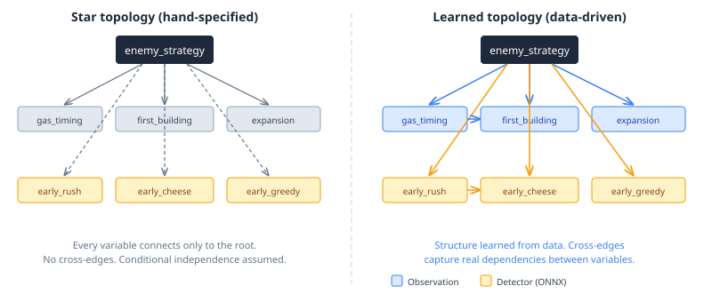
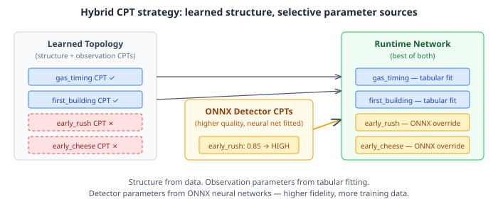

# Learning What Your Network Should Look Like

Most Bayesian network tutorials start with a known graph. Someone draws the nodes, draws the edges, and the problem becomes fitting parameters to data. This is comfortable. It is also almost always wrong for real systems, because the person drawing the graph is encoding assumptions they cannot verify — which variables are conditionally independent, which influence each other, which are redundant. Structure learning asks a harder question: given data, what should the graph itself be?

QuarkMind's scouting system classifies an opponent's strategy during a StarCraft II game. It fuses two kinds of evidence: observation variables (what the scout sees — gas timing, first building, expansion patterns) and detector variables (binary ONNX classifiers that fire on feature vectors — early rush, early cheese, mid air tech). Until now, both sat in a hand-specified star topology: every variable pointed at the root, no cross-edges, conditional independence assumed everywhere.



The star is a reasonable starting point. It is also provably suboptimal the moment any two variables share information that the root does not fully mediate. If `gas_timing` and `first_building` are correlated given a strategy — and they are, because a fast gas opening constrains what buildings can follow — the star throws that signal away.

## Why structure matters more than parameters

A well-fitted star and a well-fitted learned graph use the same parameter learning algorithm. The difference is which parameters exist at all. In a star, `P(gas_timing | strategy)` and `P(first_building | strategy)` are independent tables. In a learned graph with an edge from `gas_timing` to `first_building`, the second table becomes `P(first_building | strategy, gas_timing)` — a larger table that captures a real conditional dependency. The observation "gas before pool" now shifts the posterior differently depending on what building came first, rather than contributing an independent, unconnected signal.

This matters for the same reason it matters in any classification system. Naive Bayes (the star) works well when features are genuinely independent. When they are not — and in any domain with structured causal relationships, they never are — the posterior concentrates too quickly on hypotheses supported by redundant evidence, or fails to distinguish hypotheses that differ only in their feature correlations.

The algorithms here are standard: PC (constraint-based, using conditional independence tests) and hill-climbing with BIC scoring (score-based, searching the DAG space). I run both variants — unconstrained and domain-constrained — against the hand-specified star, compare via BIC model selection, and export the winner if it clears an improvement threshold. The star baseline is data-fitted first, so the comparison is fair: same data, same parameter learning, different structure.

## The two-source problem

Phase 1 learned topology over observation variables only. Phase 2 adds detector variables — the ONNX binary classifier outputs. The complication: these two data sources do not share a join key.

Observation variables come from reconstituted replay JSONs (298K replays across tournament and ladder datasets). A Java extractor (`ScoutingObservationExtractor`) processes each replay's tracker events and produces discrete states: `gas_timing=early`, `first_building=gateway`, `expansion_timing=fast`.

Detector variables come from a separate Python pipeline that extracts feature vectors from training data, runs ONNX binary classifiers, and discretizes the output: `early_rush=HIGH`, `early_cheese=MEDIUM`, `early_greedy=LOW`. The two pipelines process overlapping but not identical datasets, and the detector output files carry no replay identifiers.

Without a per-replay join key, you cannot discover cross-edges between observation and detector variables — those edges would require both variable types measured on the same data point. What you *can* discover is inter-detector structure and detector-strategy structure, by running structure learning on the detector data independently and composing the result with the observation topology.

This is a partial answer, and I am comfortable with it for now. The full cross-variable join requires the Python pipeline to propagate replay hashes through its export format — mechanical work, but not the interesting problem. The interesting problem is what happens when you bring detectors into the graph at all.

## Cardinality: three states or two?

The detector pipeline discretizes ONNX confidence scores into three buckets: HIGH (≥ 0.7), MEDIUM (0.3–0.7), LOW (< 0.3). But the runtime Bayesian network uses two states: HIGH and LOW. Every call to `buildIntelTree` adds detector variables as binary nodes — `intelBuilder.variable(detName, "HIGH", "LOW")`.

Three states in training, two states at runtime. This is a cardinality mismatch that produces learned CPTs that cannot be loaded into the runtime network.

The fix is straightforward: collapse MEDIUM into LOW at structure learning time. The runtime maps continuous ONNX outputs to a binary likelihood anyway — `new double[]{p, 1.0 - p}`. The three-state discretization was an artefact of the Python training pipeline's desire for richer signal during multi-class classifier training. For the Bayesian network, binary is correct.

## The hybrid CPT strategy

Structure learning fits all parameters simultaneously. But detector CPTs fitted from tabular data are strictly worse than the existing ONNX-fitted CPTs, because the ONNX models train on orders of magnitude more data with continuous confidence scores, while the tabular fit sees only discretized HIGH/LOW labels.

The solution: learn the structure from data, but selectively override detector parameters at runtime.



The implementation is a one-line change in `buildIntelTree(NetworkSpec, ...)`. When iterating the topology's variables, skip any that match a name in `activeDetectorNames`. The detector loop that follows adds those same variables with their ONNX-learned CPTs instead. The topology provides the edges; the ONNX models provide the parameters. Best of both.

```java
var detectorNameSet = new HashSet<>(activeDetectorNames);
for (var v : observationTopology.variables()) {
    if (v.name().equals("enemy_strategy")) { continue; }
    if (detectorNameSet.contains(v.name())) { continue; }
    // ... use topology's CPTs for observation variables
}
// Detector loop follows — adds detectors with ONNX CPTs
```

This is a general pattern worth naming: **learn topology from broad data, source parameters from the highest-fidelity provider per variable.** In this system, replay count data provides the topology; neural networks provide detector parameters; Drools rules provide an evidence injection node. Three sources of knowledge, composed into a single inference graph.

## The broader pattern

This work is part of QuarkMind, which is a living lab for the CaseHub agentic harness — an architecture that coordinates multiple AI plugins via a shared blackboard. The scouting system is one plugin among several (strategy, economics, tactics), each contributing to a shared `CaseFile` that represents the current game state.

The structure learning work demonstrates something transferable: **in agentic systems, the coordination topology between sensors, classifiers, and decision-makers should be learned, not prescribed.** A hand-specified star topology is a bet that every information source is independent given the current hypothesis. That bet is almost always wrong, and the penalty is posterior concentration on the wrong hypothesis — which, in an agentic system, means the wrong plugin gets dispatched, the wrong plan executes, and the wrong action is taken.

Structure learning replaces that bet with data. The graph encodes the actual conditional dependencies in the domain, not the ones an engineer guessed at during whiteboarding. When the domain changes — a new game patch, a meta shift, a different opponent population — rerun the structure learning pipeline and export a new topology. The runtime picks it up via a config flag, no code changes required.

Every agentic system that fuses multiple evidence sources faces this same problem. The medical diagnosis system that combines blood tests, imaging, and patient history. The fraud detection system that fuses transaction patterns, device fingerprints, and behavioural models. The autonomous vehicle that merges lidar, camera, and radar. In each case, the graph structure determines what the system can learn from its evidence — and getting it wrong means leaving signal on the table while amplifying noise.

The algorithms are not new. The application to agentic coordination is.
