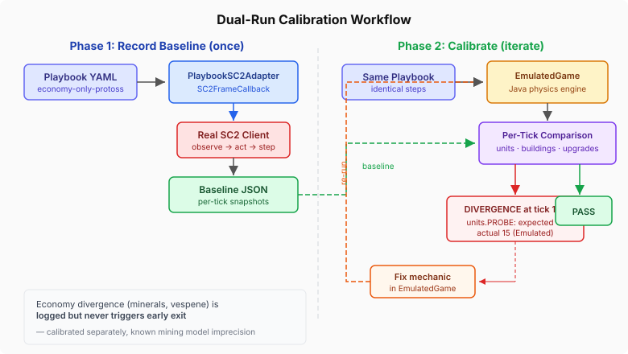

# Fix the First Broken Thing

QuarkMind's EmulatedGame is a Java physics engine that simulates StarCraft II mechanics — mining, production, combat, abilities. It drives the entire agent pipeline: the strategy layer plans against it, the economics layer budgets from it, the tactics layer fights in it. If the physics are wrong, every decision downstream is wrong too.

The calibration problem until now: run a full 5-minute game, compare final state against a replay, read a divergence report. The report says things like "unit delta peaked at 3 around tick 200" and "mineral divergence reached 400 by tick 280." Useful, but not actionable in one step. The delta at tick 280 might be caused by a Chrono Boost misfire at tick 50 that compounded through 200 ticks of production. You stare at the report, guess which mechanic broke first, fix something, re-run. Hope the guess was right.

The insight is obvious once you say it: stop at the first divergence. If tick 187 shows 16 Probes in SC2 but 15 in EmulatedGame, that's where the bug is. You don't need to see what happens at tick 280 — everything after tick 187 is downstream noise from the same root cause. Fix the one mechanic, re-run, find the next divergent tick. Tighter loop, less guessing.

## Record once, iterate offline

The key constraint is iteration speed. Running against live SC2 every time is slow, requires the game client, and introduces timing jitter. The approach: record SC2 state once per playbook, then calibrate EmulatedGame against the recording.



A *playbook* is a YAML file that scripts a deterministic build order — "train Probes continuously, Chrono Boost the Nexus, build a Pylon at 14 supply." The same playbook drives both engines with identical inputs. SC2 runs the playbook once through a `PlaybookSC2Adapter` that translates each action to SC2 API calls (`ActionRawUnitCommand` with the right ability ID and unit tag), captures the per-tick `GameState` via `ObservationTranslator`, and writes a JSON baseline. That baseline is a test resource — committed to git, ~30KB per playbook, fully reproducible.

The calibration test then runs the same playbook against EmulatedGame, compares every tick against the baseline, and exits on the first structural mismatch:

```java
CalibrationSnapshot expected = baseline.snapshots().get(tick);
CalibrationSnapshot actual = CalibrationSnapshot.from(tick, game.snapshot());
CalibrationResult divergence = compare(expected, actual);
if (divergence != null) return divergence;
```

"Structural" means unit counts by type, building counts by type, and upgrade sets. Economy (minerals, vespene) is logged but doesn't trigger exit — the mining model has known imprecision that's calibrated separately. You don't want every run halting at tick 1 because EmulatedGame's flat mining rate produces 58 minerals instead of SC2's 50.

## Why playbooks matter

The alternative is replays. Replays are ground truth from real games, and the existing `ReplayValidationHarness` already runs them at scale — 118 oracle replays, per-matchup divergence baselines, the full accuracy pipeline. But replays test emergent full-game behaviour. When a replay shows a divergence at tick 200, you're looking at the combined effect of hundreds of intents interacting with every mechanic at once.

Playbooks isolate. An economy-only playbook tests mining rate, Probe train time, and Nexus production queue — nothing else. A gateway-units playbook tests train times and Warp Gate research timing. A Chrono Boost playbook tests ability effects on production speed. When a playbook diverges, you know which mechanic category the bug is in before you look at the tick number.

This is the difference between a system test and a unit test for physics. The replay harness is the system test — it tells you whether the whole model is accurate. Playbooks are the unit tests — they tell you which specific mechanic is broken.

## The practical loop

The workflow follows the calibration waypoint protocol: record, calibrate, iterate, assess.

1. Record a baseline for each race's playbook suite. Re-record when the playbook changes or SC2 patches.
2. Run `DualRunCalibrationTest`. It exits at the first broken tick with the exact field and values.
3. Fix the mechanic in EmulatedGame. The divergent field tells you where to look — `units.PROBE` means Probe train time or production queue logic, `buildings.GATEWAY` means build time or placement, `upgrades` means research timing.
4. Re-run. Find the next divergent tick. Repeat until the playbook passes, or until you hit a ceiling that requires a methodology shift.

Step 2 runs in under a second — plain JUnit, no Quarkus boot, no SC2 client. The iteration cost is near zero. This is the payoff of recording once: every subsequent run is a fast local test.

The test is also its own regression suite. Once a playbook passes, it stays in the test suite. Any future EmulatedGame change that breaks the mechanic shows up immediately as a test failure at the exact tick and field.

## What this doesn't do

Full-game accuracy. Playbooks test isolated mechanics in controlled conditions, not emergent behaviour where Chrono Boost interacts with expansion timing interacts with scouting-triggered tech switches. The replay validation harness covers that — and it should. Different tools for different questions.

It also doesn't calibrate economy. Mineral and vespene divergence is expected and tracked separately. The flat mining rate in EmulatedGame is a known simplification; fixing it is a different problem with different trade-offs.

What it does do is make the mechanic-by-mechanic calibration loop fast enough to be practical. Run, see the break, fix it, run again. The right loop for the right problem.
