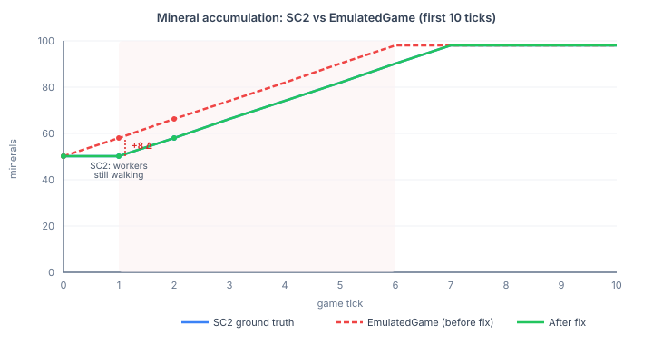
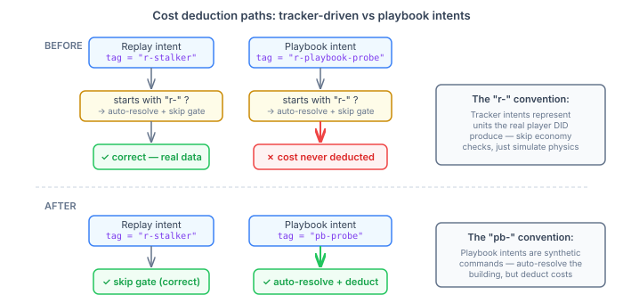

# The Eight Minerals That Broke Everything

QuarkMind's agent pipeline — strategy, economics, tactics, scouting — reasons against an emulated physics engine. Every decision the AI makes depends on that engine being right. If the emulator says a Probe completes at tick 6 but SC2 says tick 7, the strategy layer plans around a worker it doesn't have yet. If the emulator says 58 minerals but SC2 says 50, the economics layer budgets from money that doesn't exist. The errors compound. Not linearly — exponentially, through every agent that reads the game state.

The [previous entry](2026-10-30-mdp03-fix-the-first-broken-thing.md) described the dual-run calibration framework: record SC2 ground truth once, compare EmulatedGame tick-by-tick, stop at the first divergence. The first real SC2 baseline broke at tick 1.

Eight extra minerals.

## Why eight minerals cascade

In StarCraft II, workers start the game standing at the town hall. They walk to the nearest mineral patch, harvest, walk back, deposit. That initial walk takes real time — at least one game step where no income is earned. The first observation from SC2 still shows 50 starting minerals.

EmulatedGame didn't model this. On the very first tick, twelve probes earn their full per-tick income: ~8.18 minerals. SC2 shows 50. EmulatedGame shows 58.



Eight minerals sounds like noise. It isn't. The first Probe costs 50 minerals. With the extra 8, EmulatedGame reaches the 50-mineral threshold faster, queues the Probe earlier, and completes it one tick ahead of SC2. By tick 6, the unit counts disagree. By tick 10, the entire production timeline has shifted. Every agent downstream — the strategy layer checking worker count, the economics layer projecting income, the scouting layer estimating enemy production from observed timings — is reasoning against a game state that has already diverged from reality.

This is the core problem with simulation accuracy in game AI. A flat offset in one input variable doesn't produce a flat offset in output. It cascades through every mechanic that reads the variable: production queues, supply calculations, build timing, tech progression. An eight-mineral error on tick 1 becomes a missing unit on tick 6 becomes a wrong strategy selection on tick 50.

The fix is one constant: `MINING_START_DELAY_TICKS = 1`. Skip income on the first game tick. Not a general worker-travel model — just the game-start case, calibrated from ground truth.

## The convention that ate the economy

The mineral offset was the obvious bug. The second one was architectural.

EmulatedGame distinguishes train intents by their building tag prefix. Tracker-driven intents — reconstructed from replay data — carry an `r-` prefix. These represent units the real player actually produced, so they skip the economy gate: no mineral check, no cost deduction, just physics simulation. The player already afforded it; the emulator is measuring physics accuracy, not economic accuracy. Correct design for that purpose.

The playbook delivery handler needed the same building auto-resolution — find a Nexus when the playbook says "train Probe" without specifying which one. The path of least resistance: reuse the `r-` prefix. Tag the intent `r-playbook-probe`. Auto-resolution works. Ship it.

The side effect: every playbook train intent also skipped the economy gate. Minerals were never deducted. SC2 deducts 50 minerals the moment you queue a unit. EmulatedGame's playbook path charged nothing. Probes were free.



This pattern bites in any codebase with convention-driven dispatch — not just game engines. A tag, a prefix, a marker annotation, a naming convention gets introduced to mean one thing. It bundles two behaviours: the one you want (auto-resolution) and one that's incidental to the original use case (skip economy checks). A second subsystem borrows the convention for the behaviour it needs and inherits the one it doesn't. The bundling is invisible because the convention was never documented as "this prefix does two things." It was documented — if at all — as "this prefix means tracker-driven."

The fix separates the concerns:

```java
boolean autoResolved = false;
boolean trackerDriven = false;
if (building == null) {
    if (model != null && buildingTag != null
        && (buildingTag.startsWith("r-") || buildingTag.startsWith("pb-"))) {
        autoResolved = true;
        trackerDriven = buildingTag.startsWith("r-");
        // ... resolve building
    }
}

if (!trackerDriven) {
    // economy gate: check minerals, deduct cost
}
```

One convention split into two. The `r-` prefix still means "trust the real player's economy." The new `pb-` prefix means "resolve the building, but pay for it." Six lines of intent; years of latent bug removed.

## When you observe matters as much as what you observe

A third issue, subtler than the other two. The dual-run test was comparing EmulatedGame snapshots taken *after* playbook actions to SC2 snapshots taken *before* actions. In SC2, the adapter observes state, records the snapshot, then sends commands. Effects appear in the next observation. The test was doing it backwards — fire actions, then snapshot — making cost deductions visible one tick early.

This matters beyond this specific fix. Any simulation that compares against real-time ground truth has to answer: does the snapshot represent the state *before* or *after* this step's actions? Get it wrong and every comparison carries a systematic one-step offset. The fix is to match semantics: observe, record, act. Effects from this tick's actions appear in the next tick's snapshot. Same as the real engine.

## What ground truth at tick granularity actually buys you

These bugs had been present since the playbook system was first written. The mining model always started one tick too early. The cost deduction was never wired up. The snapshot timing was always off.

None of it showed up in unit tests — those tested EmulatedGame against itself. Internally consistent, but wrong. None of it showed up in replay validation — that compared accuracy at minute-long checkpoints. A tick-1 offset washes out over 300 ticks; the aggregate numbers looked fine. None of it showed up in integration tests — those proved the pipeline runs, not that it runs correctly.

Ground truth comparison at tick granularity found all three in the first run. Not through statistical analysis. Not through careful inspection. Just by stopping at the first tick where the numbers didn't match and asking why.

Most teams test simulations by checking that outputs look reasonable. That catches gross errors — a unit that never spawns, a resource that goes negative. It does not catch the eight-mineral offset that compounds silently through every downstream decision. The only thing that catches that is a ground truth recording and a comparison loop tight enough to stop at tick 1.
