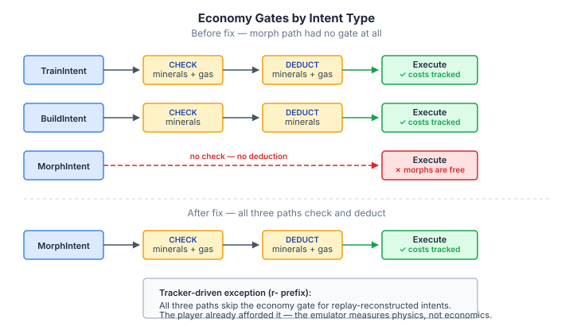
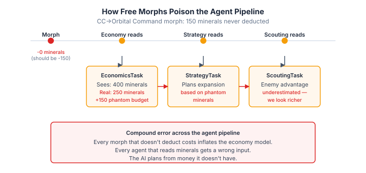

# The Gate That Was Never Written

The [previous entry](2026-10-30-mdp04-the-eight-minerals-that-broke-everything.md) described a convention leak: train intents tagged with `r-` to get building auto-resolution inherited the tracker-driven path that skipped cost deduction. Playbook Probes were free. The fix split the convention — `r-` for replay reconstruction, `pb-` for playbook intents that should still pay.

That bug was about a gate applied to the wrong path. This one is simpler. The morph handler had no economy gate at all.

## What a morph costs

In StarCraft II, morphing is a transformation. A Command Center becomes an Orbital Command (150 minerals). A Hatchery becomes a Lair (150 minerals, 100 gas). A Zergling becomes a Baneling (25 minerals, 25 gas). These aren't free operations. The player pays, the resource count drops, the transformation begins.

EmulatedGame's `handleMorph()` did everything except charge for it. It resolved the source building, validated that it existed and was complete, replaced it with the target type, scheduled the completion callback. Mechanically correct. Economically wrong — no mineral check, no gas check, no cost deduction. Every morph was free.

This isn't the kind of bug where a check exists but fires on the wrong condition. There was no check. The economy gate was never written.



## Why missing cost paths are worse than wrong cost paths

A wrong cost path — deducting 140 minerals instead of 150 — shows up as a quantitative divergence. Comparison against ground truth reveals a systematic offset. You see numbers that are close but not right, and you investigate.

A missing cost path shows up as a structural divergence. The emulator's mineral count diverges from reality at every morph event, but the divergence is mixed into the general resource noise. Each morph leaks 25–200 minerals depending on the operation. Over a game with a dozen morphs — Zerg tech-ups from Hatchery to Lair to Hive, Banelings morphed from Zerglings, a Terran player lifting off to Orbital Command — the cumulative phantom budget can reach hundreds of minerals.

The downstream effect is worse than a simple over-count. Every agent in the pipeline reads the economy state:



The economics layer sees more minerals available than actually exist and budgets accordingly. The strategy layer sees a healthier economy than the opponent and selects a greedier strategy. The scouting layer, comparing our mineral trajectory to the enemy's, underestimates how behind we actually are. Each agent makes a locally rational decision — from a wrong input.

This is the general problem with partial cost tracking in any simulation that feeds agent decisions. If some operations charge correctly and others don't, the economic model drifts silently. Not in a direction that triggers obvious errors (negative minerals, impossible purchases), but in a direction that makes every downstream decision subtly overconfident.

## The three-path consistency problem

EmulatedGame has three ways to spend minerals: train a unit, build a structure, morph an existing unit or building. Each needs its own economy gate because the preconditions differ:

| Path | What it checks | What it deducts |
|------|---------------|-----------------|
| Train | minerals, gas, supply, building queue | minerals + gas |
| Build | minerals | minerals |
| Morph | *nothing* | *nothing* |

The train path was the most complex and the most tested. The build path was simpler — at the time it was written, it only checked minerals (buildings that cost gas are a separate gap). The morph path was the newest and the least considered. It worked mechanically from the first commit, which made it feel done.

The pattern is general. Any system that has multiple paths through the same resource — spending it, reserving it, refunding it — needs each path to participate in the accounting. The paths that get written last, or that seem simplest mechanically, are the ones most likely to skip it. Not because anyone decided to skip it, but because the accounting concern isn't visible in the mechanical concern. The building morphed correctly. Nobody noticed it morphed for free.

## What the fix looks like

The economy gate for morphs follows the same structure as trains, adapted for the two morph subtypes (buildings and units):

```java
boolean trackerDriven = m.unitTag() != null && m.unitTag().startsWith("r-");
if (!trackerDriven) {
    int mCost = SC2Data.mineralCost(targetBt);
    int gCost = SC2Data.gasCost(targetBt);
    if ((int) state.minerals() < mCost || state.vespene() < gCost) {
        return;  // insufficient resources — reject
    }
    state.deductMinerals(mCost);
    state.deductVespene(gCost);
    economyTracker.recordMorphSpending(targetBt, mCost, gCost);
}
```

The tracker-driven exception carries over from the train path. Replay-reconstructed morphs (tagged with `r-`) skip the gate — the real player already afforded it. Playbook morphs (tagged with `pb-`) go through the full check.

The same gate applies to unit morphs — Zergling to Baneling, Hydralisk to Lurker, Corruptor to Brood Lord. Each checks minerals and gas before transforming, deducts on success, and records the spending in the economy tracker.

A `gasCost(BuildingType)` method didn't exist — `handleBuild` had never needed it because it only tracked mineral costs. Morphs need both, so the method was added. Orbital Command costs 150 minerals and 0 gas. Lair costs 150 minerals and 100 gas. Greater Spire costs 100 minerals and 150 gas. Each value is one constant in a switch expression. The gap was just that nobody had enumerated them yet.

## The broader point about simulation fidelity

I keep coming back to the same observation across this calibration work. The dangerous bugs in a simulation are not the ones that produce wrong outputs. Those get caught — unit counts that don't match, resources that go negative, timing that looks off. The dangerous bugs are the ones that produce *plausible* outputs from a silently wrong model.

A simulation with missing cost paths doesn't crash. It doesn't produce impossible states. It produces states that look reasonable but are systematically biased. The economy runs hot. Units appear to be affordable when they shouldn't be. Tech transitions look smooth when they should be constrained. Every agent downstream operates in a world that is subtly more generous than reality.

For any system where agents reason about shared state — game AI, economic simulation, multi-agent planning — the question isn't "do the agents produce reasonable outputs?" It's "is the state they're reasoning about accurate?" And the only way to answer that is ground truth comparison at the granularity where the accounting happens. Not aggregate checks at game-end. Not statistical validation at minute-long checkpoints. Tick-by-tick comparison against a recording of the real thing, stopping at the first divergence and asking what went wrong.

The dual-run framework found this bug the same way it found the mining delay and the tag-prefix leak: first run, first morph, first tick where the numbers disagreed. It doesn't take sophisticated analysis. It takes a tight enough comparison loop that missing cost paths have nowhere to hide.
