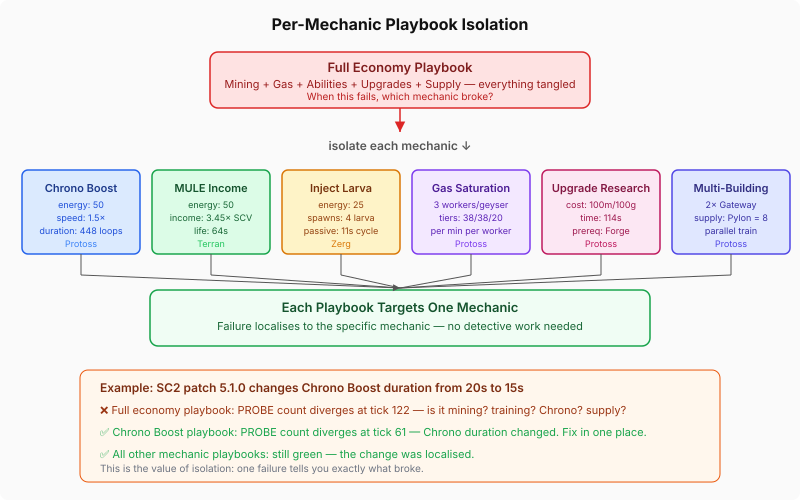

# Per-Mechanic Calibration: Why Your Simulation Needs Isolated Smoke Tests

QuarkMind runs a full StarCraft II economy simulation in Java — mineral income, gas saturation, ability energy, upgrade timers, supply chains. It drives the agent's decision-making without needing a running SC2 client. The simulation has to be accurate enough that strategy decisions made against it hold up against the real game.

We already had economy-only playbooks: one per race, continuous worker training, assert on worker counts at minute checkpoints. They caught gross errors — wrong mining rates, broken supply — but they had a diagnostic problem. When a Probe count diverged at tick 122, was it the mining rate? The Chrono Boost duration? Energy regeneration? Supply from the second Pylon? All of these feed into Probe production, and the economy playbook exercises all of them simultaneously.

This is the standard testing failure mode: an integration test that touches everything catches regressions but localises nothing.

## Isolating the Mechanics

The fix is the same one that works everywhere else in testing: decompose the integration test into focused units, each targeting a single mechanic. Each playbook is a YAML sequence of game actions — build this, train that, research this — with assert checkpoints at known ticks.



Six mechanic-specific playbooks, each testing one thing:

| Playbook | Mechanic | Key constants validated |
|----------|----------|----------------------|
| `chrono-boost-economy` | Chrono Boost acceleration | 50 energy, 448 game loops, 1.5× multiplier |
| `mule-income` | MULE calldown and income | 50 energy, 64s lifetime, 3.45× SCV rate |
| `inject-larva` | Larva spawning and injection | 25 energy, 4 larva per inject, 11s passive cycle |
| `gas-saturation` | Gas income tiers | 3 workers/geyser, tiered rates (38/38/20 per min) |
| `upgrade-research` | Research timing and prerequisites | 114s for Ground Weapons 1, requires Forge |
| `two-base-production` | Supply and multi-building training | Pylon = 8 supply, parallel Gateway queues |

When Chrono Boost breaks, only the chrono playbook fails. The MULE playbook, the gas playbook, the upgrade playbook — all still green. No detective work.

## What a Playbook Looks Like

A playbook is a declarative sequence: actions fire at supply thresholds or tick timestamps, and assert steps check the simulation state at known points.

```yaml
playbook: chrono-boost-economy
schema: sc2
meta:
  race: PROTOSS
  duration: 183 ticks

steps:
  - train: PROBE
    loop: continuous

  - ability: CHRONO_BOOST
    target: NEXUS
    loop: continuous

  - build: PYLON
    at: 14 supply

  # ... more supply-gated builds ...

  - assert: tick-61
    at: 61 ticks
    expect:
      units:
        PROBE: { min: 16 }
```

The assert at tick 61 (one game minute) says: with Chrono Boost running continuously on the Nexus, at least 16 Probes should exist by the one-minute mark. Without Chrono, the economy-only playbook shows 15 Probes at the same point. That single extra Probe is the Chrono Boost signal — the speedup reduces training time from ~17 seconds to ~11 seconds, and that compounds across 61 ticks of continuous production.

The checkpoint values are calibrated from EmulatedGame itself. The point isn't to hardcode SC2 truth — it's to detect when the simulation *changes*. If a refactor to the energy regeneration system silently breaks the Chrono Boost multiplier, the next test run catches it at the exact playbook that tests Chrono Boost.

## The Dual-Run Architecture

Each playbook feeds into two test harnesses:

**SC2PlaybookCalibrationTest** runs the playbook against EmulatedGame and checks the assert steps. This is the fast, offline, runs-in-CI test. It validates that EmulatedGame's internal mechanics are self-consistent — the Probe count at tick 61 is what EmulatedGame produces, and it stays that way across refactors.

**DualRunCalibrationTest** takes a recorded SC2 baseline (a JSON file of per-tick snapshots from a real SC2 client) and compares it tick-by-tick against EmulatedGame running the same playbook. When EmulatedGame's Probe count diverges from SC2's at tick 187, the test exits immediately and reports: `units.PROBE: expected 16, actual 15`. The self-baseline variant generates the baseline from EmulatedGame itself — tautological, but it validates the calibration plumbing end-to-end.


The real SC2 baselines are the calibration ground truth. Run the playbook against SC2 once per patch, save the snapshots, and from then on the offline test detects any EmulatedGame drift without needing SC2 running.

## Why This Matters Beyond SC2

The pattern here isn't specific to game simulation. Any system that models real-world behaviour — a financial simulator, a network emulator, a physics engine, a digital twin — faces the same calibration problem: how do you know your model still matches reality after a refactor?

The answer is always the same three pieces:

1. **Record a baseline from the real system** — the ground truth
2. **Replay the same inputs against your model** — deterministic comparison
3. **Isolate each mechanic** — so a failure points to the specific behaviour that drifted

The integration test that exercises everything catches the regression. The isolated test tells you which constant changed.

SC2 is effectively frozen — last behavioural change was years ago; patches are balance-only, and BalanceData already tracks those. These playbooks are a safety net for *our* simulation code, not SC2's. Every refactor to EmulatedGame's physics, every dependency upgrade, every new feature that touches the economy loop — the smoke suite runs in CI and reports exactly which mechanic, if any, broke.

That's the value: not that the tests pass, but that when they fail, you know exactly where to look.
