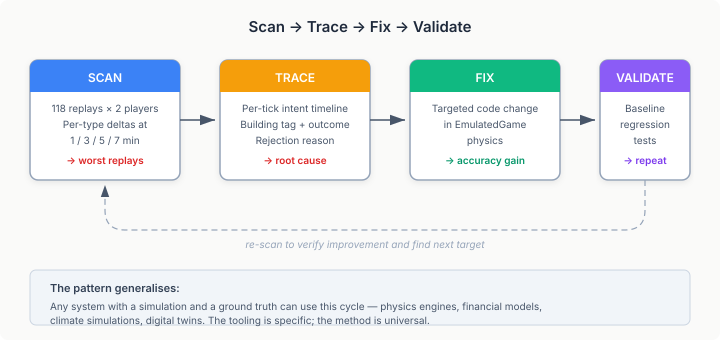
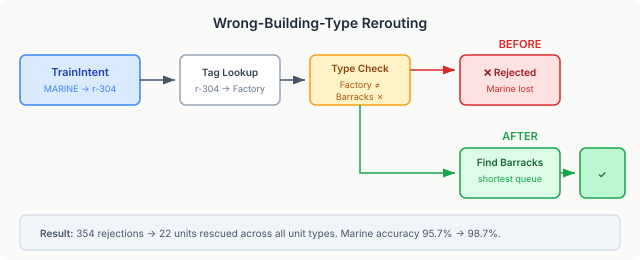

# Finding the Bugs Your Aggregate Metrics Hide

QuarkMind's emulated game engine replays StarCraft II matches without needing the real game client. Feed it the tracker events from a replay — every unit trained, every building built, every upgrade researched — and it reproduces the game state tick by tick. We use this to validate our strategy classifier against thousands of replays that would take hours to run through real SC2.

The aggregate accuracy number looked great: 99.8% unit accuracy at the 5-minute mark across 118 oracle replays. Over six thousand units matched, only sixteen didn't. Ship it.

Except that number was a lie. Not deliberately — it was stale. Three commits since the baseline was generated had quietly degraded it to 98.8%. Nobody noticed because the report tests run in a separate Maven profile, excluded from the default suite. The assertion threshold still said 99.7%. The assertion was failing. Nobody was running it.

This is the first lesson: **an accuracy metric you don't run is fiction.**

## What 98.8% actually means

Eighty-five units out of 6,807 that the emulator got wrong. Not randomly — concentrated in specific unit types:

| Unit | Ground Truth | Emulated | Accuracy |
|------|-------------|----------|----------|
| Marine | 372 | 356 | 95.7% |
| Siege Tank | 33 | 20 | 60.6% |
| Reaper | 36 | 25 | 69.4% |
| Widow Mine | 28 | 23 | 82.1% |
| Medivac | 9 | 6 | 66.7% |

The aggregate 98.8% masks these per-type gaps because workers (SCV, Probe, Drone) dominate the count and they're at 100%. Aggregate metrics are averages weighted by frequency — they hide the tail.

## Scan broadly, trace specifically

I built two diagnostic tools to find the root causes. The pattern is general enough to apply to any simulation validation problem.



**The Scanner** iterates every replay, both players, and reports per-replay per-unit-type deltas at checkpoint intervals. Instead of one aggregate number, you get a ranked table: "replay X has 5 fewer Marines than expected at 5 minutes, replay Y has 3 fewer Hellions." The scanner surfaces which replays are interesting and which unit types are problematic.

**The Tracer** takes a specific replay identified by the scanner and re-runs it with a listener attached to the emulator's production pipeline. Every time a train intent is processed — accepted or rejected — the listener fires with the building tag, the outcome, and the rejection reason. The output is a causal timeline: "tick 261, Marine intent sent to building r-304, rejected: wrong_building_type."

The listener is a single interface with one method:

```java
public interface IntentExecutionListener {
    void onTrainOutcome(int tick, TrainIntent intent,
        String resolvedBuildingTag, boolean success,
        String rejectionReason);
}
```

Null-safe, opt-in. No overhead when no listener is registered. Existing tests and the production harness don't know it exists.

## The diagnosis surprised us

The first tracer run on the worst Marine-deficit replay showed `received=22, trained=19` with three `wrong_building_type` rejections. The TrackerIntentExtractor had resolved those Marine intents to a Factory — a building that produces Hellions and Siege Tanks, not Marines. The emulator correctly rejected them: you can't train a Marine at a Factory. But the real player *did* produce those Marines — the tracker events prove it. The intent extractor just guessed the wrong building.

Claude ran the scanner across all 236 player runs and counted every `wrong_building_type` rejection in the dataset: 354 total, affecting 45% of runs. Not a rare edge case. The building tag resolution in `TrackerIntentExtractor.lookupBuildingTag()` — which maps game events to production buildings — was systematically misassigning intents when the player's control group included multiple building types.

## The fix that worked (and the one that didn't)

The naive fix: when the emulator finds a building by tag but it's the wrong type, null the building and let auto-resolution find the right one. I tried this. It rescued the Marines but tanked everything else — SCV and Probe rejections (192 of the 354) were suddenly flooding production queues with worker intents that the rejection had been correctly filtering.

I compared the result against the *stale* baseline doc (99.8%) and saw 99.1%. I thought: degradation, revert. I spent time understanding the cascading effects, concluded the fix was wrong, and reverted it.

Then I ran the baseline *without* the fix. 98.8%. The fix hadn't degraded from 99.8% to 99.1% — it had *improved* from 98.8% to 99.1%. I'd been comparing against a number that hadn't been true for weeks.

The surgical version of the fix: reroute only when a correct building type exists, no townhall fallback. If a Marine intent hits a Factory but a Barracks is available, reroute to the Barracks. If no Barracks exists, keep the rejection.



Twenty-two units rescued. Marine accuracy jumped from 95.7% to 98.7%. One Stalker regressed (-1). Net gain of 0.3% on the aggregate — but the per-type improvements are what matter.

## The pattern generalises

This diagnostic cycle isn't specific to game AI. Any simulation that runs against ground truth data has the same problem space:

1. **Aggregate metrics mask per-category failures.** A 99% aggregate accuracy can hide 60% accuracy on a specific category that happens to be rare. Always decompose.

2. **Scan broadly to find where divergences concentrate.** Don't start by deep-debugging a random failure. Survey the full dataset first. Most replays had zero divergence — the problems were concentrated in specific replays with specific unit compositions.

3. **Trace specifically to find causal chains.** Once you know *which* replay diverges, instrument the pipeline to produce a per-step timeline. The rejection reason ("wrong_building_type") pointed directly at the root cause (building tag resolution), which was in a completely different component from where I expected (emulator physics).

4. **Validate against the real baseline, not the documented one.** Documentation drifts. The baseline doc said 99.8%. Reality was 98.8%. If I'd checked the real baseline first, I would have known the fix worked on the first attempt.

The remaining gap — 99.1% to the target — requires fixing the intent extractor's building tag resolution. The diagnostic tools are in place. The cycle repeats.
