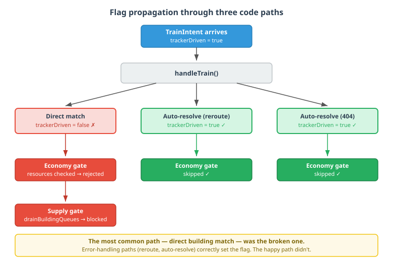

# The Flag That Didn't Propagate

A boolean flag enters a system at the front door. It changes how the request should be processed — skip certain validation, use lenient limits, defer instead of reject. The entry-point code checks the flag and routes accordingly. Everything works.

Except the entry point isn't the only place that validates. Three methods downstream also check resources, supply caps, queue limits. The flag never reaches them. The request gets rejected by a gate it was supposed to bypass, and because the rejection happens deep in the pipeline, the failure looks like a resource problem — not a flag propagation problem.

We hit this pattern three times in one session while calibrating QuarkMind's StarCraft II emulator. The fix was trivial each time. Finding it was not.

## The setup

QuarkMind replays real StarCraft II games through an emulated engine to validate strategy classifiers. Tracker events from the replay tell us exactly what happened — every unit trained, every building built. We feed these as intents into the emulator, which should reproduce the game state. At the 5-minute mark across 118 replays, the emulator was matching 99.1% of units. Sixty-three units were missing.

The previous session had built diagnostic infrastructure: a scanner that finds worst-divergence replays per unit type, and a tracer that produces per-tick causal timelines. The hypothesis going in was building tag resolution — the extractor sometimes mapped production intents to the wrong building. Three hundred and fifty-four `wrong_building_type` rejections had been counted. That's where we started looking.

## The wrong fix

We built a type-aware building tag lookup. Instead of storing only the first tag in the player's selection, we stored all of them and built a tag-to-building-type map from tracker events. When looking up a building for a Marine intent, we filtered to Barracks tags. When looking up for a Siege Tank, Factory tags. Clean, correct, and it changed the accuracy number by exactly zero.

The rerouting logic in the emulator was already handling wrong-type matches. Our improved lookup prevented the mismatch, but the emulator's fallback was already fixing it downstream. We'd built a better front door for a room nobody was entering through.

## The right diagnostic

Claude built a `RejectionReasonDiagnosticTest` — an aggregate that runs all 118 replays and counts rejections per unit type, broken down by reason. Five seconds to run. The result:

```
wrong_building_type:     0
building_not_found:      0
production_blocked:      0
queue_full:              0
insufficient_resources: 128
```

Every single rejection was `insufficient_resources`. Not building tag resolution. Not wrong building type. Economy gates.

But these were tracker-driven intents — they represent units the real player *did* produce. The emulator is supposed to skip economy checks for them. The `trackerDriven` flag exists exactly for this purpose. Why was it false?

## The happy path was the broken one



The `handleTrain` method resolves a building for each production intent. Three things can happen:

1. **Direct match** — the building tag from the replay matches a building in the emulator. Most common case.
2. **Wrong type** — the tag matches a building, but it's the wrong type. Rerouting kicks in.
3. **Not found** — no building matches the tag at all. Auto-resolution finds the best available.

Paths 2 and 3 are the error-handling paths. Both correctly set `trackerDriven = true` as part of their recovery logic. Path 1 — the normal, successful path — never set it. The flag was born at the entry point (`TrainIntent.trackerDriven = true`) but `handleTrain` initialised a local `trackerDriven` variable to `false` and only updated it in the fallback paths.

The result: the most common case — a tracker-driven intent that correctly matches a building on the first try — went through full economy validation. Mineral checks. Gas checks. Supply cap checks. The emulator's economy model diverges from ground truth (it doesn't track real spending), so many of these checks fail. Units the player actually built get rejected for insufficient resources.

## One flag, three gates

Fixing the `handleTrain` economy gate moved accuracy from 99.1% to 99.7%. Forty units rescued. But twenty-three remained.

The diagnostic showed zero rejections again. We looked deeper — `drainBuildingQueues`, a separate method that starts queued production when a building slot opens, had its own supply check. Same pattern: the `trackerDriven` flag from the intent never reached this code path. Queued units stalled on a supply cap that shouldn't have applied.

Fixing that: 99.7% to 99.9%.

The third instance — `handleResearch` — has the same pattern for upgrade intents. We filed it rather than fixing it in the same session, but the shape is identical: entry point sets the flag, downstream gate doesn't read it.

## The general pattern

This isn't a game AI problem. It's a flag propagation problem, and it shows up wherever a boolean mode changes validation behaviour at the entry point but not in downstream processing.

Feature flags in web applications. A flag disables rate limiting for internal API calls. The API controller checks it; the middleware rate limiter doesn't. Internal calls get throttled in production, and the symptom looks like a performance problem.

Auth tokens in microservices. A service account token skips user validation at the gateway. The downstream service re-validates. Service-to-service calls fail intermittently, and the symptom looks like an auth configuration problem.

Test mode in billing systems. A flag skips payment processing at checkout. The subscription renewal cron doesn't check it. Test accounts get charged, and the symptom looks like a billing logic bug.

The shape is always the same. The flag works at the entry point. The failure happens downstream. The symptom matches the downstream gate's domain (resources, auth, billing), not the actual root cause (missing flag). And because the entry point works correctly, you never suspect it.

## What makes it findable

Aggregate diagnostics. Not per-request tracing, not log analysis — a test that runs the full dataset and counts failures by category. Our rejection diagnostic took five seconds and produced a one-line answer: `insufficient_resources: 128, everything else: 0`. That answer pointed directly at the economy gate, which pointed directly at the missing flag.

Without it, we'd have spent the session refining building tag resolution — the fix for a rejection category that had already been handled. The diagnostic didn't just save time. It changed which problem we solved.
