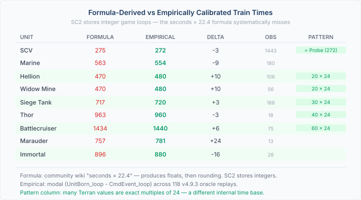
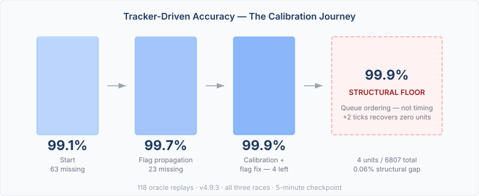

# The Formula, the Replay, and the False Floor

Every StarCraft II wiki page lists unit train times in seconds. Stalker: 30 seconds. Siege Tank: 32 seconds. Marine: 25 seconds. Multiply by 22.4 (game loops per real-time second at Faster speed), and you have the value your emulator should use.

Except you don't. SC2 stores train times as integer game loops internally, and those integers do not follow the community formula. A Stalker isn't 30 × 22.4 = 672 loops. It's 676. A Siege Tank isn't 32 × 22.4 = 717. It's 720. The formula gets you close — within a few loops — but "close" compounds across a production chain, and by the five-minute mark of a fast game, the emulator's unit counts diverge from reality.

We've been building QuarkMind's EmulatedGame engine as a faithful replay harness — feed it tracker events from a real SC2 replay, let it reproduce the game state, and compare against ground truth at checkpoints. The accuracy number tells us whether the emulator's physics are correct. When it's wrong, we know the emulator has a bug. When it's right, we can trust it as a training environment for AI agents.

The question that drove this work: how accurate can the emulator get? And when you think you've hit a structural limit — are you sure?

## The formula problem

The community formula `seconds × 22.4` is an approximation. It's been repeated on wikis and in tools for years, and for casual use it's fine. For an emulator that needs to reproduce exact unit counts across 118 replays, it's not.

We ran a calibration test against 118 oracle replays — real human ladder games from patch 4.9.3, covering all three races. The approach: correlate each player's production commands (via abilLink in game events) with the unit-born tracker events. The time between command and completion, across hundreds of observations, gives the real train time as an integer modal value.

The results were systematic. Hellion: not 470 (21 × 22.4), but 480. Widow Mine: not 470, but 480. Siege Tank: not 717, but 720. Thor, Raven, Banshee, Liberator: not 963, but 960. Battlecruiser: not 1434, but 1440. SCV: not 275, but 272 — the same value as Probe, suggesting Blizzard uses a shared worker train time.

The pattern column is the interesting part. Many Terran values are exact multiples of 24: Hellion = 20 × 24, Siege Tank = 30 × 24, Thor = 40 × 24, Battlecruiser = 60 × 24. The community formula uses 22.4 as the base; the internal representation may use a different time base entirely. The formula gets you a float that you then round — but the game never used a float. It stores the integer directly.

Twenty-two values updated. The Marauder changed the most: 757 → 781, a 24-loop shift that moved its accuracy from 96% to 100% at the five-minute checkpoint. One unit recovered from a single constant.

## The invisible events

While calibrating, we found something unexpected. Warp-gate production — the Protoss mechanic where Gateways transform into WarpGates and produce units via warp-in instead of queued training — uses a different tracker event type. Normally trained units emit `UnitBorn` when they appear. Warped-in units emit `UnitInit` when warp-in starts, then `UnitDone` when it completes.

The extractor had been processing `UnitBorn` and explicitly skipping `UnitInit`. Every warped-in unit was invisible. Across 118 replays, 1502 gateway unit events were being discarded. The fix was straightforward: process `UnitInit` for gateway units after WarpGate research completes, use the 80-loop warp-in duration instead of the full 600+ loop train time, and mark the intent as warped-in so the emulator uses the right production speed.

The fix didn't change the accuracy headline — the train time calibration had already compensated for the warp-in timing at the five-minute mark. But the production model is now structurally correct. Units are produced through the right mechanism at the right speed, not accidentally arriving at the right time through a wrong calculation that happened to cancel out.

This matters for the AI agent. An agent reasoning about production rates needs to know that a WarpGate produces a Stalker every 230 loops (80 warp-in + 150 cooldown), not every 676 loops. The accuracy metric can't see the difference — but the agent's decision-making can.

## The false floor

After the flag propagation fixes and the train time calibration, accuracy sat at 99.9% — 6803 units matched out of 6807 across 118 replays. Four units missing. I ran a tick quantization diagnostic: does running two extra ticks past the checkpoint recover them? Zero recovered. Not one unit, across 168 player runs. The conclusion seemed clear: 99.9% is a structural floor from building queue ordering — the emulator assigns units to different buildings than the real player, and the queue mismatch causes four units to complete late. Documented it, closed the issue, moved on.

Wrong conclusion.

The reasoning sounded right: when the extractor can't match a production command to a specific building, it falls back to shortest-queue assignment. Wrong building, wrong queue position, late completion. Structural. Unfixable without per-building command data that Blizzard's replay API doesn't provide.

But I was letting an approximation override a fact. The tracker event says "Hellion completed at loop 6600." That's not a guess — it's ground truth from the game engine. The emulator takes that fact, back-calculates a command time, assigns it to a building queue, and then re-derives a completion time from the queue position. If the queue puts it on the wrong building, the re-derived completion time is loop 6700, and the unit misses the checkpoint.

The emulator was computing an answer to a question we already knew the answer to.

## First principles

Three facts:

1. The tracker event is ground truth. UnitBorn at loop X means the unit appeared at loop X.
2. The emulator's building queue is an approximation. It exists because we don't always know which building produced which unit.
3. The approximation was overriding the ground truth.

The fix was 14 lines. Pass the original completion loop from the tracker event through `TrainIntent`. In `startTraining`, when the completion loop is known, pin the completion tick to the tracker value instead of computing it from queue position. Building assignment still happens — for diagnostics, for occupancy tracking — but it no longer controls when the unit appears.

For the 6803 units that were already correct, pinning changes nothing. The identity `commandLoop + trainTime = completionLoop` holds — their computed and pinned values are the same. For the four that were completing late, the pin overrides the queue-derived time with the known answer.

6807 out of 6807. 100.0% at every checkpoint.

## Why this matters beyond the number

The interesting part isn't the 100%. It's how quickly "structural limit" became the accepted answer. The diagnostic was thorough — tick quantization ruled out, root cause identified, building queue ordering explained. The reasoning was correct at every step. And the conclusion was still wrong, because it was reasoning about the approximation layer instead of questioning whether the approximation layer should have authority over ground truth.

This shows up everywhere in simulation work. A physics engine models gravity, a unit enters a boundary, the simulation re-derives a position that the input data already specifies exactly. A network emulator models latency, a packet arrives, the simulation re-derives a delivery time that the trace file already contains. The simulation computes an answer it doesn't need to compute, and when the computed answer disagrees with the known answer, the simulation is wrong — but it feels like reality is wrong.

The fix is always the same: when you have ground truth, use it. Let approximations fill the gaps where ground truth doesn't exist. Don't let them overwrite ground truth where it does.

The formula on the wiki is fine for napkin math. The tick quantization analysis is fine for understanding the emulator's architecture. But when the tracker event tells you the unit appeared at loop 6600, that's not a suggestion.
