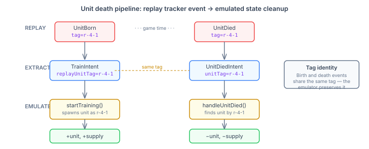
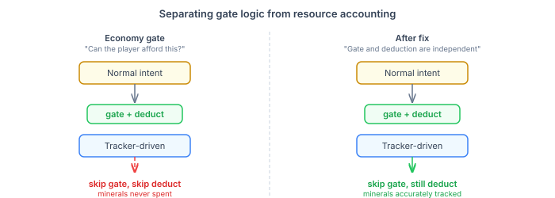

# Teaching the Emulator About Death

QuarkMind's EmulatedGame had a peculiar blind spot: it could birth every unit perfectly but never noticed when they died. The emulator faithfully reproduced every `TrainIntent` from replay tracker events — 100% unit production accuracy against ground truth — yet its economy numbers were wildly wrong. `foodUsed` was off by 52%. `workersActiveCount` by 55%. And `mineralsCurrent` showed a comical 654% error, with the emulator hoarding six times more minerals than the real player ever had.

The production side was perfect. The bookkeeping side was broken. Two fixes, both conceptually simple, both requiring the kind of plumbing work that makes emulators actually useful.

## The Death Problem

SC2 replays include `UnitDied` tracker events — exact game loop, unit tag, unit type. The information is right there. We just weren't reading it.

The emulator's `PlayerState` accumulated units forever. A Zealot produced at minute one was still contributing to supply at minute seven, even if it died charging into Siege Tanks at minute three. Workers killed by harassment raids still counted toward `workersActiveCount`. The economy stats were a fiction of a player who never lost a unit.



The fix follows the same pattern as the existing tracker intent pipeline. `TrackerIntentExtractor` already processes `UnitBorn` and `UnitInit` events to produce `TrainIntent`s. We added a `UnitDiedIntent` — a new member of the sealed `Intent` hierarchy — and taught the extractor to emit it when a `UnitDied` event arrives for a tracked unit.

The interesting design problem was tag identity. When a `TrainIntent` enters the emulator, the spawned unit needs a tag that the later `UnitDiedIntent` can match. The replay's tracker events use composite tags (`unitTagIndex` + `unitTagRecycle`) that persist across birth and death. But the emulator was assigning its own internal tags — `em-unit-42`, `em-unit-43` — which no death event would ever reference.

The fix: thread the replay unit tag from `TrackerIntentExtractor` through a new `replayUnitTag` field on `TrainIntent`, and use it as the spawned unit's tag in `startTraining()`. When the `UnitDiedIntent` arrives with that same tag, `handleUnitDied()` finds the unit, removes it from `PlayerState`, deducts supply, and cleans up physics state (movement targets, attack cooldowns, blink cooldowns). A diagnostic across 118 oracle replays confirmed a 97% tag-match rate — the 3% miss is units born via paths the extractor doesn't track (auto-spawned Larvae, Interceptors).

## The Spending Problem

The second fix was simpler but had a larger numerical impact. When we introduced `trackerDriven` intents — units the real player provably produced, extracted from replay events — we skipped the economy gate check. The reasoning was sound: the emulator's income model is inaccurate, so gating on "can the player afford this?" would reject units that actually existed. Skip the gate, keep production accuracy at 100%.

The problem: the gate check and the resource deduction lived in the same `if (!trackerDriven)` block. Skipping the gate also skipped spending. The emulator never deducted minerals or vespene for any tracker-driven unit or upgrade. Minerals accumulated without bound.



The fix separates two concerns that should never have been coupled:

```java
if (!trackerDriven) {
    // Gate: can the player afford this? Skip for tracker-driven.
    if (state.minerals() < mCost || ...) { return; }
    // Deduction: record the spending.
    state.deductMinerals(mCost);
    state.deductVespene(gCost);
} else {
    // Tracker-driven: no gate, but still deduct.
    state.deductMinerals(mCost);
    state.deductVespene(gCost);
}
```

Same pattern in `handleResearch` — upgrade costs were being silently eaten.

## The Numbers

| Metric | Before | After | Direction |
|---|---|---|---|
| mineralsCurrent error (5min) | 654% | 4.1% | Emulator now tracks spending |
| foodUsed error (5min) | 52.4% | 35.1% | Dead units removed from supply |
| workersActiveCount error (5min) | 55.2% | 43.0% | Dead workers removed from count |
| Unit production accuracy | 100% | 100% | No regression |

The minerals fix is dramatic because the error was entirely from missing deductions — production was already correct, so deducting the correct costs produces the correct balance. The remaining 4% is from income model inaccuracy (flat mining rate vs SC2's saturation-based model).

The death fix is meaningful but doesn't close the gap entirely. `foodUsed` still shows 35% error because the emulator assigns supply at training start, not completion — a unit in the production queue already counts toward supply, while ground truth only counts it when it finishes. That's a separate architectural decision, not a missing feature.

## Why This Matters Beyond SC2

Emulator accuracy is the foundation everything else sits on. QuarkMind uses the emulator as both a validation harness (does the agent's strategy work against real replay data?) and a training environment (can the agent learn from simulated games without running SC2?). Every percentage point of economy error is a percentage point of wrong signal fed to the strategy layer.

The broader pattern is worth noting: a simulation that gets production perfect but ignores destruction is useless for economic reasoning. Every game simulation — RTS, city builder, factory management — has the same requirement. If your emulator can build but not destroy, it's modelling a world without consequences. And an AI trained in a world without consequences learns strategies that don't survive contact with one that has them.ed
