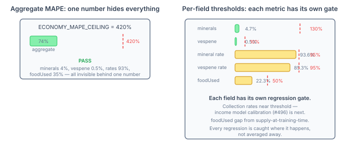

# The Regression Test That Caught Nothing

We had a regression test for economy accuracy. It had a threshold. It passed every run. And it was catching absolutely nothing.

The threshold was 420% MAPE. Four hundred and twenty percent. The actual economy error after our recent fixes was 74%. The test would have passed at 400%. It would have passed at 300%. It would have passed if we'd accidentally broken mineral tracking completely and the error climbed back to 350%. The test existed, it ran, it reported a green checkmark, and it provided exactly zero protection against regression.

This is a failure mode I've seen in every long-running project: a threshold set during early development when accuracy was genuinely bad, never tightened as the system improved. The number becomes an artefact of the historical worst case rather than a guard against the current best case. Every improvement widens the gap between "what the test allows" and "what would actually indicate a problem." The test fossilises while the code evolves.

## One Number Hides Five Problems

The deeper issue wasn't just that 420% was too loose. It was that the test collapsed five independent economy fields into a single aggregate MAPE. Minerals, vespene, collection rates, supply — all averaged into one number. An aggregate metric is a weighted average of things going well and things going badly. If minerals are perfect (4% error) and collection rates are terrible (93% error), the aggregate says "things are roughly OK." Neither the success nor the failure is visible.

The aggregate MAPE was 74% after the recent fixes. That number tells you the economy model exists and does something. It does not tell you that mineral balance tracking is now excellent (4.7% error), that vespene tracking is near-perfect (0.5%), that collection rates are still terrible (93% — the income model uses flat rates where SC2 uses saturation-based mining), or that supply tracking has a known structural gap (22% — the emulator counts supply at training start, not completion).

Each of those facts demands a different threshold. Minerals can be tight — 130% ceiling, because the fix that brought it from 654% to 4.7% is structural and shouldn't regress. Collection rates need a loose ceiling — 95% — because the fix requires rewriting the income model, which hasn't happened yet. A single number averages away the distinction.

## Calibrate From Actuals, Not Aspirations

The replacement thresholds are calibrated from actual post-fix baselines, not from where we'd like the numbers to be:

| Field | Current error | Threshold | Margin | Why |
|---|---|---|---|---|
| mineralsCurrent | 4.7% | 130% | ~27× | Early-game spike (432% at 1min) normalises by 5min |
| vespeneCurrent | 0.5% | 10% | 20× | Harness syncs vespene — should stay near-zero |
| mineralsCollectionRate | 93.6% | 95% | 1.5% | Known: flat-rate model vs saturation mining |
| vespeneCollectionRate | 85.3% | 95% | ~10% | Same income model gap |
| foodUsed | 22.3% | 50% | ~28% | Known: supply assigned at training start |

The margins look enormous for minerals and foodUsed — 27× and 28× headroom respectively. That's intentional. The 1-minute checkpoint shows 432% minerals error (early-game economics are volatile), and the aggregate at 5 minutes includes replays with wildly different economic profiles. The threshold isn't "how much error is acceptable in steady state" — it's "what's the worst this number reaches across 168 player runs in 118 replays without indicating a code regression." Setting it tighter would produce false failures on replay variance, not on code problems.

The collection rate thresholds are tight by contrast — 95% ceiling against 93.6% and 85.3% actuals. These will fire the moment the income model gets worse. They're also the thresholds that will need loosening if someone tries to refactor the mining model and temporarily makes it less accurate during the transition. That's the correct behaviour: the test gates you from merging a partially-implemented income model change that regresses accuracy, forcing you to complete the fix before landing it.

## The Broader Point

A regression test is a ratchet. It should tighten as the system improves — mechanically, not aspirationally. The threshold should be derived from measured actuals with a variance margin, not from a target you hope to hit someday. And it should be granular enough that a failure tells you which thing broke, not just that something somewhere got worse.

Every simulation project accumulates metrics. The natural tendency is to add a test that checks "the number" and move on. The discipline is to come back when the number improves and tighten the gate. If you don't, the test becomes a participation trophy — it proves you ran the check, not that the check means anything.
