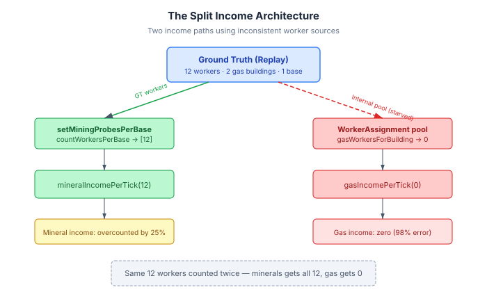
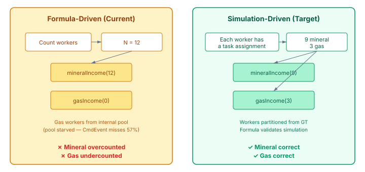

# When the Formula Is the Bug

QuarkMind's emulated game computes vespene income from a formula: count the gas workers, feed the count into `gasIncomePerTick(N)`, done. For months, that formula returned zero. Not because the formula was wrong — the formula was fine. The workers just never showed up.

## The symptom that hid the architecture

The CmdEvent replay path had 98% vespene collection rate error at the 5-minute checkpoint. Effectively zero gas income. The tracker-driven path — which captures every production command from replay data — worked fine at 0.2%. So the problem looked like a CmdEvent extraction issue: gas building commands being missed, gas buildings never built, no gas income.

Claude dug into it and came back with a sharper diagnosis. The gas buildings were there. The replay validation harness syncs all buildings from ground truth every tick — `injectReplayBuilding` adds new ones, `syncReplayBuilding` updates existing ones. Gas buildings appeared in EmulatedGame's building list, completed and ready. The harness just never told `WorkerAssignment` about them.

The normal build path — where a player issues a build command, a Probe walks over, construction starts, and the building completes — fires `onGasBuildingCompleted` when the build finishes. That call transfers 3 mineral workers to the gas building. But the harness injection path skipped that step entirely. It added the building to the player state and walked away.

## The two-error architecture

The fix was straightforward: call `onGasBuildingCompleted` from the injection and sync paths, same as the normal build completion does. Add position-based dedup so the same geyser doesn't get workers assigned twice (once from a CmdEvent-built building, once from the ground truth injection). Vespene error dropped from 98% to 34%.

But 34% is still wrong. And when I looked at where the remaining error came from, the architecture problem became clear.

The harness uses two separate mechanisms for income, and they disagree about where workers are:

- **Mineral income** uses `setMiningProbesPerBase`, overridden from ground truth every tick. It calls `countWorkersPerBase`, which counts *all* workers per base — including the ones standing at gas buildings. So mineral income treats gas workers as mineral workers.

- **Gas income** uses `WorkerAssignment.gasWorkersForBuilding()`, which tracks an internal pool. That pool starts with 12 workers and only grows when EmulatedGame produces new workers through intents. CmdEvent captures 43% of production commands. The pool barely grows.

Two errors, partially cancelling: minerals overcounted because gas workers are included in the mineral count, gas undercounted because the internal pool is starved of new workers the harness never produces. The formula was correct. The inputs were wrong. And the inputs were wrong because two income paths used two different sources of truth for the same workers.

## The insight: formulas as validators, not calculators

I'd been thinking about this as a formula calibration problem — are the income-per-tick functions returning the right values? But the functions were fine. The architecture was the issue.

Then the observation that reframed everything: why are we using aggregate formulas as the primary income calculation at all?

In SC2, each worker is individually assigned — mining minerals at a specific mineral patch, or harvesting gas at a specific gas building, or idle. Mineral saturation (diminishing returns after 16 workers per base) isn't a formula — it's physics. Workers compete for 8 mineral patches. With 16 workers, each patch has 2 (one mining, one walking back). Add a 17th and it queues up waiting for a free patch. The "saturation curve" in `mineralIncomePerTick(N)` is a mathematical approximation of that physical process.

When you approximate physics with a formula, two things happen:

**The formula becomes unfalsifiable.** It IS the calculation. There's nothing to check it against. If `mineralIncomePerTick(16)` returns the wrong value, the emulated income is wrong — but nothing in the system can detect that. The formula has no independent validator.

**Errors compound silently.** The formula works on aggregate counts. If the counts are wrong (gas workers miscounted as mineral workers), the formula dutifully computes the wrong income. It can't distinguish "12 mineral workers" from "9 mineral workers + 3 gas workers counted as mineral." The abstraction hides the error.

The alternative: simulate each worker individually. Each worker has a task — MINING_MINERALS, HARVESTING_GAS, IDLE, BUILDING. Income emerges from what each worker is doing. Mineral saturation emerges from patch competition. Gas income emerges from the 3-worker rotation at each geyser.

The formula doesn't disappear — it becomes a *validator*. Derive a formula from the simulation's output distribution. When the formula disagrees with the simulation, something is wrong — in one direction or the other. The formula catches simulation bugs. The simulation catches formula assumptions. Neither is the sole source of truth.

## What's next

The current fix (#499) landed the worker assignment patch — 98% to 34% vespene error, acceptance criteria met. The next piece (#500) is the architectural shift: individual worker simulation where income is emergent, not formula-driven, and the formula serves as a discrepancy detector. That's a larger change to how EmulatedGame fundamentally computes income, but the diagnosis here makes the case for it. The 34% residual error isn't a calibration problem. It's an architecture problem.

The formula was never wrong. It was just never checked.
