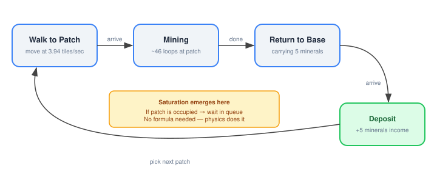
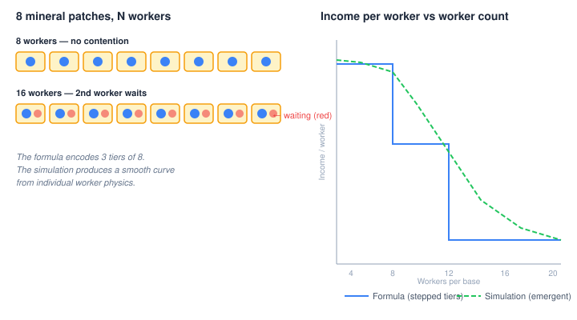
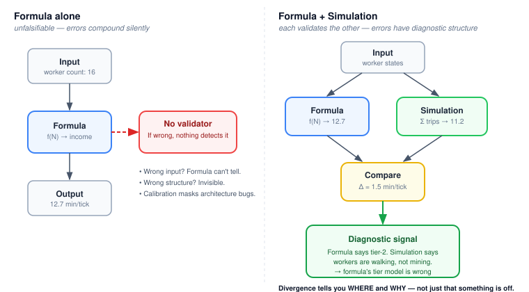

# Let the Workers Work

Every system that approximates physics with a formula has the same structural weakness: the formula is unfalsifiable. It computes what it computes. If the result is wrong, nothing inside the system can detect it. You calibrate against external data, adjust parameters, and hope the model structure is right. But you can't test that hope — not with the formula alone.

There's a better architecture. Run a simulation alongside the formula. Let the simulation produce the same quantity from first principles. When they agree, you're probably right. When they disagree, you've found a question worth answering — and the shape of the disagreement tells you where to look.

## The formula that hid its own assumptions

QuarkMind's emulated StarCraft II game computed mineral income from a function:

```java
public static double mineralIncomePerTick(int probeCount) {
    double income = 0;
    for (int tier = 0; tier < MINERAL_TIER_RATES_PER_TICK.length; tier++) {
        int probesInTier = Math.min(Math.max(probeCount - tier * 8, 0), 8);
        income += probesInTier * MINERAL_TIER_RATES_PER_TICK[tier];
    }
    return income;
}
```

Three tiers of 8 workers each. First 8 earn full rate. Next 8 earn half. Next 8 earn a tenth. Calibrated against 118 tournament replays. Reasonable math.

The formula encodes three claims about how mining works:

1. Saturation is a discrete step function at tier boundaries (8, 16, 24 workers)
2. All workers within a tier earn identically
3. Income depends only on count, not on position, distance, or state

All three are wrong. In SC2, saturation is a smooth curve driven by patch competition. Workers near close patches earn more. A worker walking back to the town hall earns zero for those ticks. The formula doesn't model any of this — and because it IS the model, nothing detects the gap.

## Simulation as the alternative

The replacement tracks each worker individually. Three things: a position, a velocity, a task.



Each tick, every worker advances one step. Walking? Move toward the target. Mining? Count down. Arriving at the town hall with cargo? Deposit — and that deposit event is the income.

There's no `mineralIncomePerTick` function. Income is a side effect of workers completing trips. Saturation emerges from workers competing for 8 patches: when 16 workers share 8 patches, each patch has a queue of 2. The second worker waits. That wait time IS the saturation penalty.



Gas works the same way. Each gas building has an interior slot and a wait queue. 3 workers rotate: one enters, harvests for ~29 game loops, exits, walks to base, deposits. The 3rd-worker penalty that the formula approximated with a lower per-worker rate now falls out of the rotation geometry.

## The real payoff: structural validation

The formula doesn't disappear. It becomes a validator.

```java
FormulaComparison compareWithFormula(TickIncome simulated) {
    double formulaMineral = 0;
    for (int count : mineralWorkersPerBase()) {
        formulaMineral += SC2Data.mineralIncomePerTick(count);
    }
    // ...
    return new FormulaComparison(simulated, formula);
}
```

Run the simulation. Compute the formula. Compare. When they diverge, something is wrong — and the divergence tells you where. Formula says 15 minerals/tick but simulation says 12? Either workers are spending too long walking (simulation bug) or the formula's tier rates are miscalibrated (formula bug). The error has diagnostic structure. Neither model is privileged; each validates the other.



This isn't a theoretical nicety. The dual-model approach caught real bugs within hours. The gas income formula was returning correct values for months — but the worker assignment system was feeding it the wrong input. Gas workers were being counted as mineral workers, inflating mineral income and starving gas income. Two errors partially cancelling. The formula was correct. The inputs were wrong. And nobody knew, because the formula was the only model. Once the simulation ran alongside it, the disagreement pointed straight at the worker-counting layer.

## The pattern generalises

This isn't specific to game AI. The pattern shows up wherever a formula approximates a physical process:

**Financial models** approximate market dynamics with aggregate functions. Black-Scholes computes option prices from volatility, time, and strike. Agent-based models simulate individual traders and let prices emerge from their interactions. When Black-Scholes says an option should cost X and the agent model says Y, the gap tells you something about the assumptions the formula makes about market microstructure — assumptions that are invisible when the formula operates alone.

**Network simulators** model throughput with queueing theory — Little's Law, M/M/1 queues. The formulas give steady-state averages. A packet-level simulation shows what happens under bursts, congestion, and correlated arrivals that the formula's independence assumptions don't cover. Run both; the divergence reveals how far reality is from steady state.

**Climate models** approximate radiative forcing with parameterisations — simplified functions that stand in for cloud physics, ocean mixing, and ice albedo. Higher-resolution simulations model these processes directly. When the parameterisation and the simulation disagree about regional temperature response, you've learned something about what the parameterisation assumed away.

In each case, the formula isn't wrong. It's an approximation that encodes specific structural assumptions. Those assumptions are invisible from inside the formula. A simulation that produces the same quantity from different principles — from individual agents, individual packets, individual physical processes — makes the assumptions visible by producing a different answer when they're violated.

## Why teams don't do this

The obvious objection: running two models costs more than one. More code. More maintenance. More cognitive load.

True. But consider what the alternative costs. A formula operating alone is a closed system. When its output is wrong, your debugging options are: check the inputs, or recalibrate the parameters. If the inputs are correct and the parameters are calibrated, you're stuck. The bug is in the model structure — the shape of the function, the assumptions about independence, the discretisation of a continuous process — and no parameter tuning can surface that.

A dual-model architecture turns structural bugs into observable divergences. The formula says the answer should be X. The simulation says Y. The gap isn't noise; it's a signal about what the formula assumed and what reality actually does. The cost of the second model is real. The cost of shipping a formula you can't structurally validate is harder to see, and usually larger.

The formula was never the bug. Trusting it alone was.
