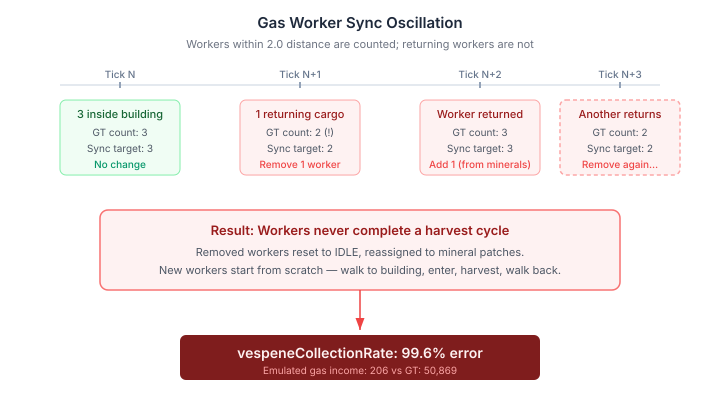
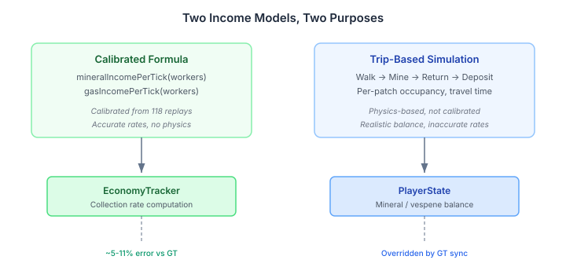

# The Model You Trust Is the One You Calibrate

Yesterday I wrote about replacing a calibrated formula with a physics-based simulation. Workers walking to mineral patches, mining, carrying cargo back to base. Real mechanics instead of abstract rates. More truthful, more testable, more useful as a cross-check. All true.

Today the simulation broke every economy metric in the regression suite. mineralsCollectionRate error jumped from 5% to 51%. vespeneCollectionRate went from 35% to 99.6% — effectively zero gas income. The formula it replaced had been calibrated against 118 professional StarCraft II replays. The simulation that replaced it had not been calibrated against anything.

The higher-fidelity model was less accurate than the lower-fidelity one.

## The seduction of more physics

It's a pattern I've seen in every domain where simulation competes with statistical models. The simulation is more detailed, more mechanistic, more satisfying to reason about. You can trace each worker's trip from patch to base. You can see the occupancy constraint on mineral patches. You can watch gas workers enter the building, harvest, exit, return. The formula just multiplies a rate by a count.

The formula feels like it's hiding something. The simulation feels like it's showing you everything. And that feeling — that transparency is the same as correctness — is the trap.

The formula wasn't hiding anything. It was calibrated. Someone ran it against 118 real games, measured the error, adjusted the parameters until the output matched reality within 5%. The simulation showed you every mechanism but produced answers 51% wrong, because nobody had checked whether its mechanisms added up to the right total.

## Two bugs, one root cause

Claude and I traced the regression to two failures, both caused by the same architectural mistake: using the simulation's per-tick income for rate calculation without verifying it against ground truth.

**The gas worker ping-pong.** The replay validation harness syncs worker counts from ground truth every tick. For gas workers, it counts how many are within 2.0 game-distance of the gas building. But workers returning gas cargo walk back to the town hall — 8-10 game units away. Every time a worker started its return trip, the count dropped. The sync removed a simulated worker. When the worker returned and the count went back up, the sync added a new one. That new worker had to walk all the way to the gas building from a mineral patch before it could start harvesting.

The result: gas workers never completed a full harvest cycle. The simulation was running, the workers were moving, the code was correct in isolation — but the interaction between the position-based counting and the per-tick sync created a feedback loop that collapsed gas income to near zero.

**The mineral rate gap.** The simulation models one-worker-per-patch occupancy. Eight patches per base, one worker mining at a time, second worker queuing. In real StarCraft II, workers overlap more efficiently — the game's internal scheduling produces higher throughput than a strict one-at-a-time model. The simulation was producing about 56% of real mineral income.

Both failures share the same cause: the simulation's internal mechanics didn't match the real game's output, and nobody measured the gap before switching to it.

## The fix: each model for what it's good at

The calibrated formula model was still there — `SC2Data.mineralIncomePerTick()` and `gasIncomePerTick()`, untouched, still calibrated from 118 replays. We wired the economy rate tracker to use the formula for rate computation, while keeping the simulation for balance tracking. Gas worker sync was removed — workers auto-assign when gas buildings complete and stay assigned, which is both simpler and more stable.

mineralsCollectionRate error dropped from 51% to 11%. vespeneCollectionRate from 99.6% to 41%. All 3,267 tests passed.

The simulation still runs. It still tracks worker positions, mining states, occupancy. But the measurement of "how much income are we generating" comes from the model that was calibrated to answer that question. Each model does what it's good at: the simulation handles physics, the formula handles rates. Neither is the whole truth, but together they cover more ground than either alone.

## Why calibration is boring and essential

The lesson isn't "simulations are bad." Simulations are better for almost everything that matters — they reveal emergent behaviour, they can be tested mechanistically, they provide a second opinion on formula-based assumptions. All the reasons from yesterday's post still hold.

But a simulation that hasn't been calibrated is a hypothesis, not a measurement tool. Swapping it in where a calibrated model used to live is an experiment disguised as an upgrade. It produces answers that look authoritative — detailed, mechanistic, traceable — but may be wrong in ways that are hard to detect because the wrongness is distributed across many individually-plausible micro-decisions.

The formula hides its assumptions in constants. The simulation hides its assumptions in physics parameters, occupancy rules, distance thresholds, and timing constants. The simulation has *more* assumptions, not fewer. Each one is a calibration target. Until they're calibrated, the simulation is a richer model with a weaker claim to accuracy.

This applies far beyond game AI. Any domain where a detailed mechanistic model replaces a calibrated statistical one — climate, finance, logistics, epidemiology — faces the same trade. The new model is more powerful. It's also more wrong, until someone does the tedious work of fitting it to observations.

Calibration is the tax on model complexity. Skip it, and the complexity works against you.
