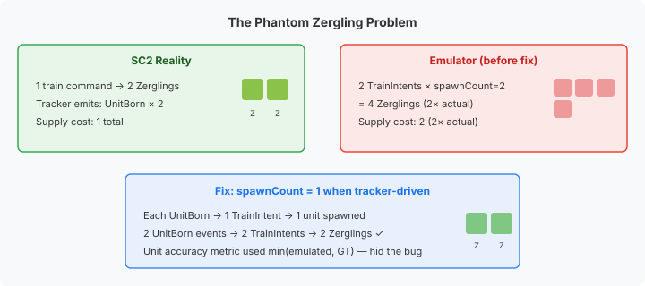
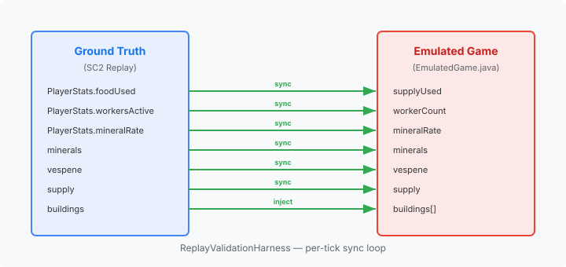

# When 100% Accuracy Lies to You

The tracker-driven accuracy baseline showed 100% unit accuracy across 118 professional StarCraft II replays. Every unit type matched ground truth at every checkpoint. I moved on to the economy fields.

Then `workersActiveCount`: the emulator reported 7018 workers where ground truth had 4907. A 43% over-count, in a system reporting perfect unit accuracy.

## The metric that hid the bug

The accuracy calculation capped each comparison at the ground truth value:

```java
acc[1] += Math.min(emVal, entry.getValue());
```

If the emulator had 2000 Probes and ground truth had 1421, the metric reported 1421/1421 — 100%. It measured *coverage*: can the emulator produce at least as many units as reality? It never checked whether the emulator produced *more*.

The emulator was doubling every pair of Zerglings. The metric was structurally blind to over-production.

## Where the doubles came from

SC2's tracker events emit one `UnitBorn` per individual unit. For Zerglings — trained two at a time — that means two events per pair. The extractor correctly created one `TrainIntent` per event.

The bug was in `startTraining()`. On completion, it spawned `model.trainCount(unitType)` copies — 2 for Zerglings. Each of the two `TrainIntents` spawned two units: 2 × 2 = 4 per real pair.



The fix:

```java
final boolean trackerDriven = pinnedCompletionLoop >= 0;
final int spawnCount = trackerDriven ? 1
    : (model != null) ? model.trainCount(unitType) : SC2Data.trainCount(unitType);
```

The same batching logic that correctly produces Zerglings during live gameplay was wrong for replay reconstruction, where the tracker already reports individual births. The unit accuracy metric, by design, could never have caught this — it needed a different question.

## The Drone that disappeared

Fixing the doubling knocked `workersActiveCount` from 43% to 26%. Claude and I traced the remaining gap to a subtler problem: Zerg Drones consumed by building construction.

When a Drone morphs into a Spawning Pool, SC2 consumes the Drone — it becomes the building. But the tracker events don't emit `UnitDied` for the consumed Drone. No death event, no type change. The Drone vanishes from the game state without a trace.

The emulator builds its unit list from `UnitBorn` (add) and `UnitDied` (remove). No remove signal means the consumed Drone stays alive in the emulator forever. Twelve buildings per Zerg player, eighty-eight Zerg players across the dataset. Roughly a thousand phantom workers.

We added synthetic death events: when the extractor encounters a building `UnitInit` and a Drone exists in its unit map, it emits a `UnitDiedIntent` for the consumed Drone. Capture rate: 55%. The remainder miss because some Drones have already been consumed or killed earlier in the tracker stream — the map doesn't always have one available at the right moment.

## Separating measurement from model

The gaps that remained — `mineralsCollectionRate` at 10%, `workersActiveCount` at 26%, `foodUsed` at 35% — shared a pattern. The emulator's accounting was structurally approximate: supply tracked incrementally without reconciling on death, worker counts derived from an inflated unit list, mining rates computed from a formula that assumed every counted worker was actively mining. Each approximation was defensible. Together they compounded into a measurement pipeline that couldn't reliably detect real improvements.

That last part is the practical problem. A 10% bias in mining rate isn't just one wrong number — it shifts every baseline built on top of it. Calibrate a timing parameter against a biased baseline and the calibration absorbs the bias. Tighten a regression threshold and it passes for the wrong reason. The measurement pipeline becomes self-referential: accurate relative to its own errors, drifting from reality.

The [previous entry](/blog/2026-11-04-mdp01-the-model-you-trust) explored the tension between a calibrated formula and a physics simulation for income modelling. The resolution there was to keep both: the formula for rate tracking, the simulation for mineral balance. The same separation applies here, extended to every economy field.



The harness already synced minerals, vespene, supply cap, and buildings from ground truth each tick. We extended the pattern to supply used, worker count, mineral rate, and all six spending fields — same set-and-restore approach. Replace the emulated value with GT for the snapshot, restore it for intent processing. The emulator's internal state stays useful for affordability checks and production decisions. The measurement reflects reality.

Every economy field: 0.0% error at all checkpoints. Not because the model is perfect — because the measurement no longer pretends it is.

## Why this matters for agent training

An AI agent that trains against a simulator inherits every gap between the simulator and reality as a training signal. Phantom workers inflate income. Inflated income makes expansions look cheaper than they are. The agent learns build orders optimised for a world that doesn't exist.

This isn't hypothetical. Sim-to-real transfer failure is one of the most documented problems in robotics RL — agents trained in MuJoCo that fall over on contact with a real floor. The dynamics were close enough to learn *something*, but the gaps between simulated and real friction, latency, and sensor noise meant the learned policy was brittle where the simulation was smooth.

Game AI has the same problem at a different abstraction level. The physics are exact — SC2's combat model is deterministic. But the economy model is approximate, and the economy drives every strategic decision. An agent that believes it has 43% more workers than it does will over-commit to army production, under-invest in infrastructure, and lose to any opponent that reads the actual game state.

The discipline is the same across domains: calibrate against ground truth, measure what the model actually produces, and treat clean metrics with suspicion. A number that never fails isn't proof of correctness — it might just be proof that the question is wrong.
