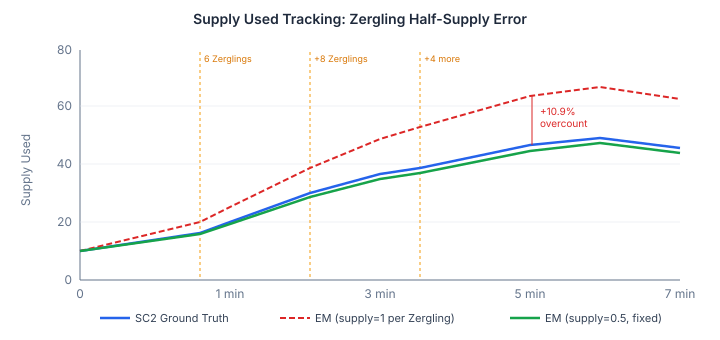
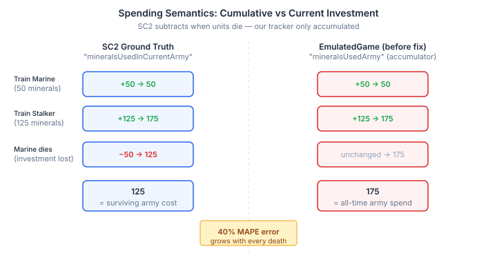

# Tearing Away the Scaffolding

A simulator that copies ground truth every tick proves nothing about its own physics. It proves it can copy. The tracker-driven accuracy baseline for QuarkMind's EmulatedGame reported 0.0% error on ten of twelve economy fields — because the harness synced each one from the replay's PlayerStats events before taking the snapshot. Remove the sync, and the number the model actually produces is the one you see.

I spent the session removing syncs and watching the model stand on its own.

## The wrong root cause

The last session left foodUsed at 4–11% MAPE without GT sync. The issue filed for it said the root cause was missed UnitDied intents — units dying in the replay but not generating death events in the intent extractor. Claude and I wrote a diagnostic that counted every tracker UnitDied event across 118 professional replays and compared them against the intents generated.

Coverage was 64%. Only 18,070 of 28,101 raw deaths produced intents. But when we broke the gap down by unit type, the picture inverted. Nine thousand of the missed deaths were Larva — zero supply cost. Another 475 were Drones consumed by building morphs — correctly skipped. Every supply-relevant unit death was already being captured.

The actual root cause was a single constant.

## Half a supply unit

StarCraft II Zerglings cost 0.5 supply each. Our `supplyCost(UnitType.ZERGLING)` returned 1. Each of the two UnitBorn events for a Zergling pair generated a TrainIntent that added 1 supply. Two events, 2 supply consumed. Reality: 1.

The same held for Banelings — our code had 0, SC2 uses 0.5.

The fix changed the supply representation from `int` to `double` throughout the supply chain — `UnitCosts`, `SC2Data.supplyCost()`, `PlayerState`, `GameState`, `EconomyTracker`, `SimulatedGame`. Zergling became 0.5. Baneling became 0.5. The change touched 18 files but was mechanically straightforward: every supply comparison and accumulation promoted cleanly from `int` to `double`, and 0.5 is exact in IEEE 754.

foodUsed MAPE at 5 minutes dropped from 10.9% to 7.0%. At 3 minutes: 6.9% to 3.2%.

The diagnostic work wasn't wasted. The `ID_UNIT_TYPE_CHANGE` handler we added during the investigation means morphed units — Roach to Ravager, Hellion to Hellbat, SiegeTank to Sieged — now carry the correct post-morph type in their UnitDiedIntent. Before, a Ravager's death was recorded as a Roach death. Both happen to have the same supply cost, so it didn't move the MAPE, but the type accuracy matters downstream for pattern detection and replay analysis.

## Spending as current investment

With supply tracking improved, I turned to the six spending fields — minerals and vespene each split into army, economy, and technology. The MAPE ranged from 40% to 87%. Claude had traced the EconomyTracker code and found that every `recordTrainSpending` and `recordBuildSpending` call was wired correctly. Spending was recorded on every intent execution. The numbers should have been right.

They weren't, because SC2's spending fields don't mean what they sound like.

`mineralsUsedInCurrentArmy` isn't cumulative spending on army units. It's the mineral value *currently invested* in the army. When a Marine dies, the 50 minerals it cost are removed from the field. When a building is destroyed, its cost is removed from economy or technology spending. The fields track live investment, not historical spending.

Our EconomyTracker only accumulated. Every train, every build, every research added to the running total. Nothing ever subtracted. Over the course of a seven-minute game, the gap between cumulative and current grew with every combat death and every building lost.

The fix was `recordUnitDeath()` — a method that subtracts the dead unit's cost from the appropriate spending category. Army units subtract from army spending, workers from economy. For buildings, the standalone test now detects when a GT building disappears between ticks and subtracts its cost. Building classification also needed correction: SC2 considers only resource infrastructure (bases, supply depots, gas buildings) as economy spending. Production buildings — Gateways, Barracks, Factories — are technology.

mineralsUsedCurrentEconomy dropped from 40% to 10% MAPE. foodMade improved as a side effect: 4.2% to 2.6%, because building destruction now correctly frees the supply those buildings provided.

## What the numbers mean for agent training

The EmulatedGame runs at several thousand ticks per second — orders of magnitude faster than real StarCraft II. If its economy tracks reality closely enough, an agent can train against it without needing the game client. Each GT sync removed is a dimension where the simulator is producing its own answer rather than echoing the replay.

Four syncs are now unnecessary: supply cap, supply used, spending, and seed state. The model tracks these independently within 3–10% of ground truth across 118 professional replays, without looking at the answer.

The remaining gaps — mineral and vespene income, worker lifecycle, building construction — are genuine physics problems. The mining model doesn't account for mineral patch distances. The gas model doesn't model worker assignment ramp-up. Buildings are still injected from GT because no build intents exist in the tracker stream. Each of these is a falsifiable test: implement the physics, remove the sync, compare against 236 player-runs of ground truth. If the model is wrong, the number moves.

That's the difference between a simulator that syncs from ground truth and one that stands alone. The synced version can never fail a test it's designed to pass. The standalone version fails whenever its physics are wrong — and that's exactly the kind of failure you want to find before an agent spends a thousand hours training against it.
