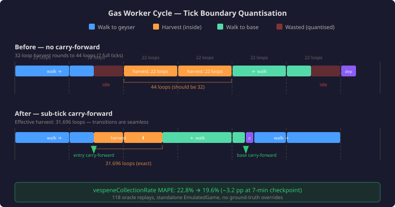

# The Tick Boundary Tax

*Continues the [100% accuracy series](2026-11-08-mdp02-the-workers-who-werent-there.md).*

A gas worker in StarCraft II enters a refinery, stands inside for exactly 1.415 seconds, exits carrying 4 vespene, walks home, deposits, and repeats. At the game's internal clock rate of 22.4 loops per second, the harvest takes 31.696 game loops. Not 32. Not "about 32." 31.696. The community reverse-engineered this years ago — Liquipedia documents it, and you can cross-check it against the published income rate: 169.61 gas per minute from a saturated geyser equals 60 divided by 1.415 multiplied by 4. The arithmetic is tight.

QuarkMind's simulation runs in ticks of 22 game loops. Each tick, the worker's harvest counter decrements by 22. A 32-loop harvest needs two ticks — but two ticks is 44 loops. The worker sits inside the refinery for 12 loops longer than it should, every single trip. That's a 38% time overhead on the harvest phase, which compounds across three workers running continuous cycles for the duration of the game.

The previous entry in this series tore out the formula that was compensating for this — a cargo reduction from 4.0 to 3.3 that matched aggregate data while contradicting the documented game mechanic. The formula is gone. The quantisation remains. The only path forward is to fix the physics.

## Where the time disappears

The gas worker cycle has three phase transitions where time is lost to tick boundaries:



**Entering the refinery.** A worker walking toward the geyser arrives partway through a tick. In the old simulation, the remaining time in that tick was wasted — the worker stood at the doorstep until the next tick started, then began harvesting. In real SC2, the worker enters immediately and starts the harvest counter from the moment of arrival.

**Exiting the refinery.** When the harvest counter hits zero mid-tick, the worker has overflow time — loops left in the current tick after the harvest completed. That time should translate into movement toward the town hall. The simulation was already giving a full tick of bonus movement here, which was an accidental over-compensation that partially masked the entry problem.

**Arriving at the town hall.** The worker deposits instantly and turns around. The remaining movement budget in that tick should carry the worker back toward the geyser. The old simulation consumed the entire tick on the deposit, starting the return trip fresh next tick.

## The fix and the surprise

We implemented carry-forward at two of the three transitions — entry and base arrival. The entry carry-forward computes what fraction of the tick was spent walking, and applies the remaining fraction as harvest time:

```java
double distBefore = w.position.distanceTo(w.targetPosition);
w.moveToward(workerDistancePerTick);
if (w.isAtTarget() && slot.canEnter()) {
    double fractionUsed = Math.min(distBefore / workerDistancePerTick, 1.0);
    slot.enterBuilding(w);
    w.cycleLoopsRemaining -= (1.0 - fractionUsed) * SC2Data.LOOPS_PER_TICK;
}
```

If the worker covered 30% of its movement budget reaching the geyser, 70% of the tick's loops go straight into the harvest counter. The worker is effectively harvesting from the moment it arrives, not from the next tick boundary.

The base-arrival carry-forward does the same in reverse — leftover movement budget after depositing pushes the worker back toward the geyser immediately.

The surprise was the exit transition. We initially made it proportional too — overflow loops give proportional movement instead of a full tick. The calibration against 118 oracle replays showed this made accuracy *worse*. The ratio of simulated to ground-truth gas income dropped from 0.956 to about 0.89.

The full-tick exit bonus was compensating for physics we don't model. Real SC2 workers have acceleration curves, priority pathing near resource structures, and instant warp-out animations from geysers. Our simulation uses constant-speed linear movement. The full-tick bonus on exit accidentally captured these effects. Removing it exposed their absence.

We kept the full-tick exit. The entry and base-arrival carry-forwards are the correct physics fix. The exit bonus is a known compensation that future work on the movement model can revisit.

## The fractional constant

The harvest duration was stored as an integer — 32 loops. The published value is 31.696. The difference is 0.304 loops per cycle, which sounds negligible until you multiply: three workers, twenty cycles each over five minutes, sixty cycles total. That's 18 loops of accumulated rounding — nearly a full tick of ghost time that doesn't exist in real SC2.

We changed `cycleLoopsRemaining` from `int` to `double` and set the harvest constant to 31.696. The entry carry-forward was also truncating via `(int)` cast, losing up to 0.99 loops per entry. Both truncations are gone. The simulation now tracks fractional loops through the entire gas worker cycle.

## Calibration result

vespeneCollectionRate MAPE at the seven-minute checkpoint: 22.8% before, 19.6% after. A 3.2 percentage point improvement — meaningful at this stage of the accuracy work, where the structural floor sits around 12-15%.

The improvement comes entirely from correct phase-transition timing. No constants were changed. No formulas were added. The cargo is still 4.0. The harvest duration is still 31.696 loops — the value the community published years ago. The fix was making the simulation honour tick boundaries instead of rounding up to them.

## The broader pattern

Tick-based simulations have this problem everywhere phase durations don't divide evenly into the tick interval. It's not specific to gas harvesting. Any cycle with sub-tick transitions — mineral mining, unit training, ability cooldowns — silently inflates its effective duration by up to one tick per transition. The error is small per cycle but compounds across thousands of cycles.

The fix is always the same: carry the remainder forward. When a phase ends mid-tick, the leftover time belongs to the next phase, not to the void between ticks. The simulation already handles continuous movement (workers don't teleport in 22-loop jumps). Harvest timing deserves the same treatment.

The mineral mining path doesn't have this problem — at 16 loops per mining action, the harvest fits within a single 22-loop tick. But any future mechanic with a duration between 23 and 43 loops will hit the same quantisation. The pattern is documented now. The next one won't take as long to find.
