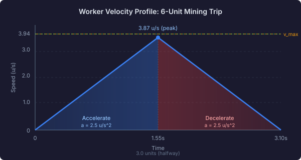
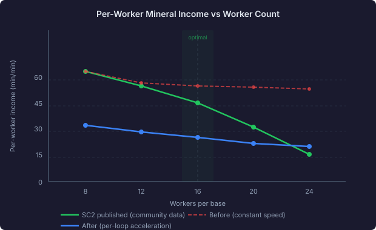

# The Physics That Was Always There

*Continues the [100% accuracy series](2026-11-08-mdp02-the-workers-who-werent-there.md).*

The previous entry described removing every formula from QuarkMind's economy simulation. Efficiency scalars, tier-rate arrays, formula-based gas income — all gone. What remained was an honest simulation that moved workers at constant speed, mined for 16 game loops, and produced numbers that were wrong by 15-80% depending on what you measured.

The simulation had three physics errors hiding in plain sight. Each one had been there since the beginning, accepted as "close enough" or never questioned because the formulas were papering over them.

## Sixteen loops

The mineral harvest duration — how long a worker stands at a mineral patch collecting resources — was set to 16 game loops. That's 0.714 seconds. Nobody remembers where that number came from. It was set empirically during early development and never revisited, because the formula layer was absorbing the downstream errors.

Liquipedia documents the actual SC2 value: 1.99 seconds. At 22.4 game loops per second, that's 44.576 loops. The simulation was mining almost three times too fast.

This matters for more than just income rates. With a 16-loop harvest, a worker spends less than one tick at the mineral patch. Two workers assigned to the same patch rarely overlap — one finishes before the other arrives. There's no contention. A third worker barely has to wait. The saturation curve comes out nearly flat: workers 17-24 earn 94% of what workers 1-16 earn per head. SC2's actual curve has a steep drop — the third worker on a patch earns roughly half what the second earns.

Correcting to 44.576 loops steepened the curve immediately. Workers now occupy patches for nearly two ticks, which means two workers on the same patch frequently overlap.

## One at a time

The second error was subtler. The simulation allowed two workers to mine a mineral patch simultaneously — `MAX_MINERS = 2`. This was the designed intent: the saturation model set the optimal count at 2 per patch, and the code enforced it as a cap on concurrent miners.

But SC2 doesn't work that way. Only one worker can harvest a given mineral patch at a time. The second worker waits until the first finishes. Two workers per patch is optimal not because they mine together, but because they alternate — one mines while the other travels, and if the trip timing works out, the patch is rarely idle.

Setting `MAX_MINERS = 1` changed the contention dynamics. The third worker per patch now competes with two others for a single mining slot. The marginal income of workers 17-24 dropped to 59% of workers 1-16 — close to SC2's published 50-55%.

## Workers don't teleport

The third error was the movement model. Every worker in the simulation moved at constant speed: 3.94 units per game-second, every tick, from the moment it started walking to the moment it arrived. Linear interpolation, straight-line path, full speed from the first step.

SC2 workers accelerate. The SC2 data editor records the value: 2.5 units per second squared, for all three worker types. Deceleration is the same — 2.5 u/s^2 near the target. Most ground units have an acceleration of 1000 (effectively instant), but workers are deliberately slow to ramp up. This is part of what makes mining work — workers don't snap between positions, they ease in and out.

The consequences for a 6-unit mining trip are dramatic. To reach max speed of 3.94, a worker needs to cover 3.1 units while accelerating. But the patch is only 6 units from the town hall. Accelerating for 3 units and decelerating for 3 units means the worker never reaches max speed at all. The velocity profile is a triangle, not a trapezoid.

Peak speed on a 6-unit trip: 3.87 u/s. The worker spends the entire journey either speeding up or slowing down. The old constant-speed model completed the trip in 1.52 seconds. The acceleration model takes 3.10 seconds — more than double.

The right way to simulate this is per-loop stepping. Not a formula for trip time. Not an analytical solution. Each of the 22 game loops within a tick, the simulation updates the worker's speed — accelerating when far from the target, decelerating when close — and moves it by `currentSpeed * loopDuration`. The trip time emerges from the physics. SC2 runs movement at per-loop granularity internally, and the simulation now does the same.

This matters because the per-tick granularity (22 loops per tick, ~0.98 seconds) is too coarse for acceleration at these distances. A worker at max speed covers 3.87 units in a single tick — more than the 3.1-unit deceleration zone. A per-tick model overshoots the deceleration point and snaps to the target. Per-loop simulation catches the deceleration correctly.

## The saturation curve

With all three fixes applied — 44.576-loop harvest, single-miner patches, per-loop acceleration — the saturation curve looks like this:

The red dashed line is the old model: nearly flat, with a 5.6% per-worker efficiency drop from 16 to 24 workers. The blue line is the corrected model: 13.9% drop, with marginal third-worker efficiency at 59% of the optimal rate. The green line is SC2's published community data.

The blue line sits below the green. Per-worker income is lower across the board. This is expected — the simulation uses a flat 6-unit patch distance for all patches, while real SC2 has close patches at 4-5 units and far patches at 6-7. Close patches have shorter trips and higher per-worker income. Using actual map geometry (which the replay harness already does via ground-truth mineral patch positions) will shift the blue line upward.

## What this means for the digital twin

The economy model is no longer a formula calibrated to match aggregate data. It's a physics simulation that produces income from first principles: acceleration, harvest duration, patch occupancy, trip geometry. When a parameter is wrong, the error is localised — fix the parameter and the downstream numbers correct themselves. With formulas, every parameter interacted with every other parameter through the calibration, and fixing one thing broke the fit for everything else.

The acceleration model also enables something the formula path never could: distance-dependent accuracy. A geyser 10 units from the town hall now genuinely produces less gas than one at 7 units, because the worker spends more time accelerating and decelerating. A far mineral patch genuinely earns less per trip than a close one. Map geometry matters in the simulation the same way it matters in the real game.

The scouting and transit infrastructure — new worker states for SCOUTING and TRANSFERRING, with hooks for the replay harness and strategy layer — is ready but not yet wired to callers. When it is, the "workers who weren't there" problem from the previous entry gets its physics fix: workers pulled off minerals for scouting or base transfers produce no income for the duration, and the income gap that the formula tried to hide with a blanket 0.92 multiplier emerges naturally from the simulation.

The remaining issue on the epic is spending timing — a measurement cadence question, not a physics one. The economy simulation is now doing what we set out to do: simulate the game, not fit curves to it.
