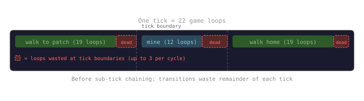
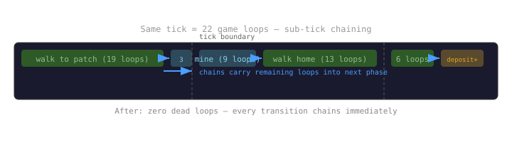

# The Constant That Couldn't Be Wrong

SC2's data editor stores physics constants at normal game speed. Unit speeds are documented at "faster" speed — the 1.4× multiplier that every competitive game runs at. Liquipedia reports Probe speed as 3.94 tiles per second. SC2Mapster's data editor shows 2.8125. Multiply by 1.4, get 3.94. Consistent.

Acceleration is also in the data editor: 2.5 units per second squared. Nobody mentions scaling it. Every community resource I found quotes 2.5 directly. So that's what QuarkMind used.

The per-loop velocity change tells the real story. At normal speed (16 Hz): 2.5 / 16 = 0.15625 per loop. At faster speed (22.4 Hz): 2.5 / 22.4 = 0.11161. A worker accelerating at the unscaled rate takes 35 loops to reach cruising speed instead of 25. That's ten extra loops per leg, twenty per round trip, across every worker on every mineral patch for the entire game. The unscaled acceleration dropped mineral collection rate by roughly 50%.

Fixing it was one line: 2.5 → 3.5.

Nothing changed.

## The fix that did nothing

The mineral collection rate MAPE stayed exactly where it was. I re-ran the oracle replay baseline — 118 replays, 236 player runs — and the numbers hadn't moved. Workers were accelerating faster, reaching patches sooner, completing cycles more quickly, and the aggregate income was identical.

The simulation processes workers in ticks of 22 game loops. Each tick, a mineral worker can be in one of three states: walking to a patch, mining, or walking home. When it transitions between states — arrives at the patch, finishes mining, arrives at the town hall — it moves to the next state and waits for the next tick to continue.

A worker arriving at a mineral patch on loop 19 of a 22-loop tick has 3 loops remaining. Those 3 loops are wasted — the worker stands at the patch doing nothing until the next tick starts. Then it begins mining. When mining finishes mid-tick, the same thing happens: the remaining loops are wasted before the return trip starts.

Three transitions per cycle. Up to one tick wasted at each. At 22 loops per tick and a cycle of roughly 110 loops, that's up to 15% of the worker's time evaporating at tick boundaries. The faster acceleration from the ×1.4 fix saved about 10 loops per cycle — but those 10 loops disappeared into the same tick-boundary gaps. The physics improvement was invisible inside the quantisation noise.

## Chaining within the tick

The movement code already tracked loops precisely — `moveLoops(int)` returns the number of loops consumed before the worker reaches its target. If a worker arrives at loop 19 with 3 loops remaining, those 3 loops are available for the next phase.

The mining phase didn't work this way. It checked whether the current time exceeded the mining end time. If not, it returned the entire remaining tick unused. A 5-loop mining animation starting at loop 19 would complete at loop 24 — well within the tick boundary at loop 22+22=44. But the code checked at loop 19, found mining incomplete, and returned. Next tick it checked at loop 22, found mining complete (22 < 24 is false, but the phaseEndLoop was set relative to tick start). The worker consumed a full extra tick for a 5-loop phase.

The fix: after `moveLoops` returns, calculate how many loops remain in the tick. If mining would complete within those loops, complete it immediately and chain into the return trip. Same pattern at every transition.

This one change made the acceleration fix visible. The mineralsCollectionRate MAPE dropped — but it didn't drop to where it should have been. It dropped *too far*. The simulation was now producing 65% more income than real SC2 at the 1-minute checkpoint.

## When the numbers came loose

With tick boundaries no longer absorbing errors, every constant had to be re-examined. The mining duration — previously set to 5 game loops based on an empirical sweep — was producing the right MAPE only because the tick boundary overhead was compensating for a too-short animation. With that overhead gone, 5 loops was far too fast.

A sweep across 118 oracle replays at 13 different mining durations found the new optimum: 12 loops. But 12 loops is 0.54 seconds, and community sources cite mining at roughly 1 second. So I connected to a real SC2 instance via the protobuf API, started a game, and tracked a Probe's position every single game loop for 3000 frames.

The stationary period at mineral patches — the actual mining animation, position unchanged frame to frame — was 5 loops. Median: 5 loops. Mean: 6.1 loops. Not 1 second. Not 12 loops. Five.

The 7-loop gap between measured reality (5 loops) and the calibrated constant (12 loops) isn't error. It's the sum of everything the simulation doesn't yet model: 2-3 loops of deposit time at the town hall (visible in the measurement data as stationary periods at the Nexus position), 2-3 loops of approach and docking delay at the mineral patch, and occasional path contention between workers. The mining constant absorbs these because the simulation treats deposit as instant, approach as immediate, and pathing as obstacle-free.

## The lesson is two-layered

The acceleration constant was wrong. Fixing it alone changed nothing. The simulation granularity was too coarse to express the improvement — the tick boundary quantisation ate every loop the faster acceleration saved.

This is a general pattern in any tick-based simulation. A physics constant and the simulation's time resolution interact multiplicatively. If the resolution is coarse enough, the constant doesn't matter — any value within a range produces the same output. You calibrate the constant, find an optimum, and the optimum is an artefact of the quantisation, not the physics.

The corrected acceleration was hiding inside the quantisation. The corrected mining duration was compensating for the quantisation. Both were "calibrated" — both matched the oracle MAPE — and neither reflected reality. Only when the quantisation was fixed did the physics constants become meaningful.

If you're building a simulation — game AI, a digital twin, a physics model — and your calibration sweeps show wide plateaus of identical output, check your time resolution. The constant isn't wrong. The simulation can't see it.
