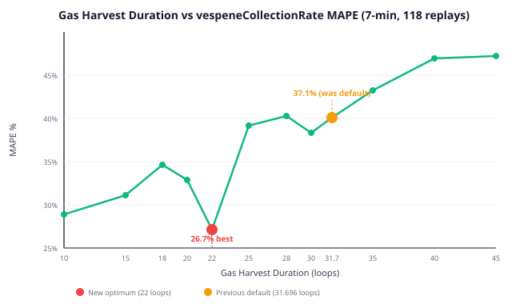
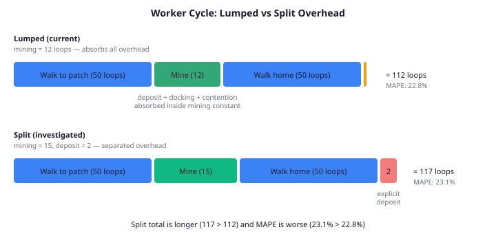
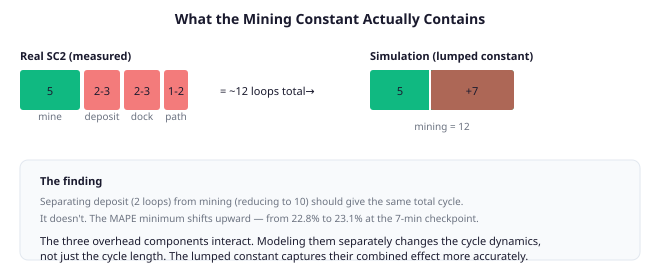

# When One Number Beats Three

Every physics simulation has constants that absorb more than they describe. A mining duration of 12 loops doesn't mean "the worker mines for 12 loops." It means "the worker mines for 5 loops, deposits for 2-3, docks for 2-3, and occasionally gets stuck behind another worker for 1-2 — and 12 is the single number that makes all of that produce the right aggregate income when you don't model any of it." I know this because I measured the real animation at 5 loops via the SC2 API and then spent a session trying to model the other 7 explicitly.

The explicit model was less accurate.

## Gas confirms the pattern

The [previous entry](2026-11-08-mdp05-the-constant-that-couldnt-be-wrong.md) described how sub-tick chaining revealed the mining constant's true nature. This session I applied the same treatment to gas harvesting. The gas harvest duration from Liquipedia is 1.415 seconds — 31.696 game loops. After sub-tick transitions were added in #584, the oracle MAPE sweep told a different story.

Duration 22 is the optimum at the 7-minute checkpoint: 26.7% MAPE versus 37.1% at the Liquipedia value. That's a 10.4 percentage point improvement in vespene rate accuracy, cascading to a 12-point improvement in cumulative vespene balance (77.4% → 65.4%).

The non-monotonic curve is worth noticing. Durations 28, 30, and 31.7 produce identical output — a tick-quantisation plateau where the harvest phase happens to span the same tick boundaries regardless of the exact constant. Duration 10 dips low at the 5-minute checkpoint but loses ground by 7 minutes. Duration 22 sits in a narrow valley — it's not the smoothest minimum, but it's the deepest at the checkpoint that matters.

The gas constant follows the same pattern as mining: the calibrated value (22 loops) is significantly shorter than the community-documented value (31.7 loops), and the gap absorbs per-cycle overhead the simulation doesn't model. Gas workers spend time depositing at the town hall, animating through the geyser entry, and occasionally waiting for the geyser slot. The 9.7-loop reduction captures all of that.

## Then I tried to model the overhead explicitly

The SC2 API measurement from the previous session showed 2-3 loops of stationary time at the Nexus during each deposit. That's real, measurable physics — the worker arrives, stands still for 2-3 frames, then walks back. A simulation that models this should be more accurate than one that pretends deposit is instant.

I added `DEPOSITING_MINERALS` and `DEPOSITING_GAS` worker states, with sub-tick chaining, configurable via `starcraft.worker.deposit-duration-loops`. Set deposit to 2 loops (the measured value). Reduced mining to compensate. Ran the oracle sweep.

The split model was worse. Not catastrophically — mineralsCollectionRate went from 22.8% to 23.1% at the 7-minute checkpoint. But it was worse, and no combination of mining + deposit durations I tried could match the lumped constant.

The reason isn't obvious until you think about what "deposit time" actually does to the worker cycle. When deposit is instant (the lumped model), a worker arriving at the town hall immediately starts walking back to its mineral patch. The mining constant — 12 loops — accounts for the total overhead, including the time the worker would have spent depositing. When I split deposit into its own 2-loop phase, the worker sits at the base for 2 real loops before walking back. The patch is available for the same amount of time (the mining constant is shorter), but the worker returns later. This changes when worker A and worker B overlap at the same patch. The contention dynamics shift.

The three overhead components — deposit, docking, contention — interact. They're not additive. Modeling one without the others moves the equilibrium without improving the fit. The lumped constant captures their combined effect at the point where the oracle data says the total income is most accurate.

## What this means for simulation work

There's a modelling instinct that says: if you know three physical phenomena contribute to a delay, model all three. More physics means more accuracy. This instinct is wrong when the phenomena interact and the simulation doesn't capture the interaction mechanism.

In our worker economy, the interaction mechanism is spatial contention: workers block each other at patches, at the town hall, and on paths between them. The simulation doesn't model collision or queuing. Without that, splitting overhead into phases just rearranges when the unmodeled contention occurs — it doesn't reduce it.

The practical test is empirical. Measure the aggregate against ground truth. If the lumped constant wins, the interaction effects dominate the individual phase accuracy. If splitting wins, the phases are genuinely independent. In our case, 118 oracle replays across 236 player runs said the lumped constant wins. The individual phase measurements from the SC2 API are still valuable — they explain what the lumped constant contains, which matters for diagnostics — but they don't improve accuracy when modeled separately.

This is the difference between understanding a system and simulating it. I understand that workers spend 2-3 loops depositing. I've measured it. I can describe the physical process. But the simulation, which doesn't model worker collision, produces better numbers when it pretends deposit is instant and bakes the delay into the mining phase.

The infrastructure stays in place. Setting `starcraft.worker.deposit-duration-loops=2` activates the explicit deposit model — useful for future experiments if we ever add worker collision. But the default is 0. One number, not three.

## Current accuracy

Four issues closed this session: gas harvest recalibration (#586), deposit time investigation (#587), and two cumulative-drift issues (#588, #589) that turned out to be rate-dependent with no separate fix.

Standalone EmulatedGame at the 7-minute checkpoint (118 oracle replays, no GT syncs):

| Field | MAPE | Status |
|---|---|---|
| mineralsCollectionRate | 22.8% | Near structural floor |
| vespeneCollectionRate | 26.7% | Improved from 37.1% |
| mineralsCurrent | 67.5% | Rate-dependent |
| vespeneCurrent | 65.4% | Improved from 77.4% |
| workersActiveCount | 2.5% | At floor |
| foodMade / foodUsed | 3.1% / 3.7% | At floor |

The remaining rate error is likely structural — a cadence mismatch between SC2's PlayerStatsEvent reporting (~160 loops) and the simulation's sampling interval (154 loops). That's the next investigation (#590).

Units, buildings, and upgrades remain at 100% accuracy.
