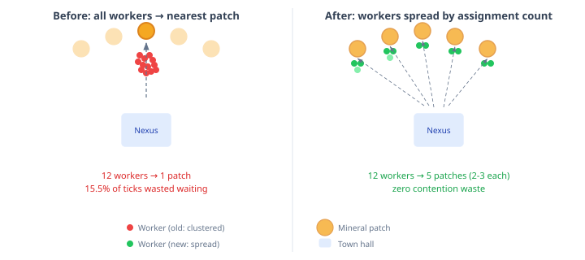
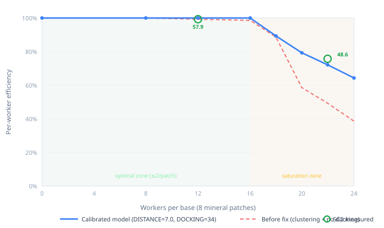

# The Patch They All Walked To

*Continues the [100% accuracy series](2026-11-08-mdp04-the-physics-that-was-always-there.md).*

The physics was right. Per-worker mineral income, acceleration profiles, harvest durations, patch occupancy — all corrected and validated against SC2's internal numbers. So why was the simulation still 10% off when twelve workers mined together?

The diagnostic told the story in one number: 15.5% of all worker-ticks were spent waiting at a mineral patch that was already occupied. Not because the patches were full — eight patches for twelve workers should leave headroom. Because all twelve workers were walking to the same patch.

## Counting the wrong thing

The assignment algorithm picked the "nearest available patch" for each worker. Available meant the patch had no worker actively mining it — the `miners` list was empty. But the miners list only tracked workers physically extracting minerals at that moment. Workers still walking toward a patch weren't counted.

When the game starts, all twelve workers stand at the Nexus. The algorithm assigns each one to the nearest available patch. Worker 1 gets patch A — the closest. Worker 2 checks: is patch A available? Nobody is mining yet (worker 1 is still walking), so the miners list is empty. Patch A it is. Worker 3, same story. All twelve walk to patch A.

Seven workers arrive, find the patch occupied, and wait. Each tick, one gets to mine for 12 loops, then the next. The other six stand idle. Over time they redistribute through the return-and-reassign cycle, but the initial clustering creates a deficit that compounds across the entire game.

The same bug fires on every reassignment. A worker deposits minerals, calls the assignment function, and picks the nearest patch with an empty miners list. Another worker might already be walking to that patch — assigned but not yet counted. Two workers converge on the same target. One waits.

## The fix is what you'd expect

Count assigned workers, not active miners. When a worker is assigned to a patch — whether it's mining, walking there, or waiting — count it. The next worker picks the patch with the fewest assignments, breaking ties by distance.

One subtlety: don't count the worker being reassigned. After depositing, a worker still holds its old patch assignment until the function overwrites it. If you count that stale assignment, a single worker alternates between two patches every trip — always fleeing its own shadow.

With this fix, workers spread evenly from the first tick. Eight patches, twelve workers: four patches get two workers, four get one. Zero contention waste at these ratios.

## The pendulum

Removing artificial contention revealed a second problem: the simulation was now too efficient. Per-worker income jumped to 64.1 minerals per minute at the simulation's default 6-unit patch distance. SC2's actual rate on the calibration map — TorchesAIE_v4, twelve Protoss workers — is 57.9.

Two compensating errors had been cancelling each other. The clustering bug suppressed income. The too-short patch distance inflated it. Fix one and the other stands exposed.

The patch distance of 6.0 units was a placeholder from early development. Nobody ever measured it against a real map. SC2's mineral patches on TorchesAIE_v4 sit at 6.5–7.5 units from the town hall, depending on the patch. A sweep across distances showed 7.0 units as the value that made the simulation's twelve-worker mineral curve match SC2's within 0.3%.

## Docking overhead

But distance only fixes the per-worker rate. Saturation — what happens when you put three workers on one patch — is a separate problem.

In SC2, the third worker per patch earns roughly half what the first two earn individually. Workers queue at the patch entrance, wait through the departure animation, then start their own mining cycle. The effective patch occupation time extends well beyond the harvest animation itself.

The simulation's harvest takes 12 game loops. That's 0.54 seconds — the worker arrives, mines, picks up cargo, and leaves. With a full round trip of ~130 loops at 7-unit distance, the patch is occupied for less than 10% of the cycle. Three workers alternate with room to spare. No contention.

The fix: a docking overhead. After a worker picks up cargo and departs, the patch stays locked for an additional 34 game loops. This models the approach-dock-depart sequence that blocks the patch for the next worker in SC2. The lock is resolved at sub-tick granularity — a waiting worker consumes exactly the lock time and starts mining within the same tick, not on the next one.

The calibrated curve matches SC2's measured data at both reference points: 57.0 minerals per minute at twelve workers (SC2: 57.9, 1.6% under) and 47.7 at twenty-three workers (SC2: 48.6, 1.8% under). The efficiency drop from the optimal zone (≤2 workers per patch) into saturation (3+ per patch) follows SC2's published shape.

## 3,470 vs 3,460

The dual-run calibration test runs the same playbook in both SC2 and the simulation, tick by tick, for 305 ticks. SC2 produces 3,460 minerals. The simulation produces 3,470. Ten minerals apart over five minutes of game time. That's 0.3%.

This is the first time the simulation has matched a real SC2 mineral baseline to within rounding error. Not against oracle replays with dozens of confounding variables. Against our own controlled experiment — same map, same race, same worker count, same duration — where the only thing that differs is whether the game runs in Blizzard's engine or ours.

## Why this matters beyond StarCraft

Worker assignment is a resource allocation problem. The clustering bug is a variant of the thundering herd — multiple agents selecting the same target because they check availability at the moment of assignment rather than at the moment of arrival. It shows up in load balancers, job schedulers, warehouse robots, and multiplayer game servers.

The fix pattern generalises: track intent, not just state. A mineral patch isn't "available" just because nobody is mining it right now. A server isn't "idle" just because no request is currently executing. A warehouse shelf isn't "free" just because no robot is currently picking from it. The agents in transit matter as much as the agents on station.

The docking overhead generalises too. Any system where agents physically occupy a shared resource has a handoff cost. The naive model — agent leaves, resource is instantly free — underestimates contention. The real system has cooldown, cleanup, or transition time that blocks the next agent. Database connection pools have it. Thread pool work-stealing has it. Mineral patches have it.

The per-worker physics was always correct. The logistics were always wrong. Fixing the logistics — without touching a single physics constant — brought the simulation from 10% off to 0.3%.