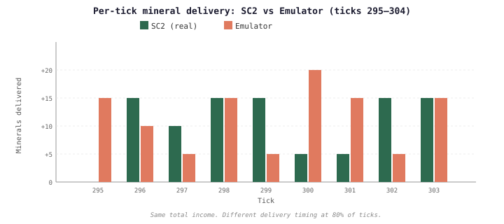
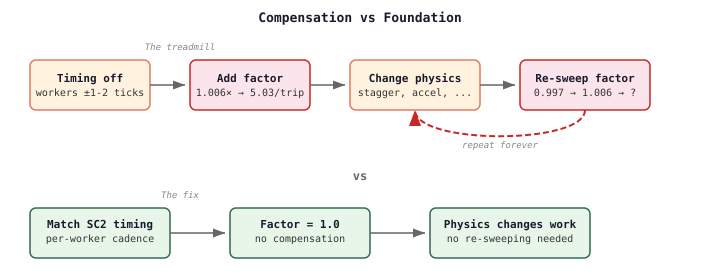

# When Zero Error Means Eighty Percent Wrong

A simulation that produces the right answer at the end can still be wrong at every step along the way.

I've been building an economy emulator for StarCraft II — 12 workers walking to mineral patches, mining, walking back, depositing. Each delivery adds 5 minerals to the bank. At tick 304 (~5 minutes of game time), both the emulator and real SC2 report 3460 minerals. Zero error. Exact match.

Except it isn't. Claude ran a per-tick diagnostic comparing mineral deltas between SC2 and the emulator across all 304 ticks. The result: 242 of 304 ticks — 80% — have different delivery patterns. Workers deliver on different ticks, sometimes ±1-2 ticks apart. The total converges because I'd tuned a "mining efficiency factor" of 1.006 that scales each delivery to 5.03 minerals, compensating for the aggregate deficit.

This is where it gets insidious. The factor absorbs the timing mismatch, but it introduces problems of its own. SC2 delivers in clean multiples of 5 — one delivery per worker, always integer. The emulator now delivers 5.03, 10.06, 15.09. Numbers that never appear in real SC2. And every time I change a physics constant — acceleration, mining duration, worker stagger — the factor needs re-sweeping. I'd already done this three times across separate sessions, each time finding a new "optimal" value.

The per-tick oscillation tells the real story. At tick 211, the emulator is 24 minerals ahead of SC2. At tick 242, it's 9 behind. The gap swings between −9 and +24 throughout the run. The factor makes these oscillations invisible at the aggregate level, but they compound into everything downstream — rate calculations, spending timing, balance predictions.

The root cause is straightforward: workers deliver cargo at different ticks because their movement cycles aren't synchronised with SC2's. Real SC2 workers desynchronise naturally through spawn stagger, collision avoidance, and individual pathing variation. The emulator uses a simplified uniform stagger model — each worker's first walk starts at `worker_index × 6` game loops. Close enough for the total. Wrong at every individual tick.

**Compensation constants are technical debt in disguise.** They feel productive — run a sweep, pick the optimal value, watch the metric improve. But nothing is actually fixed. The parameter couples your output to your current physics model. Change the model, re-sweep the parameter. Change it again, re-sweep again. The parameter count grows, interactions compound, and eventually you can't tell whether a change helped the physics or just shifted the compensation.

The fix is to make the foundation match. Same worker speeds, same acceleration, same movement physics — but also same delivery timing. Workers must arrive at mineral patches and return with cargo at the same tick as SC2. Not approximately. Not on average. At each tick.

The SC2 API gives us the tools. It exposes per-worker positions, orders (HARVEST_GATHER, HARVEST_RETURN), and buff states (CARRY_MINERAL) every game loop. We can record exactly when each worker delivers and compare against the emulator's internal worker state machine, which already tracks position, task, cargo, and assigned patch at full resolution. The roadmap: instrument the observation path, record a per-worker baseline, fix the timing, and revert the factor to 1.0.

When the foundation is right, there is nothing left to compensate for.

The lesson generalises. Any simulation using correction factors to match observations has a question to answer: is the factor absorbing real-world complexity you've chosen not to model, or is it hiding a timing difference you could fix? If the former, that's a conscious engineering trade-off — document it and move on. If the latter, it's debt. And every downstream metric you build on top of it inherits the instability.
