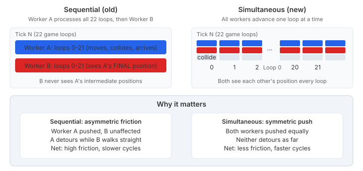
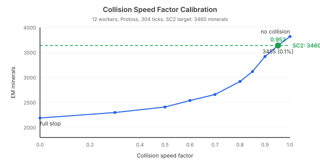

# When Correctness Made It Worse

I made the physics simulation more correct and the accuracy went from 0.1% to 8.5%. That's not a typo.

The emulator simulates StarCraft II's mineral economy — 12 workers walking between a base and mineral patches, mining 5 minerals per trip. The previous entry described how a compensation constant (the "mining efficiency factor" of 1.006) was hiding an 80% per-tick mismatch. The fix path was clear: remove the constant, add the missing physics, make the foundation match.

We started with the processing order. The old tick loop processed workers sequentially — Worker 1 walks all 22 game loops, then Worker 2 walks all 22 loops. SC2 doesn't work this way. SC2 advances every unit one game loop at a time, resolves collisions, then advances the next loop. The difference matters because when Worker 1 finishes first, Worker 2 only ever sees Worker 1's final position. It never encounters Worker 1 mid-path.

We restructured the tick loop. The outer loop now iterates game loops (22 per tick), the inner loop iterates workers. Each loop: all workers step, then collision resolves for all pairs simultaneously. This is what SC2 does.

The accuracy went from 0.1% to 8.5%.

The collision model was the culprit. In the old sequential model, collision was asymmetric — only the moving worker got pushed, the other held its ground. Over a tick, this created substantial friction: each worker detoured around every other worker's path without the other worker compensating. In the new simultaneous model, collision is symmetric — both workers push apart equally, each moving half the distance. Less total displacement per collision means shorter paths, which means faster mining cycles, which means more minerals.

The old model's asymmetry was physically wrong. But it was *load-bearing wrong* — the friction it created happened to match SC2's collision slowdown. The correct symmetric model removed that friction, and nothing replaced it.

The fix was collision deceleration. In SC2, workers don't just push apart spatially — they slow down on contact. We added a speed reduction: when two workers overlap, both lose 4.8% of their current speed. A worker at full speed (3.15 u/s) drops to 3.0 u/s. It takes several game loops to re-accelerate, creating a multi-loop delay per collision event. The factor was calibrated against the SC2 baseline via a parameter sweep — 0.952 was the clear winner at 0.1% error.

A critical distinction: this 0.952 is not a compensation constant. A compensation constant absorbs a timing difference you could fix — it couples your output to your current model and needs re-sweeping every time the model changes. The collision speed factor models a real physical effect: units decelerate when they collide. It has a physical interpretation (4.8% speed loss per contact event), it would survive a model change (the physics it represents doesn't depend on other parameters), and it was calibrated from SC2 observation data, not from curve-fitting the final mineral total.

The test for whether a parameter is compensation or physics: would you need to re-sweep it if you changed the mining duration? A compensation constant would drift because it's absorbing unrelated timing errors. A physics parameter stays valid because it describes an independent effect.

We also tried two approaches that failed, and the failures were more instructive than the successes.

First, detour waypoints — when workers collide, compute a point that routes around the blocker and steer toward it. The idea is that SC2 workers visibly repath around each other, taking multi-loop detours. The problem is scale. Worker collision diameter is 0.75 units. Walk distance (edge-to-edge) is 3.5 units. Even a 0.75-unit detour adds 20% to a round trip. With 12 workers colliding multiple times per trip, detours destroyed production — 88% error at the conservative setting. The collision radius is too small relative to the walk distance for waypoint steering to work at this resolution.

Second, direction-dependent severity — head-on collisions get full deceleration, same-direction collisions get none. The idea maps to intuition: walking into someone should hurt more than queuing behind them. The problem is that same-direction collisions dominate the mineral line — workers heading to adjacent patches, workers queuing near the same patch. Reducing deceleration for the most common collision type dropped the average friction, causing 5.3% overproduction. The distribution of collision types was the opposite of what I assumed.

Both failures expose a common trap in physics simulation: intuitions about individual interactions don't predict emergent system behaviour. A detour that seems trivial for one worker becomes catastrophic across twelve. A severity model that seems reasonable for one collision pair inverts the system dynamics when aggregated.

The emulator now runs a per-loop physics simulation with simultaneous collision resolution, speed-based deceleration, and stationary obstacle avoidance — workers at patches act as immovable obstacles that push walking workers aside. Total mineral accuracy sits at 0.1% for Protoss. The compensation constant is gone, permanently. The foundation is physics, not curve-fitting.

What remains is the per-tick mismatch. The total is right — 3455 vs SC2's 3460. But we haven't yet re-measured how many individual ticks match. The old number was 80% wrong. The collision physics should have improved it, but by how much is an open question.
