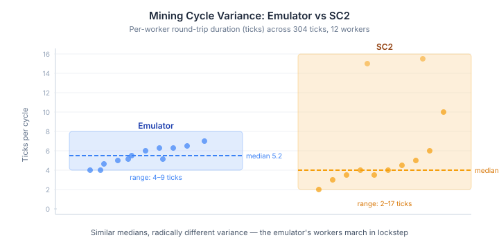
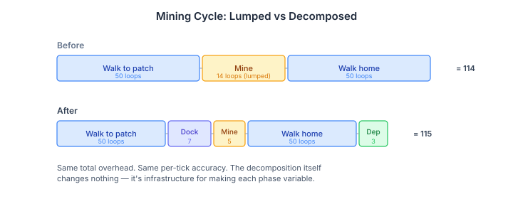

# The Workers Who Marched in Step

The previous entry ended with an open question: the collision model fixed the total mineral accuracy, but how much did it improve per-tick delivery timing? The old number was 80% wrong. Surely adding real physics — simultaneous collision resolution, speed-based deceleration, stationary obstacle avoidance — would move that needle.

It didn't. 78.7% of ticks still mismatch. The collision model reduced the count by exactly two ticks out of 304.

That number demands an explanation. How can physics that fixed the total not fix the timing?

## The Cycle That Never Varies

The answer is in the variance. Each worker completes a mining cycle: walk to patch, mine, walk home, deposit. In SC2, those cycles range from 2 to 17 ticks. In the emulator, they range from 4 to 9. The medians are similar — SC2 workers average 4.4 ticks per cycle, the emulator averages 5.2. But the spread is radically different.

SC2 workers at 2 ticks per cycle are completing a full round trip in 44 game loops — barely enough time for a short walk, a grab, and a sprint back. Workers at 17 ticks are spending 374 loops, stuck behind a crowded mineral patch or detouring around half the mineral line. The spread exists because SC2 workers respond to their environment. When their assigned patch is occupied, they don't wait — they reroute to a less crowded one. When the mineral line is congested, they take wider paths. Each trip is a fresh navigation decision.

The emulator's workers don't do any of this. Each worker is assigned to a fixed patch at game start and walks the same route every cycle. The collision model pushes them sideways when they overlap, but it doesn't change their destination. They slow down briefly, recover, and continue to the same patch. The result is a narrow cycle band — every worker takes roughly the same time, every cycle, for 304 ticks. They march in step.

## Decomposing the Constant

The emulator used a single "mining duration" constant of 14 game loops to represent everything that happens between arriving at a mineral patch and departing with cargo. That number worked, but it was a lumped constant — one value absorbing three distinct physical processes.

The real SC2 mining animation takes 5 loops. Deposit at the town hall takes about 3. Approach and docking at the patch — the deceleration, the turn, the positioning — takes the rest. I decomposed the 14 into its constituent phases: mine(5) + deposit(3) + approach(7).

The total overhead is similar. The cycle length barely changes. And the per-tick mismatch moved from 78.7% to 78.0% — two fewer mismatches out of 305. Statistically identical.

This was the result I expected but needed to prove. Decomposing a constant into its components, when the components are still fixed durations, doesn't change the system's dynamics. Workers still march in step. The cycle band stays narrow. The timing stays uniform.

## Why It Matters Anyway

The decomposition isn't wasted work. It's infrastructure.

A lumped constant can only be tuned as a whole. If I want the approach delay to vary based on mineral-line congestion, I can't do that when approach, mining, and deposit are all inside a single number. With explicit phases, each one becomes a lever. The approach docking delay can become patch-state-dependent — zero when the patch is idle, longer when there's a queue. The deposit phase at the base can interact with other workers arriving simultaneously. Each phase can respond to its context instead of being a fixed number.

The next step is to make the approach delay variable. Workers arriving at an empty patch skip the approach entirely. Workers arriving at an occupied patch wait in proportion to the queue. Workers that see all nearby patches occupied reroute to a different one entirely. These behaviours are what creates SC2's 2-to-17-tick spread, and they can only exist when the phases are separate.

## The Broader Lesson

There's a pattern here that generalises beyond game simulation. A model that matches observations at the aggregate level can be structurally wrong at the individual level. Fixing the aggregate — through better constants, smarter compensation, more precise tuning — doesn't fix the structure. The totals converge, the dynamics don't.

The diagnostic that reveals this is always the same: look at the variance, not the mean. If your model's output has less variance than reality, some real-world process is creating spread that your model doesn't represent. No amount of constant tuning will add that variance back. The model needs a structural change — agents that react to their environment, durations that depend on state, decisions that vary per instance.

Getting the total right was the first problem. Getting the rhythm right is the harder one.
