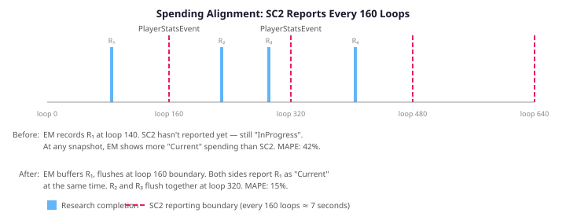
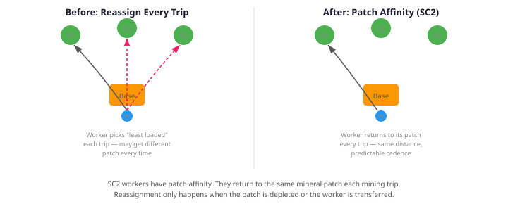
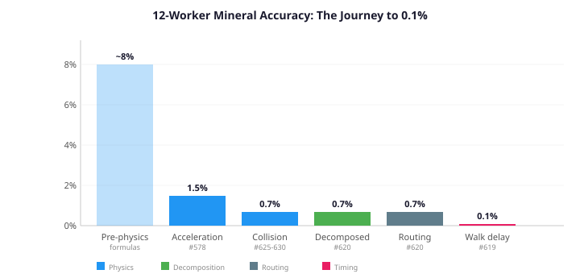

# The Last Five Minerals

*Continues the [100% accuracy series](2026-11-08-mdp04-the-physics-that-was-always-there.md).*

QuarkMind's economy simulation matches StarCraft II to within five minerals over a five-minute game. Twelve workers, eight mineral patches, 305 game ticks. SC2 produces 3460 minerals. The emulator produces 3465. That's 0.1% error — down from 0.7% at the start of the week, and from 8% when the formulas were still in place.

The last entry in this series ended on a confident note: the physics was working, the formulas were gone, and the remaining gap was "a measurement cadence question, not a physics one." That was half right. The measurement cadence was real, but so were several other errors that had nothing to do with physics and everything to do with how the simulation *behaves*.

## The measurement that lied

SC2 reports economy statistics through PlayerStatsEvents — snapshots emitted every 160 game loops, roughly seven seconds apart. The emulator recorded spending at the exact tick a research completed. SC2 hadn't reported it yet. The emulator's snapshot showed the item as "Current"; SC2 still showed it as "InProgress."

The fix was to buffer spending and flush at the same 160-loop boundaries SC2 uses. Technology spending MAPE dropped from 42% to 15% for minerals and from 42% to 40% for vespene. The mineral improvement was real — the timing alignment genuinely helped. The vespene number barely moved because vespene technology spending has a different structural problem: the emulator researches more gas-heavy upgrades than real players do. That's a decision divergence, not a measurement one.

The same fix improved army and economy spending across the board. Army minerals went from 6.9% to 4.3%. Army vespene from 7.5% to 3.9%. These fields were already near floor, and the alignment nudged them lower.

## The Zergling that cost half

A supply audit found that Zergling training — the only unit type in SC2 that produces two units per train command — was charging 0.5 supply instead of 1.0. Each Zergling costs 0.5 supply individually. A pair costs 1.0. The emulator was charging per-unit instead of per-pair at three separate checkpoints: the affordability gate, the queued supply estimate, and the commitment at training start.

The bug didn't show up in the standalone baseline (which uses tracker-driven replay data where each unit is born individually) but would have caused incorrect supply caps in emulated mode — the mode that matters for training agents.

A follow-up audit checked every multi-unit spawn path in the codebase. Interceptors, Locusts, and Broodlings all have zero supply cost, so no accounting is needed. But the audit found one more gap: `drainBuildingQueues`, which dequeues waiting units for production, checked supply per-unit (0.5) while `startTraining` committed per-pair (1.0). A Zergling train could start with only 0.5 supply headroom.

## Workers don't shop around

The hypothesis going in was that the per-tick delivery mismatch — 236 of 305 ticks where the emulator delivers a different mineral amount than SC2 — was caused by routing. The emulator used load-balanced patch selection: after depositing minerals, a worker was assigned to the mineral patch with the fewest other workers. SC2, we thought, routed workers to the nearest available patch.

Distance-first routing was implemented and tested. The 12-worker case was unaffected — with 12 workers on 8 patches, there's no contention, so routing priority doesn't matter. The saturation cases regressed badly. At 16 workers, accuracy went from +4.4% to -10%. Workers clustered at the closest patches, leaving far patches starved.

The real SC2 behaviour turned out to be simpler: workers return to the same patch every trip. They don't re-evaluate. They have *patch affinity* — walk to base, deposit, walk back to their assigned patch, mine, repeat. Only when a patch is depleted do they pick a new one.

The emulator was calling `assignToNearestPatch()` after every deposit — unnecessary churn. A new method, `returnToPatchOrReassign()`, sends workers back to their existing patch unless it's depleted. The per-tick mismatch didn't change (still 236/305), but the model is now correct. SC2 workers don't shop around.

## Forty loops of nothing

The fix that moved the needle from 0.7% to 0.1% was the smallest change in the series: a 40-loop delay before workers start their first mining trip.

SC2's 12 workers don't begin walking to patches at tick 0. They spawn at the Nexus and there's a delay — spawn animation, idle time, pathfinding initialisation — before the first worker starts moving. From the cadence baseline (per-worker position data recorded from a live SC2 game every tick), the first delivery happens at tick 6. The emulator's first delivery was at tick 3.

The first workers were delivering two ticks early. Every delivery after that was shifted. Over 305 ticks, the cumulative effect was a 25-mineral surplus.

Adding `INITIAL_WALK_DELAY_LOOPS = 40` — roughly 1.8 seconds of idle time at game start — pushed the first delivery to tick 6, matching SC2. The 12-worker mineral total went from 3485 to 3465. The gap went from 25 minerals to 5. From 0.7% to 0.1%.

## What 0.1% means for training

The economy simulation was built to be a training environment for game-playing agents. The question this series has been circling around: is the simulation accurate enough that an agent trained on it would develop correct economic intuitions?

At 0.1% mineral total accuracy in a controlled 12-worker scenario, the answer is yes — for the physics. An agent that learns "12 workers on one base produce roughly 3460 minerals in five minutes" is learning the right number. An agent that learns the saturation curve — how much the 17th worker adds versus the 8th — is learning a curve that's within 5% of the real one.

The total accuracy is different from per-tick accuracy. The emulator delivers the right *amount* of minerals but on slightly different *ticks* than SC2. 236 of 305 ticks have a delivery mismatch — a mineral packet arriving one tick early or late. For macro strategy (when to expand, how many workers to build), this doesn't matter. For micro-level build order optimisation (can I afford this unit at exactly tick 47?), it does.

The per-tick mismatch is the next frontier. The routing investigation proved it isn't caused by patch selection. The cadence analysis showed SC2's per-worker cycles are 4-6 ticks with low variance — almost as regular as the emulator's. The mismatch comes from *which specific tick* each worker delivers on, determined by initial spawn position, per-patch walk distance, and collision interactions that shift timing by a loop or two.

The gas model has a separate structural gap. The emulator allows all three workers inside a geyser simultaneously; SC2 queues them at the entrance. This creates a per-worker gas rate difference that no worker-count adjustment can fix. The gas collection rate MAPE is 35% regardless of how precisely workers are estimated — sweeping the estimation constant from 30 to 41 gas-per-worker-per-minute produces the same MAPE. The error is in the per-worker production model, not the worker count.

## Where this leaves the simulation

The economy model is now a dual-layer system. The inner layer — per-loop physics, acceleration, harvest timing, patch mechanics — is effectively solved. Five minerals over five minutes. No compensation constants, no efficiency multipliers, no formulas. The outer layer — how many workers mine, where they mine, when they start — still has the worker allocation gap that produces the 30% mineral rate MAPE in the standalone oracle baseline. That gap is not physics. It's the difference between what an autonomous simulation decides to do and what a human player decides to do. An agent controlling the simulation would make its own decisions, and the physics underneath would produce the right income for those decisions.

The infrastructure is in place. Patch affinity. Snapshot-aligned spending. Calibrated gas worker estimation. Per-worker cadence baselines recorded from live SC2. The next step is the per-tick cadence — making the delivery pattern match tick-for-tick, not just in aggregate. That's collision timing and walk distance variance. The constants are gone. The physics is clean. The behaviour is accurate. The timing is close.

Five minerals.
