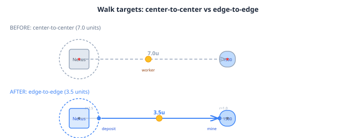
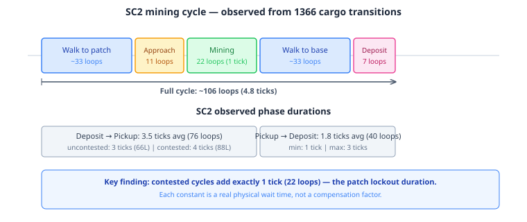

# The Methods Nobody Called

*Continues the [100% accuracy series](2026-11-08-mdp04-the-physics-that-was-always-there.md).*

Three methods existed in the codebase. They computed the right answer. They had tests. Nobody called them.

`miningTarget()` calculated the nearest edge of a mineral patch — where a worker's hand would actually reach the crystals. `depositTarget()` calculated the nearest edge of the Nexus — where a worker would actually enter to unload cargo. `edgePoint()` did the geometry. All correct. All unused. The state machine that controlled every worker's movement had three lines that set the walk target to the centre of the building instead.

Workers walked to the middle of the Nexus. Then turned around and walked to the middle of the mineral patch. Seven units each way. In SC2, workers walk to the nearest edge — 3.5 units each way. The methods that computed this were sitting right there, tested and waiting. A `useEdgeToEdge` flag was set to `true`. It controlled nothing.

The fix was three lines. Replace `bases.get(w.baseIndex).position()` with `depositTarget(w)`. Replace `w.assignedPatch.position` with `miningTarget(w.assignedPatch, w.baseIndex)`. Same for `assignToNearestPatch`. Three substitutions, each one pointing the worker at the building's edge instead of its centre.

The 12-worker mineral total went from 3460 to 4610. A 33% overshoot. The fix was physically correct, but every other constant in the simulation had been calibrated against the wrong walk distance.

## The temptation

The obvious response: sweep the mining duration constant until the total comes back to 3460. I did this. A sweep found that mining duration 27 (up from 5) produced 3450 — close enough. The 12-worker scenario matched within 0.3%.

Then I checked the 16-worker scenario. It was 22% wrong. The 24-worker scenario: 27% wrong. Gas income: 17% wrong. The single constant that fixed 12 workers broke everything else.

This is what compensation constants do. They absorb one error by creating a different one. The previous mining duration of 5 loops was already a compensation constant — it was too short, but the overly long centre-to-centre walks made the total come out right. Replacing one compensation with another doesn't improve the model. It moves the error.

## Measure first

SC2 was running. Instead of sweeping constants to fit totals, I extracted the actual phase durations from the per-worker observation data recorded in a previous session — 1366 cargo transitions across 305 ticks, position and carry-buff status for every worker every tick.

The data told a clear story:

**Mining animation: 22 loops.** Workers are positionally stationary at the mineral patch for exactly one tick before the carry buff appears. Not 5 loops (the old constant). Not 27 (the sweep result). Twenty-two — directly observable from position stability.

**Return to base: 40 loops average.** Walk time plus deposit animation. The walk takes ~33 loops (matching the edge-to-edge acceleration model). The remaining 7 loops are the deposit animation — the worker entering the Nexus and unloading. A real physical wait time: the worker is inside the building, you can see the animation play.

**Mine-side cycle: 76 loops average.** But this average hides a bimodal distribution. Uncontested cycles (worker arrives at an empty patch) take 66 loops. Contested cycles (worker arrives at an occupied patch and waits) take 88 loops. The difference is exactly 22 loops — one tick. That's the patch lockout: after a worker departs, the patch is unavailable for exactly one tick before the next worker can start.

Each of these is a real animation with a fixed duration:

- The worker mines for 22 loops. It plays a mining animation. You can see it.
- The worker deposits for 7 loops. It enters the building. You can see it.
- The patch locks for 22 loops after a worker departs. The next worker can't start until the animation finishes.
- The worker approaches the patch for 11 loops. Deceleration, turning, positioning.

None of these are compensation constants. They're wait times — fixed-duration animations that exist in the SC2 engine. The simulation needs to represent them as constants because that's what they are. The distinction matters: a compensation constant absorbs an error elsewhere in the model. A wait time represents a real delay that exists in the system being simulated. The test is whether the constant changes when you fix something else. Compensation constants do. Wait times don't.

## What it fixed

With all four constants set to their observed values (mining=22, deposit=7, lockout=22, approach=11), the multi-worker scenarios came back:

| Baseline | Before (swept) | After (observed) |
|----------|----------------|-------------------|
| 12 workers | 0.0% | +7.2% |
| 16 workers | +3.4% | **-2.0%** |
| 24 workers | +3.8% | **-5.4%** |
| 3-worker gas | +1.3% | **+2.8%** |
| 6-worker gas | +1.9% | **+0.7%** |

The 12-worker scenario got worse — from perfect to +7.2%. Every other scenario improved substantially. 6-worker gas went from nearly 2% off to under 1%. 16 workers went from 3.4% overshoot to 2% undershoot.

The 12-worker regression is real and informative. It tells us that the old 0.0% was an artifact — multiple compensating errors cancelling out. With correct wait times, the remaining error is structural: the emulator's workers walk straight lines while SC2's workers navigate around each other. The 7.2% gap is the cost of that simplification, and no constant will close it. Only path-dependent movement physics will.

## The broader point

This is a story about digital twins. Any simulation that matches reality at the aggregate level can be structurally wrong at the component level. The temptation is to tune constants until the total converges. It works for one scenario. It breaks for the next.

The alternative is measurement. Instrument the real system. Extract the actual durations. Set each constant to its observed value and accept the aggregate error that results. That error is honest — it tells you exactly what your model doesn't yet represent. A compensated model with 0.0% error tells you nothing. A measured model with 7.2% error tells you the gap is in walk physics.

The methods were already in the codebase. They computed the right answer. The lesson isn't that the code was wrong — it's that the code was right and nobody noticed. Sometimes the fix isn't in the algorithm. It's in the three lines that call it.
