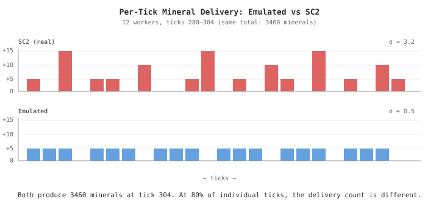

# Right Total, Wrong Heartbeat

*Continues the [100% accuracy series](2026-11-11-mdp01-the-methods-nobody-called.md).*

Seventy-three issues into calibrating QuarkMind's economy simulation against real StarCraft II, the totals are close. Twelve workers mining for five minutes produce 3460 minerals in SC2 and 3525 in the emulator — 1.9% error. Six workers on two gas geysers land within 0.7%. Saturation curves track. The aggregate numbers say the simulation works.

The per-tick data says something different.



At 80% of individual game ticks, the mineral delivery count is wrong. Not wrong by a lot — usually off by 5 minerals, one cargo load. But wrong. The emulator delivers minerals in a metronomic rhythm: +5, +5, +5, pause, +5, +5, +5, pause. SC2's rhythm is ragged: +5, nothing, +15, nothing, nothing, +10, +5, nothing. Both sum to the same total. The heartbeat is different.

The variance tells the story. SC2 worker cycles span 2 to 17 ticks, with a standard deviation above 3. Workers collide at the mineral line, get blocked, take longer paths, queue behind each other. The emulator's workers walk straight lines with an acceleration model, and their cycles span 4 to 9 ticks with a standard deviation of 0.5. They march in step because nothing in the physics makes them do otherwise.

## Why cadence matters

A game AI that plans build timings needs to know when minerals will arrive, not just how many will arrive eventually. The difference between receiving 10 minerals at tick 200 and receiving 5 at tick 199 plus 5 at tick 201 is whether you can start training a Marine on tick 200. Aggregate accuracy tells you the economy is producing enough. Cadence accuracy tells you *when* enough becomes available.

This is the practical difference between **accuracy** and **fidelity**. Accuracy means the output numbers match. Fidelity means the output *behavior* matches — the distribution, the timing, the variance. A digital twin with high accuracy and low fidelity is a model that gives right answers on questions you already know and wrong answers on questions you don't. It interpolates but it can't extrapolate, because the mechanism that produces the right total is not the mechanism that produces the total in the real system.

The economy simulation spent its first fifty issues reaching aggregate accuracy: getting mineral and gas totals to converge by decomposing the mining cycle, measuring animation durations, calibrating walk speeds. Each fix brought the totals closer. Each fix also revealed that the *cadence* — the tick-by-tick delivery pattern — was barely changing. Compensation constants masked this: when the total was 0.0%, it felt like the simulation was correct. When the constants were replaced with measured physics values and the total regressed to 7.2%, the aggregate got worse but the simulation got more honest. The error now tells you exactly what's missing: path-dependent worker movement.

## The zombie that nobody noticed

A concrete version of the same problem surfaced today. QuarkMind's SC2 transport layer runs a game loop in a virtual thread. When the loop ends — win, loss, or interruption — it cleans up the socket and exits. The code path for explicit quit requests sent a `RequestQuit` to SC2, asking it to shut down. The code path for natural game endings (the AI opponent wins before the measurement completes) did not.

```java
// Before: only quit on explicit request
if (quitting.get()) {
    sendSync(Request...setQuit(...));
}

// After: always quit
sendSync(Request...setQuit(...));
```

SC2 stayed alive at 9.6 GB. Everything looked correct from the test output — the game ended, results were recorded, the test passed. But the process was still running, invisible until you checked the system monitor. The behavior was right (game ends, test passes). The mechanism was wrong (process still alive). Same pattern: correct output, incorrect internals.

## What's left

The remaining work is a dependency chain. The mining cycle's approach phase is a fixed constant (7 loops). In SC2, approach time depends on patch contention — a worker arriving at an empty patch starts mining immediately, while a worker arriving at an occupied patch waits. Making approach time state-dependent is the entry point. Variable approach creates variable cycle times. Variable cycle times create the cadence variance that's currently missing.

No constant will produce this. The variance has to emerge from the simulation's own mechanics — workers responding to the state of the mineral line as they find it, not executing a predetermined schedule. The aggregate total will probably stay within a few percent either way. The heartbeat will change.

That's the bet behind this work: a simulation that produces the right total for the right reasons is more useful than one that produces the right total by accident. The right reasons let you change the inputs — add workers, lose a base, expand earlier — and still get a plausible answer. The accidental total only holds for the exact scenario it was calibrated against.

Seventy-three issues to learn the difference between getting the answer right and getting the physics right. The aggregate converged weeks ago. The heartbeat is still wrong. That's where the value is.
