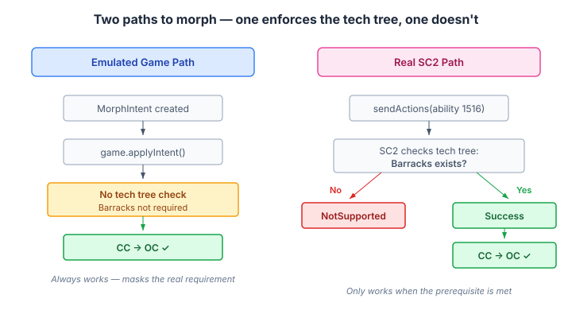

SC2's morph API had been silently rejecting our Command Center → Orbital Command morph for weeks. The command fired, SC2 responded, and nothing happened. No error in the logs. No exception thrown. The CC sat there, unchanged, while the emulated game happily morphed the same building every time.

The divergence was total — same code path, same ability ID, different outcomes.

## The silent discard

`QuarkusSC2Transport.sendActions()` builds a protobuf `RequestAction`, sends it over the wire, and checks `response.getErrorCount()`. That's the top-level error — "the wire protocol broke." But SC2's `ResponseAction` also carries a per-action `ActionResult` list, one entry per command sent. We never looked at it. Every morph command we sent came back with `NotSupported`, and we threw the answer away.

The first fix was mechanical: add `sendActionsWithResults()` that returns those per-action codes. Once we could see what SC2 was telling us, the investigation could begin.

## Three wrong hypotheses

The initial assumption was queue contention. The playbook runs `train: SCV loop: continuous`, keeping the CC's production queue busy. Maybe the morph needed an idle building? We tested: `CANCEL_LAST` then morph, frame delays between cancel and morph, `setQueueCommand(true)`. None of it mattered — the result was always `NotSupported`.

The second hypothesis was wrong ability IDs. The ocraft library maps `MORPH_ORBITAL_COMMAND` to ability 1516. We queried the CC's available abilities via `RequestQueryAvailableAbilities` and got back five IDs: 203, 416, 417, 524, 1. No 1516 anywhere.

Ability 416 looked promising — it wasn't Smart, wasn't Train, wasn't Rally. We sent it. SC2 returned `Success`. No morph happened, no minerals deducted. We queried the ability data to find out what we'd actually told the CC to do.

```
id=416  name=CommandCenterTransport  friendly=LoadAll CommandCenter
id=417  name=CommandCenterLiftOff    friendly=Lift CommandCenter
id=1516 name=UpgradeToOrbital        friendly=Morph OrbitalCommand
```

We'd told the CC to load all nearby units. It obliged. The morph ability — 1516 — existed in SC2's data, was correctly mapped by ocraft, and was the right ability. It just wasn't available on this CC.

## The prerequisite we never checked

In StarCraft II, morphing a Command Center to an Orbital Command requires a Barracks. No Barracks, no morph ability. SC2 doesn't surface 1516 in the available abilities list until the tech prerequisite is met.

Our playbooks build structures via the debug API (`DebugCreateUnit`), and the economy-only-terran playbook builds Supply Depots and a second Command Center. No Barracks.

The emulated game's `applyIntent()` accepts the morph unconditionally — no tech tree check. So the morph always worked in the emulator. Every calibration run, every dual-run comparison, every test. The gap was invisible.



We added `build: BARRACKS at: 16 supply` to the three affected playbooks, re-ran the calibration tests, and the morph worked on the first frame — `Success`, minerals deducted, Orbital Command visible after the 25-second morph time.

## The broader pattern

This is a failure mode anyone running a simulator alongside a real system will recognise. The simulation simplifies. It has to — that's the point. But every simplification is a hidden assumption, and hidden assumptions only surface when you test against the real system.

The emulated game doesn't enforce tech tree prerequisites because they're not relevant to economy modelling. Until they are. The playbook needed a Barracks not for any economic reason but because SC2 won't let you build an Orbital Command without one. The emulator's economy was correct; its game rules were incomplete.

Mocks that don't enforce the same constraints as the real service are the same pattern, different domain. A mock payment gateway that accepts any card number. A test database that skips foreign key checks. A local OAuth provider that doesn't validate scopes. The code works perfectly in the simplified environment. It fails silently in production, and the error response — if you're even reading it — says something like `NotSupported`.

The fix for the morph was two lines of YAML. The fix for the pattern is: read the response codes your real system gives you, and don't trust your simulator's silence.
