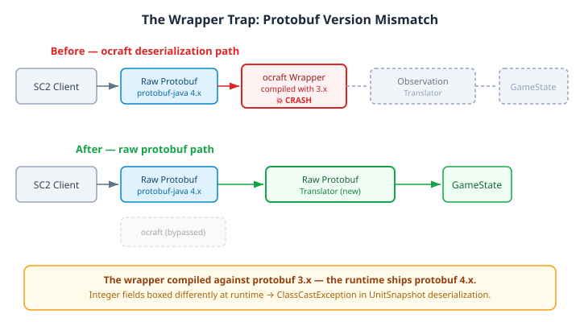

# The Wrapper That Stopped Wrapping

ocraft-s2client-protocol is the only Java library for talking to StarCraft II. It wraps Blizzard's raw protobuf API with typed Java objects — `ResponseObservation`, `Observation`, `Unit` — so you don't have to work with generated protobuf stubs directly. Version 0.4.21, released December 2024, is the latest. There won't be another.

The crash was immediate and opaque:

```
f != java.lang.Integer
```

Every call to `ResponseObservation.from()` died. No stack trace pointing to a field name. No hint at which of the dozens of integer fields in `UnitSnapshot` was the problem. Just a type mismatch deep inside ocraft's deserialization layer, killing the entire SC2 observation pipeline.

## The real cause wasn't in the library

The obvious hypothesis — a SC2 API schema change in Base96883 — was wrong. The protobuf schema hadn't changed. What changed was the *runtime*.

ocraft was compiled against protobuf-java 3.x. Quarkus pulls in protobuf-java 4.35.0. The two are wire-compatible — a message serialised with 3.x deserialises correctly with 4.x. But they aren't *reflection-compatible*. protobuf-java 4.x changed how `uint32` and `int32` fields are boxed internally. ocraft's 3.x-compiled code calls a method that expects `Integer`; the 4.x runtime hands it a `Float`. The crash happens not at the protobuf wire level but at the Java boxing level — a layer that most developers never think about.



The diagram makes the problem visible. The raw protobuf path (project-owned, compiled against protobuf-java 4.x) works perfectly. The ocraft wrapper path (third-party, compiled against protobuf-java 3.x) crashes the moment it touches any observation with integer fields — which is every observation.

## What wrapper libraries actually give you

A good wrapper library earns its place by doing three things:

1. **Type safety over raw serialisation.** Instead of `obs.getObservation().getRawData().getUnitsList()` you write `obs.getRaw().get().getUnits()`. The wrapper maps protobuf's generated types to domain-appropriate Java types with proper Optionals, enums, and typed collections.

2. **Version insulation.** When the upstream API changes fields or types, the wrapper absorbs the delta. Your code stays the same.

3. **Idiom translation.** Protobuf's builder pattern and repeated-field semantics map awkwardly onto Java idioms. Wrappers smooth that out.

ocraft did all three of these well — when it was maintained. The problem is that benefit (2) only works if someone is actively absorbing those deltas. The moment a wrapper library stops tracking the upstream it wraps, it becomes the opposite of insulation. It becomes a *fixed coupling to a specific version of two things*: the upstream API and the serialisation runtime. When either moves, the wrapper breaks.

## The fix pattern

The fix isn't to patch ocraft. A fork buys you one fix and a permanent maintenance commitment. The fix is to remove the wrapper from the critical path.

QuarkMind's `SC2FrameCallback` interface — the contract between the transport layer and every agent implementation — originally took ocraft's `Observation` type:

```java
void onStep(Observation obs) throws InterruptedException;
```

After the fix:

```java
void onStep(Sc2Api.Observation obs) throws InterruptedException;
```

`Sc2Api.Observation` is the raw protobuf type, generated by `protoc` and compiled against the same protobuf-java 4.x that Quarkus ships. There is no version gap. The generated code and the runtime are from the same release. The crash is structurally impossible.

The new `ObservationTranslator` overload maps directly from raw protobuf to the domain model:

```java
public static GameState translate(Sc2Api.Observation obs, MapInfo mapInfo) {
    Raw.ObservationRaw raw = obs.getRawData();
    List<Raw.Unit> allUnits = raw.getUnitsList();
    // ... filter by alliance, map to domain types
}
```

The mapping logic is identical to the ocraft path — same unit type classification, same building detection, same resource extraction. The only difference is the input types. ocraft's enum types (`Units`, `Abilities`, `Tag`) are still used for constant lookup — they're simple enums with no deserialization dependency.

## The broader pattern

This isn't an ocraft problem. It's a *wrapper library lifecycle* problem, and it shows up across the Java ecosystem:

- **protobuf-java 3.x → 4.x** broke binary compatibility for any library compiled against 3.x that uses reflection-based field access. Libraries that deserialise protobuf messages by calling generated `getField()` methods through the old boxing path fail silently or crash at runtime.

- **Jakarta namespace migration** (javax.* → jakarta.*) broke every library compiled against Java EE 8 that hadn't been recompiled. Same pattern: wire compatibility survives, but type-level compatibility doesn't.

- **Jackson major version bumps** routinely break wrapper libraries that depend on internal serialisation behaviour.

The common thread: wrapper libraries couple your code to *two* dependency trees — the upstream API *and* the wrapper's view of the runtime. When the wrapper stops being maintained, those two trees diverge, and your code is trapped between them.

## When to wrap, when to go raw

Wrapper libraries are worth using when all three conditions hold:

1. **The upstream API is stable and complex.** Wrapping a 200-endpoint REST API that changes quarterly is worthwhile. Wrapping a protobuf schema that changes once per game release is less obviously necessary.

2. **The wrapper is actively maintained.** "Last release: 6 months ago" is a warning. "Last release: 2 years ago" is a statement.

3. **Your framework doesn't already handle the underlying protocol.** If Quarkus ships protobuf-java 4.x and you're consuming protobuf messages, the generated stubs already work. Adding a wrapper on top adds a version-coupling point for no structural benefit.

When any of those conditions fails — and especially when (2) fails — the raw API is the safer path. It's more verbose, but verbosity you control beats brevity that crashes at runtime.

The 11 files changed in this fix could have been zero files if we'd started with raw protobuf. That's the cost of a wrapper that stopped wrapping.
