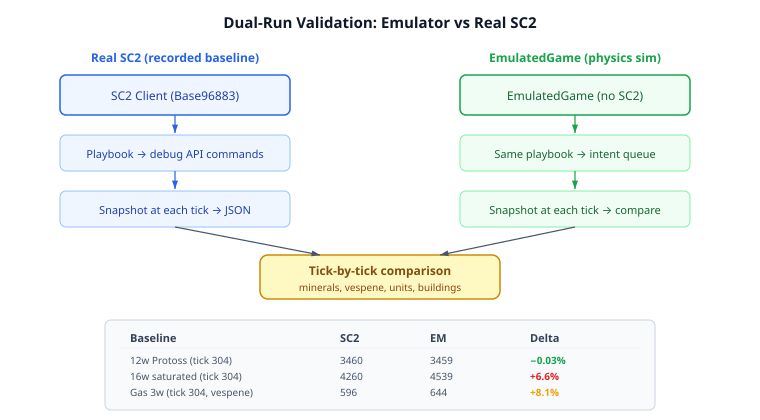

# How Wrong Is Your Simulation?

The hardest question in simulation engineering isn't "does it work?" — it's "how wrong is it, and where?"

QuarkMind's EmulatedGame simulates StarCraft II's economy at game-loop granularity. Workers mine minerals, harvest gas, build structures, transfer between bases. The simulation runs at roughly 1000x real-time on a single core. That speed is the whole point — training an AI against the real SC2 client takes minutes per game. Training against the emulator takes milliseconds. But only if the emulator is accurate enough that strategies learned in simulation transfer to the real game.

Two weeks of calibration work later, I can now answer the accuracy question with numbers.

## The dual-run method

You can't measure simulation accuracy by looking at the simulation. You need ground truth from the real game, collected under identical conditions.

The dual-run approach runs the same scripted playbook against both the real SC2 client and the EmulatedGame, then compares tick-by-tick snapshots:

Each playbook is a YAML script that produces a deterministic game state — train 12 workers, mine for 304 ticks, record minerals. The SC2 baseline is recorded once via the debug API (spawn buildings, observe economy, capture snapshots to JSON). The EmulatedGame runs the same playbook offline and compares its snapshots against the recorded baseline. First divergence stops the comparison — there's no point comparing tick 200 if tick 50 already has the wrong number of units.

The playbooks are deliberately simple. A 12-worker mineral-only baseline isolates mining physics from strategy, production, and combat. A 3-worker gas baseline isolates gas harvesting. A 16-worker baseline reveals saturation behaviour. Each playbook tests one thing.

## Where we are

The headline number is 0.03% mineral accuracy at 12 workers — the emulator produces 3459 minerals where SC2 produces 3460 at tick 304 (~135 seconds of game time). That's one mineral off. For all three races.

But that's the easy case. At higher worker counts, the accuracy degrades:

| Scenario | SC2 | Emulator | Delta |
|---|---|---|---|
| 12 workers, minerals only | 3460 | 3459 | −0.03% |
| 16 workers, saturated | 4260 | 4539 | +6.6% |
| 3 workers, gas + minerals | 596 gas | 644 gas | +8.1% |

The emulator over-produces at saturation. The reason is structural: real SC2 workers have per-cycle variance in their mining animations — the real game's maximum cycle time is 17 ticks, but the emulator's maximum is 9. That variance affects how workers contend for mineral patches when there are more than two workers per patch.

## What simulation accuracy actually requires

The tempting approach is to model more detail — explicit deposit time at the town hall, approach and docking animation at the patch, per-worker path contention. I tried all three. A full 3D parameter sweep across 288 combinations of deposit time, mining duration, and gas harvest duration showed that the current "lumped constant" architecture — where overhead is absorbed into a single mining duration value — is within 1.3% of the best any three-parameter model can achieve.

The insight: the overhead components (deposit, docking, contention) interact non-linearly. Modeling them separately doesn't improve on lumping them together, because the lumped constant was calibrated against the same oracle data. The model has reached its architectural ceiling.

Getting past 6.6% requires a different kind of change — not better constants, but different phases. The mining cycle needs decomposition into explicit walk, mine, deposit, and wait stages, each with their own timing and contention model. That's the next phase of work.

## Why this matters beyond games

The pattern — simulate fast, validate against the real system — shows up everywhere a simulation is used for training or planning:

- **Robotics sim-to-real:** train a controller in MuJoCo or Isaac Sim, deploy on hardware. The domain gap between simulation and reality determines whether the trained policy transfers. Measuring that gap requires the same dual-run approach: run the same trajectory in both environments, compare state at each timestep.

- **Financial backtesting:** a trading strategy backtested on historical data is a simulation. The question isn't whether it was profitable in simulation — it's how the simulation's market model diverges from real market microstructure. Slippage, latency, and liquidity are the "lumped constants" that absorb unmodeled physics.

- **Digital twins in manufacturing:** a factory floor simulation predicts throughput and bottlenecks. Its accuracy depends on whether the simulated machine cycle times, material handling delays, and queue contention match reality. Calibrating against real sensor data is the dual-run.

In each case, the simulation is only useful to the extent that you can quantify its error. "It looks about right" isn't engineering. A measured 6.6% mineral delta at 16-worker saturation is — because it tells you exactly where the model breaks and what architecture change would fix it.

## The validation infrastructure

Accurate measurement requires infrastructure that's easy to undervalue. The SC2 dual-run pipeline needed:

- A **raw protobuf transport** that works with the current SC2 client — the Java wrapper library we'd been using crashed on recent SC2 builds due to a protobuf version mismatch
- A **process lifecycle manager** that cleans up the SC2 client after each test run — without it, abandoned SC2 processes accumulated at 9.6GB each
- A **complete action pipeline** mapping every game intent to SC2 API ability IDs — 82 upgrade types, 7 ability types, the full train/build/morph/research vocabulary
- **Playbook-driven test harnesses** that produce deterministic, isolated scenarios

None of this is the simulation itself. It's the measurement apparatus. But without it, you're calibrating against stale data — or not calibrating at all.

The emulator is still 6.6% wrong at saturation. Now I know exactly why, and the next step is decomposing the mining cycle into explicit phases. That's a structural change, not a constant tweak — which is exactly what a good measurement tells you.
