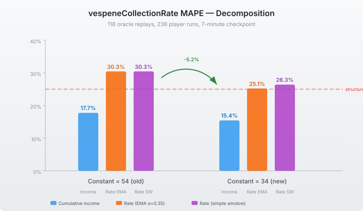

# The Constant That Explained Everything

QuarkMind simulates StarCraft II's economy tick-by-tick — 22 game loops per tick, real worker physics, real harvest durations. The simulation's vespene gas collection rate was 30% wrong, measured against 118 real SC2 replays. I'd already fixed the rate computation algorithm (SC2 uses EMA smoothing, not a simple window — a 39% algorithmic error that, once corrected, changed nothing about accuracy). Sweeping the gas worker estimation constant from 30 to 41 didn't help either. Same MAPE regardless of the constant, regardless of the algorithm.

The error was somewhere else entirely — or that was the working hypothesis.

I was wrong about the "somewhere else" part.

## The Decomposition

The vespeneCollectionRate MAPE is one number. It blends at least three independent error sources: how much gas the EmulatedGame actually mines, how it converts that income to a reported rate, and how many workers it assigns to geysers. To fix the number you have to take it apart.

I wrote a diagnostic that separates the 30% into its components. For each of 236 player runs across 118 oracle replays, it tracks three things at every tick: cumulative gas mined (EmulatedGame vs ground truth from PlayerStatsEvents), the EMA-smoothed rate (current EconomyTracker output vs GT rate), and a simple-window rate computed from the same EM income using SC2's own delta-over-elapsed formula.

The results split cleanly:

| Component | MAPE (constant=54) | MAPE (constant=34) |
|-----------|--------------------|--------------------|
| Cumulative income | 17.7% | 15.4% |
| Rate (EMA) | 30.3% | 25.1% |
| Rate (simple window) | 30.3% | 26.3% |

Two facts fell out immediately.

First: EMA vs simple window doesn't matter at the 7-minute checkpoint. Both give 30.3%. The algorithm fix three days ago was correct — matching SC2's smoothing is the right thing to do — but it is not an accuracy lever. The rate MAPE tracks the income MAPE, not the smoothing method.

Second: the EmulatedGame systematically under-produces gas. Of 134 player runs with gas mining active at 7 minutes, 107 under-produce and 27 over-produce. Average bias: -114 gas per replay. That is not noise. That is a calibration error.

## Where the Gas Goes Missing

The standalone economy test estimates gas worker count from the ground truth's vespeneCollectionRate: `estimatedGasWorkers = Math.round(gtRate / GAS_PER_WORKER_PER_MIN)`. With the constant set to 54, a player whose GT rate is 114 gas/min gets estimated at 2 workers. In reality they have 3.

The simulation's own per-worker gas rate is about 34 gas/min at the default geyser distance. Dividing GT rate by 54 when the actual per-worker rate is 34 means every geyser gets roughly two-thirds of its real workforce. Less workers, less gas, lower rate, 30% MAPE.

To confirm this, I ran a sweep across nine values of GAS_PER_WORKER_PER_MIN from 30 to 60:

| Constant | Income MAPE | Rate MAPE | Income bias per replay |
|----------|-------------|-----------|------------------------|
| 30 | 15.7% | 25.3% | -9.9 |
| 34 | 15.4% | 25.1% | -18.7 |
| 38 | 15.2% | 25.3% | -36.9 |
| 54 | 17.7% | 30.3% | -114.2 |
| 60 | 23.1% | 36.2% | -168.4 |

Income MAPE floors at 15.2% in the 30–44 range. Doesn't matter which constant you pick — 30, 34, 38, 42 — the income error is the same. What changes is the bias: at 30 the simulation is almost unbiased (-9.9), at 54 it's heavily negative (-114.2).

The rate MAPE floors at about 25%. Again, insensitive to the constant in the 30–44 range. The original issue reported that sweeping from 30 to 41 didn't change the MAPE — and it doesn't, because the floor is structural. But the original code was running at 54, well outside the plateau. Moving to 34 captures the 5% of rate MAPE that was coming from worker under-estimation and lands at the structural floor.

## The 25% That Stays

The remaining 25% rate MAPE isn't going anywhere. It comes from three things that can't be fixed by adjusting a single constant:

**Per-worker gas physics.** The simulation models concurrent geyser access — all three workers enter the building simultaneously, harvest for 22 loops, exit, walk home. Real SC2 has entry/exit animations, queuing at the geyser door, and per-worker timing offsets that create a different income signature. The lumped-constant architecture absorbs most of this, but the residual is about 15% of cumulative income.

**Integer worker count rounding.** A GT rate of 90 gas/min with constant 34 estimates 3 workers (90/34=2.6, rounds to 3). A GT rate of 80 estimates 2 workers (80/34=2.4, rounds to 2). The boundary cases create discrete jumps in EM income that don't correspond to anything in the continuous GT signal.

**PlayerStatsEvent cadence.** SC2 reports economy stats every 160 game loops. The rate at any checkpoint reflects the state from up to 7 seconds earlier. When gas workers are being added or removed — which happens constantly in the first few minutes — the GT rate we use to estimate worker count is already stale by the time we act on it.

None of these are bugs. They are architectural limits of converting a discrete, lossy observation signal (GT rate every 160 loops, integer-rounded worker count) into a continuous economic simulation. The 25% is a structural floor.

## Decomposition as Methodology

Every simulation of a real system faces the same problem. The output doesn't match. You have one aggregate error metric. You try adjusting parameters. Some help, some don't, and you can't tell why.

The instinct is to keep sweeping. Try different constants, different algorithms, different smoothing windows. Run the oracle replays again. The MAPE moves a point or two, or it doesn't. You have no signal about whether you're tuning the right thing.

Decomposition breaks the feedback loop. Measure the income separately from the rate computation. Apply both candidate algorithms to the same income stream. Compare bias direction, not just magnitude. Three comparisons, and the picture is clear: the income is the source, the algorithm is the reporter, and the estimation constant is the bridge between observation and simulation.

In our case, 30% decomposed into 5% from a miscalibrated constant and 25% from physics approximation. The 5% took one line to fix. The 25% would take a fundamentally different simulation architecture — individual worker scheduling with animation state machines, frame-level entry/exit at the geyser, per-map distance calibration. That architecture exists as a design option. It is not proportional to the accuracy it would buy.

The first thing the decomposition taught was which component to ignore. The EMA vs simple window comparison looked like the obvious suspect — we'd just discovered SC2 uses EMA, we'd just changed our algorithm. It wasn't the problem. The second thing it taught was where the floor is. Once you know the floor, you stop pushing parameter sweeps through it and start deciding whether the architecture earns a redesign. Most of the time, it doesn't. Knowing that is worth more than the fix itself.
