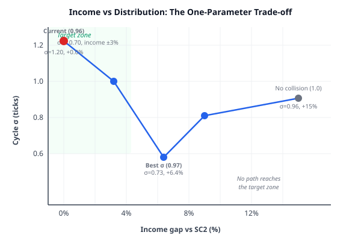

# The Constant That Does Two Jobs

QuarkMind's economy simulation matches StarCraft II's 12-worker mineral income to within 0.6%. Twenty minerals out of 3460. Four extra deliveries in 304 game ticks. That number took weeks of per-loop physics calibration — decomposing the mining cycle into measured phases, recording per-worker delivery timestamps from the SC2 API, eliminating every compensation constant from the codebase.

The income is right. The rhythm is wrong.

## The Distribution

SC2 workers mine with remarkable consistency. Tag-based tracking across five controlled games shows a cycle distribution with σ=0.56 — nearly every cycle lands in a tight 4–6 tick window. The EM's distribution is twice as wide (σ=1.25) and has a tail that SC2 doesn't:

<figure>

```
Cycle | SC2 cnt (%)  | EM cnt (%)   |
  3   |    0 ( 0.0%) |   37 ( 5.5%) |
  4   |   38 ( 5.7%) |  123 (18.4%) |
  5   |  408 (60.7%) |  301 (44.9%) |
  6   |  226 (33.6%) |  122 (18.2%) |
  7   |    0 ( 0.0%) |   52 ( 7.8%) |
  8   |    0 ( 0.0%) |   21 ( 3.1%) |
  9   |    0 ( 0.0%) |   10 ( 1.5%) |
 13   |    0 ( 0.0%) |    1 ( 0.1%) |
```

<figcaption>SC2 vs EM mining cycle distribution (12 workers, 304 ticks, SC2 map positions).</figcaption>
</figure>

SC2's range is exactly 4–6. The EM's is 3–13. The means are close (5.28 vs 5.23) — the total income converges because fast and slow cycles average out — but the shape is qualitatively different.

## Why the Tail Exists

The EM uses a collision speed factor of 0.96. When two workers' collision circles overlap, both get a 4% speed penalty. This penalty persists — the worker has to re-accelerate from the reduced speed. And collisions happen every game loop (every 1/22.4 second). A worker walking through a congested mineral line can hit the same neighbour on consecutive loops, compounding the penalty: 0.96² = 0.92, 0.96³ = 0.88, 0.96⁴ = 0.85.

At 85% of max speed, a walk that normally takes 33 loops takes 39. That's the difference between a 5-tick cycle and a 7-tick cycle.

SC2 workers don't compound this way because they *pathfind*. When two SC2 workers collide, each routes around the other — the path is longer but the speed is unaffected. The EM walks straight lines and takes the speed hit instead. Different physics, same intent: "two workers can't occupy the same space."

## The Dual-Purpose Problem

The collision factor isn't just producing the tail. It's also the mechanism that makes the total income correct.

EM workers walk in straight lines — centre-of-base to edge-of-patch, direct path, no obstacles. Real SC2 workers navigate around the mineral line formation, around other workers, around the town hall. The straight-line path is shorter. Without any penalty, 12 EM workers would over-produce by 6–7%.

The collision factor absorbs this gap. Workers collide, slow down, and the extra time on the walk offsets the shorter path. The result: income converges to within 0.6% of SC2 at 12 workers.

But income convergence and distribution shape are two independent constraints. And one parameter controls both.

## The Sweep

I swept the collision factor from 0.96 to 1.0 at three idle approach values, using real SC2 mineral patch positions from the calibration baseline:

<figure>

```
Factor  | IdleApp | Income  | vs SC2  | σ     | 7+tick%
--------|---------|---------|---------|-------|--------
  0.960 |       0 |   3480  |  +0.6%  | 1.25  | 13.0%  ← current
  0.960 |       3 |   3460  |  +0.0%  |  1.20 | 10.8%
  0.965 |       3 |   3570  |  +3.2%  |  1.00 |  6.3%
  0.970 |       3 |   3680  |  +6.4%  |  0.73 |  2.0%  ← best σ
  0.985 |       3 |   3770  |  +9.0%  |  0.84 |  1.6%
  1.000 |       0 |   3980  | +15.0%  |  0.96 |  1.6%
```

<figcaption>Collision factor sweep: the income vs distribution trade-off. SC2 reference: σ=0.56, 7+tick=0%.</figcaption>
</figure>

The trade-off is stark. Factor 0.97 with idle approach 3 gives the best distribution (σ=0.73, 7+ tick tail at 2%) — but over-produces by 6.4%. Factor 0.96 gives perfect income — but σ=1.25 with a 13% tail. There is no setting that satisfies both constraints.

I also swept collision speed floors — capping the minimum post-collision speed at 80–95% of max. The floor eliminates the tail but also removes the income compensation: income jumps 15–25% above SC2. Same fundamental problem, different parameterisation.



## What This Means

When a single constant compensates for two independent physics effects, you've hit an architectural ceiling. No amount of parameter sweeping will find a value that satisfies both constraints simultaneously. The parameter space is a one-dimensional line through a two-dimensional constraint region.

The collision factor compensates for:
1. **Path length deficit** — straight-line walks are shorter than SC2's pathfinding routes
2. **Speed penalty accumulation** — workers slow down instead of routing around each other

These two effects are coupled through one number. The fix is to decouple them by modelling the missing physics: workers that navigate around mineral patches and each other, making their paths naturally longer. Then the collision factor can be reduced or removed — it no longer needs to absorb the path length deficit, so it stops producing the tail.

Mineral-line pathfinding. That's the next structural boundary.

## The Honest Inventory

The economy simulation is accurate where it needs to be for ML training data:

- **12-worker mineral income:** +0.6% (20 minerals in 304 ticks)
- **Gas vespene:** -2.8% to -8.7% (structural floor from harvest physics)
- **Spending fields:** 3.9–5.5% MAPE (snapshot-aligned to SC2's 160-loop reporting cadence)
- **Worker count and supply:** 2.5–3.7% MAPE (at floor)

The cycle distribution gap means the EM's per-tick delivery pattern doesn't match SC2's. For aggregate statistics — total income, rate averages, spending breakdowns — this doesn't matter. For tick-level prediction or reinforcement learning that observes per-tick state changes, it might. The honest position: measure whether it affects your downstream task before investing in the fix.
