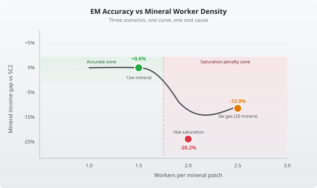

# The Bug That Wasn't There

The gas economy has a mineral deficit. When three workers go to a vespene geyser and nine stay on minerals, the emulated game produces 3385 minerals at tick 304. StarCraft II produces 3885. That is a 12.9% gap, and it looks like a gas worker transfer bug — workers being assigned at the wrong time, or mineral mining being disrupted by the handoff.

I spent the session investigating. The answer was hiding in the probe production timeline.

## The Misleading Symptom

The 12-worker mineral-only baseline matches SC2 to within 0.6%. Twenty minerals out of 3460. So when the 3-worker gas scenario shows a 500-mineral deficit, the natural hypothesis is: something breaks when workers move to gas. Maybe the EM assigns gas workers too early. Maybe the remaining mineral workers get disrupted — patch reassignment, reroute storms, a desynchronised cadence.

None of that turned out to be the problem.

## What SC2 Actually Does

The gas baseline playbook trains probes continuously. SC2 starts with 12, builds a Pylon at 14 supply, an Assimilator at 15, and keeps training until supply-capped at 23 (Nexus provides 15, Pylon provides 8). Three probes go to gas. Twenty mine minerals.

Here is the SC2 mineral income trajectory compared to the 12-worker mineral-only baseline:

<figure>

```
tick  | 12w (no gas) |  3w gas  | gas delta
------|-------------|----------|----------
    0 |          50 |       50 |         0
   60 |         680 |      220 |      -460
  120 |        1360 |      810 |      -550
  200 |        2270 |     2070 |      -200
  250 |        2845 |     2950 |      +105
  304 |        3460 |     3885 |      +425
```

<figcaption>SC2 mineral income: 3w gas scenario vs 12w mineral-only. The gas scenario overtakes 12w because 11 extra probes more than compensate for 3 workers on gas.</figcaption>
</figure>

The gas scenario finishes with *more* minerals than 12w. The 11 extra probes mine more than the 3 gas workers cost. The early deficit (ticks 0–120) is from spending: 550 minerals on Pylon, Assimilator, and probe training. By tick 250 the extra probes have overtaken the mineral-only baseline.

## The Saturation Curve

Twenty workers on eight mineral patches is 2.5 workers per patch. At that density, the EM's collision model — the same speed factor 0.96 that produces correct income at 1.5 workers/patch — becomes a compounding penalty. Workers collide more frequently, slow down more, and mine less per cycle.

The 16-worker saturation test already shows this. At 2.0 workers per patch, the EM underproduces by 20.2%. The gas mineral deficit is the same physics, just reached by a different path: probe training pushes the worker count past the collision model's accuracy ceiling.

<figure>

```
Workers/patch | EM accuracy
--------------|------------
         1.50 |     +0.6%    ← 12w mineral-only
         2.00 |    -20.2%    ← 16w saturation test
         2.50 |    -12.9%    ← 3w gas (20 mineral workers)
```

<figcaption>EM accuracy degrades as mineral worker density exceeds 2.0 workers per patch. The gas mineral deficit falls on the same curve as the 16w saturation test.</figcaption>
</figure>

## Why It Looked Like a Gas Bug

The issue was filed as "investigate gas worker transfer impact." When you see a deficit in a gas scenario, the first thing you check is gas mechanics — assignment timing, worker handoff, income disruption. The 12w baseline passes, gas doesn't, so gas must be the problem.

But the 12w baseline never trains probes. It runs with exactly 12 workers the entire game — 1.5 per patch, well within the collision model's sweet spot. The gas playbook builds Pylons and Assimilators, which means it also trains probes, which means it pushes mineral worker count past the point where straight-line movement plus collision penalties can represent SC2's pathing-based contention.

The gas mechanics are fine. The geyser vespene gap (-8.7%) is a separate, smaller issue from harvest duration calibration. The mineral deficit is the saturation curve.



## One Problem, Three Faces

The 16w saturation deficit (-20.2%), the 3w gas mineral deficit (-12.9%), and the 6w gas mineral deficit (-16.6%) share a single root cause: the collision speed factor does double duty as path-length compensation and contention penalty, and it cannot do both at high worker densities.

The fix path is unchanged: mineral-line pathfinding. Workers that navigate around patches and each other would have naturally longer paths at all densities, removing the need for the collision factor to absorb the path-length gap. That would free it to model only contention — or to be removed entirely.

For now, the simulation is accurate at the operating point that matters most for ML training data: the first 12 workers, before the economy ramps up and the saturation curve diverges.
