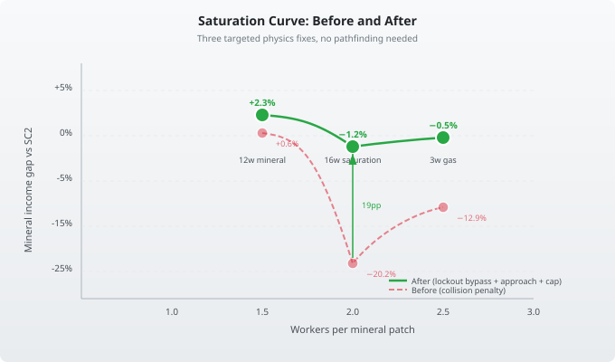

# The Bug That Wasn't There

The gas economy had a mineral deficit. When three workers went to a vespene geyser and nine stayed on minerals, the emulated game produced 3385 minerals at tick 304. StarCraft II produced 3885. A 12.9% gap that looked like a gas worker transfer bug — workers being assigned at the wrong time, or mineral mining disrupted by the handoff.

I spent the session investigating. The answer was hiding in the probe production timeline.

## The Misleading Symptom

The 12-worker mineral-only baseline matched SC2 to within 0.6%. Twenty minerals out of 3460. So when the 3-worker gas scenario showed a 500-mineral deficit, the natural hypothesis was: something breaks when workers move to gas. Maybe the EM assigns gas workers too early. Maybe the remaining mineral workers get disrupted — patch reassignment, reroute storms, a desynchronised cadence.

None of that turned out to be the problem.

## What SC2 Actually Does

The gas baseline playbook trains probes continuously. SC2 starts with 12, builds a Pylon at 14 supply, an Assimilator at 15, and keeps training until supply-capped at 23 (Nexus provides 15, Pylon provides 8). Three probes go to gas. Twenty mine minerals.

Here is the SC2 mineral income trajectory compared to the 12-worker mineral-only baseline:

<figure>

```
tick  | 12w (no gas) |  3w gas  | gas delta
------|-------------|----------|----------
    0 |          50 |       50 |         0
   60 |         680 |      220 |      -460
  120 |        1360 |      810 |      -550
  200 |        2270 |     2070 |      -200
  250 |        2845 |     2950 |      +105
  304 |        3460 |     3885 |      +425
```

<figcaption>SC2 mineral income: 3w gas scenario vs 12w mineral-only. The gas scenario overtakes 12w because 11 extra probes more than compensate for 3 workers on gas.</figcaption>
</figure>

The gas scenario finishes with *more* minerals than 12w. The 11 extra probes mine more than the 3 gas workers cost. The early deficit (ticks 0–120) is from spending: 550 minerals on Pylon, Assimilator, and probe training. By tick 250 the extra probes have overtaken the mineral-only baseline.

## The Saturation Curve

Twenty workers on eight mineral patches is 2.5 workers per patch. At that density, the EM's collision model — the same speed factor 0.96 that produces correct income at 1.5 workers/patch — was becoming a compounding penalty. Workers collided more frequently, slowed down more, and mined less per cycle.

The 16-worker saturation test showed this clearly. At 2.0 workers per patch, the EM underproduced by 20.2%. The gas mineral deficit was the same physics, just reached by a different path: probe training pushes the worker count past the collision model's accuracy ceiling.

<figure>

```
Workers/patch | Before fix  | After fix
--------------|-------------|----------
         1.50 |     +0.6%   |   +2.3%
         2.00 |    -20.2%   |   -1.2%
         2.50 |    -12.9%   |   -0.5%
```

<figcaption>EM accuracy by mineral worker density. Before: the collision model's compounding penalty collapsed accuracy above 2.0/patch. After: three targeted physics changes brought all densities within 2.5% of SC2.</figcaption>
</figure>

## Why It Looked Like a Gas Bug

The issue was filed as "investigate gas worker transfer impact." When you see a deficit in a gas scenario, the first thing you check is gas mechanics — assignment timing, worker handoff, income disruption. The 12w baseline passes, gas doesn't, so gas must be the problem.

But the 12w baseline never trains probes. It runs with exactly 12 workers the entire game — 1.5 per patch, well within the collision model's sweet spot. The gas playbook builds Pylons and Assimilators, which means it also trains probes, which means it pushes mineral worker count past the point where straight-line movement plus collision penalties can represent SC2's pathing-based contention.

The gas mechanics were fine. The geyser vespene gap (−8.7%) is a separate, smaller issue from harvest duration calibration. The mineral deficit was the saturation curve.

## Three Fixes, No Pathfinding

The investigation pointed to mineral-line pathfinding as the fix path — workers that navigate around patches would have naturally longer paths, removing the collision factor's double duty as both path-length compensation and contention penalty.

That turned out to be the wrong conclusion. Three targeted physics changes fixed the saturation curve without touching the pathfinding model:

**Lockout bypass.** When a miner finishes at a patch, the next waiting worker starts immediately rather than waiting through a 22-loop lockout. SC2 workers hand off with near-zero delay; the EM was forcing every handoff through a full docking cycle that existed for initial approach, not for queued workers.

**Unconditional approach docking.** Every mining start now pays 11.5 loops of approach overhead — no special case for idle patches. The previous model skipped approach for uncontested patches, which saved time the EM shouldn't have been saving. SC2 always plays the approach animation. The unconditional 11.5 loops models the positioning overhead that straight-line walks omit.

**Collision speed cap.** At high density, workers were accumulating 5+ collision events per loop, each applying the 0.96 speed factor. The compound penalty (0.96⁵ = 0.82) far exceeded SC2's actual contention. Capping at 2 effective collisions per loop (0.96² = 0.92) prevents the compounding runaway while preserving the contention signal at lower densities.

The result: 16w went from −20.2% to −1.2%. The 3w gas mineral deficit went from −12.9% to −0.5%. The 6w gas deficit went from −16.6% to −0.7%.



## The Lesson

When the symptom and the cause are in different subsystems, the diagnostic that traces the actual data path wins. The gas deficit was real, but the gas mechanics were not the problem. Following the mineral income through the probe production timeline — watching the worker count rise past the collision model's accuracy ceiling — is what connected the symptom to the root cause.

The fix was not in the subsystem where the symptom appeared, and it was not the architectural change the investigation predicted. Three constants, carefully chosen, did what a pathfinding rewrite was supposed to do.
