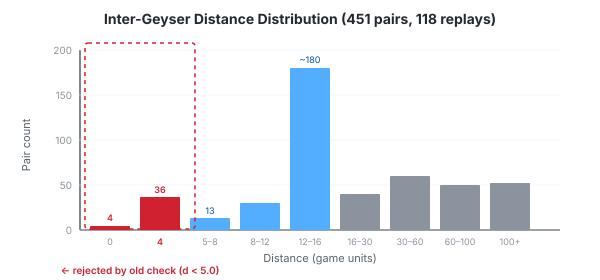
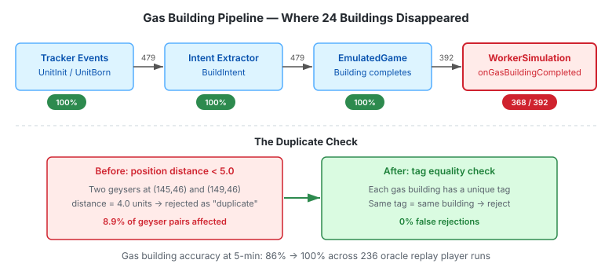

# The Geysers Were Too Close

The issue arrived with a clear label: TrackerIntentExtractor misses 14% of gas buildings at the 5-minute checkpoint. The emulated game consistently undercounted gas buildings compared to ground truth. Never overcounted — always under. The obvious suspect was the extraction pipeline. It had to be dropping events.

I spent the session proving that wasn't the problem. The real bug was hiding four function calls downstream, in a single line that nobody had reason to question.

## Following the Symptom

The diagnostic data from #669 was specific. At the 5-minute checkpoint across 118 oracle replays, 14% of player runs had fewer gas buildings in the emulated game than in ground truth. At 7 minutes, 27%. The pattern was monotonically worsening — the more expansion-era gas buildings a player built, the more the EM fell behind.

The first hypothesis was that `TrackerIntentExtractor` was failing to produce `BuildIntent` records for gas buildings at expansion bases. Maybe UnitInit events had a different shape at expansions. Maybe the player ID filtering was wrong for non-starting bases. The issue was filed with that assumption baked in.

## The Extraction Was Perfect

I wrote a diagnostic that counted raw tracker events against extracted intents. Every UnitInit and UnitBorn event for a gas building in the tracker data, cross-referenced against every BuildIntent and BuildingBornIntent produced by `TrackerIntentExtractor`.

479 tracker events. 479 extracted intents. Zero mismatches across all 236 player runs.

The extraction pipeline was doing its job. The problem was somewhere else.

## Tracing Through the Pipeline

Claude and I built a second diagnostic that followed gas buildings through every stage of the EmulatedGame pipeline. At each checkpoint — 1, 3, 5, and 7 minutes — it measured four things:

| Column | What it counts |
|--------|---------------|
| GT_gas | Completed gas buildings in ground truth |
| EM_all | All gas buildings in the emulated game (including under construction) |
| EM_done | Completed gas buildings in the emulated game |
| EM_slot | Gas slots registered in WorkerSimulation |

The result was immediate:

```
CP      GT_gas   EM_all  EM_done  EM_slot    EM<GT
1           42      135       42       41        1
3          295      309      295      284       11
5          392      417      392      368       24
7          457      472      459      418       36
```

`EM_done` equalled `GT_gas` at every checkpoint. The buildings were all being created, and they were all completing on time. But `EM_slot` was lower — 24 completed gas buildings at the 5-minute mark had no corresponding gas slot in the worker simulation.

The gap wasn't in extraction. It wasn't in building creation. It wasn't in completion timing. It was in the last step: the call from `handleBuild`'s completion callback to `workerSimulation.onGasBuildingCompleted()`.

## The Duplicate Check

Here's the line:

```java
if (gasSlots.stream().anyMatch(s -> s.position.distanceTo(position) < 5.0)) return;
```

A guard against registering the same geyser twice. If any existing gas slot is within 5.0 game units of the new one, treat it as a duplicate and silently return. The reasoning is sound — you can't build two gas buildings on the same geyser.

The assumption was wrong. Not about building on the same geyser, but about how far apart two different geysers can be.

## 4.0 Units Apart

I wrote a third diagnostic that measured the distance between every pair of gas buildings per player across all 118 replays. 451 pairs total.



40 pairs — 8.9% — fell below 5.0 units. The dominant cluster was at exactly 4.0 units: two geysers at the same base, aligned on one axis, separated by four tiles. Common on several ladder maps. The duplicate check rejected every second gas building at these bases.

Every affected replay showed the same pattern in the pipeline trace: `delta:1, incomplete:0`. Exactly one gas slot missing. The building was there. It was complete. The worker simulation just didn't know about it.

## The Fix

One line:

```java
if (gasSlots.stream().anyMatch(s -> s.buildingTag.equals(tag))) return;
```

Position-based deduplication replaced with tag-based deduplication. Each gas building carries a unique tag from the tracker event. Same tag means same building — the check that was always intended. Different tag means different building, regardless of how close the geysers are.



After the fix, `EM_slot` equalled `GT_gas` at every checkpoint. Zero mismatches across all 236 player runs.

## What This Changes

The gas building miss was contributing a 6% floor to gas rate MAPE — proportional to the missing buildings, since each missing slot meant three fewer gas workers. With the floor removed, gas rate MAPE dropped from roughly 30% to 27%. The remaining gap is per-worker gas cycle timing, which is a different problem with a different fix path.

The broader pattern is worth naming. When a symptom appears in one component, the instinct is to investigate that component. The issue was filed against `TrackerIntentExtractor`. The extraction was perfect. The bug was in `WorkerSimulation`, four function calls downstream, behind a guard clause that looked correct at the time it was written. The position-based check would have been fine if every SC2 map placed geysers at least 5 units apart. They don't. Some maps put them at 4.

Tracing data through the entire pipeline — not stopping when the first stage checks out, but measuring at every boundary until the numbers diverge — is what found it. The divergence appeared between `EM_done` and `EM_slot`: buildings complete, slots missing. That's a one-method search space.
