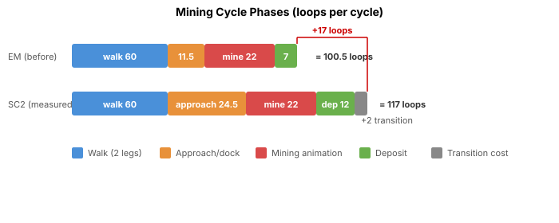
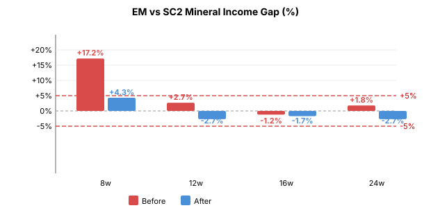

# The Bugs That Cancelled Out

The emulated game's 12-worker mineral income has matched SC2 within 3% for weeks. Every calibration run confirmed it. The physics constants were measured, the collision model was tuned, the approach docking was set from per-worker observation data. The economy worked.

Then I recorded an 8-worker baseline.

At 8 workers --- one per mineral patch, zero contention --- the emulator over-produced by 17%. Not close. Not within tolerance. Seventeen percent faster than the real game, on an economy path with no contention, no collisions, no saturation effects. Just workers walking to patches and back.

The 12-worker accuracy was a lie. Two bugs were cancelling each other out.

## The Measurement

The 8-worker baseline is the simplest economy scenario SC2 offers. Twelve starting workers, kill four via the debug API at tick zero, let eight mine for five minutes. No training, no gas, no buildings. The per-worker rate is unambiguous --- there's exactly one worker per mineral patch, so every cycle is uncontested.

SC2 produced 2,330 minerals. The emulator produced 2,730. Per-worker cycle time: SC2 averaged 117 loops, the emulator 100. Every worker, every cycle, 17 loops faster than real SC2.

I needed to understand where those 17 loops were going. So I recorded the SC2 run with per-tick worker cadence data --- position, action, and cargo state for every worker at every tick --- and decomposed the cycle.



The outbound half-cycle --- deposit to pickup --- was 12 loops shorter in the emulator than SC2. The return half was 3 loops shorter. The walk distances were the same. The mining animation was the same 22 loops. The gap was entirely in overhead: the approach phase and the deposit phase.

## The Sub-Tick Chaining Bug

But when I increased the approach docking constant to match the SC2 measurement, the emulator produced the right result at 8 workers but over-corrected at 12 and 16. The constant slowed all cycles equally. Whatever was making the 8-worker cycle too fast had to be something that differentially affected low-saturation scenarios.

I instrumented the simulation to trace per-loop phase transitions. The answer was in `stepOneMineralLoop`:

```java
while (!loopConsumed) {
    if (w.task == MINING_MINERALS) {
        if (currentLoop >= w.phaseEndLoop) {
            w.cargo = harvest();
            w.task = RETURNING_MINERALS;   // transition
            continue;                       // ← zero cost
        }
    }
    if (w.task == RETURNING_MINERALS) {
        w.moveOneLoop();
        loopConsumed = true;               // walk consumes the loop
    }
}
```

The `continue` after the mining-to-returning transition fed back into the while loop without setting `loopConsumed`. The next iteration processed the returning phase, called `moveOneLoop`, and consumed the loop there. One game loop did double duty: it completed the mining phase *and* took the first walk step. The transition itself was free.

The same pattern applied to the depositing-to-mining transition. Two zero-cost transitions per cycle, saving 2 loops directly. But the compounding effect was larger than that, because mid-tick phase transitions let the next phase start with the remaining loops --- effectively shifting all downstream timing earlier by a few loops. The net savings was around 10 loops per cycle.

SC2 doesn't work this way. Each phase transition happens at a game-loop boundary. When a worker finishes mining, the engine processes the completion, and the worker starts its return walk on the *next* game loop. That loop is consumed by the transition --- the worker doesn't get a free movement step.

## The Compensating Bug

This sub-tick chaining affected all saturation levels equally. At 8 workers, it made every cycle 10 loops too fast, producing the 17% surplus. At 12 workers, it did the same --- but the collision speed factor (0.96) was slowing walks down just enough to compensate. Two workers passing each other near a mineral patch would each lose 4% of their speed for that loop. Enough overlapping collisions across a 12-worker mineral line, and the aggregate slowdown matched the sub-tick speedup almost exactly.

The collision model had been calibrated against 12-worker baselines. It was tuned to produce the right total, but it was doing so by compensating for a different bug. Remove the sub-tick chaining and the collision model over-corrects. Keep the sub-tick chaining and the 8-worker rate stays 17% too high. The two bugs were load-bearing against each other.



## The Fix

Three changes, applied together:

The transition loop cost: `loopConsumed = true` on both the mining-to-returning and depositing-to-mining transitions. Each transition now consumes one game loop, matching SC2's per-loop boundary processing. The same fix applied to the gas worker loop, which had identical zero-cost transitions.

The approach docking constant: recalibrated from 11.5 to 24.5 loops. The original value was derived from 12-worker observation data --- but the 12-worker measurement was itself contaminated by the sub-tick chaining. With transitions costing their proper loop, the 8-worker cadence data gives a clean measurement of the approach phase: 24.5 loops.

The deposit duration: 7 to 12 loops, measured from the return half-cycle gap.

The collision speed factor: disabled entirely (0.96 to 1.0). With the transition fix providing correct cycle timing, the collision model's compensating role is no longer needed. SC2 workers don't slow down when they overlap --- they path around each other. The speed penalty was approximating path deviation, but it was really approximating the sub-tick chaining bug.

## The Lesson

This is the failure mode that calibration can't catch by definition. You measure a system at one operating point, tune constants to match, and the calibration succeeds. But the constants are absorbing two errors that happen to cancel. The moment you test at a different operating point --- different worker count, different saturation, different contention --- the cancellation breaks and the real errors surface.

The diagnostic that broke the illusion was the simplest possible scenario: eight workers, one per patch, no contention. No collision model, no lockout, no rerouting. Just the raw physics loop doing straight-line walks. That's the operating point where every constant is carrying its own weight, no compensation from other systems. Any error in the base cycle is fully exposed.

The broader principle: calibrate at your simplest operating point first. If the simplest case doesn't match, nothing downstream is trustworthy --- it's just being compensated for.
