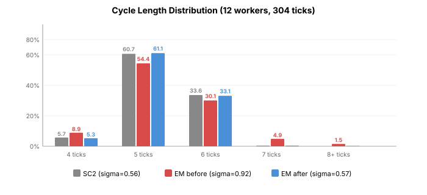
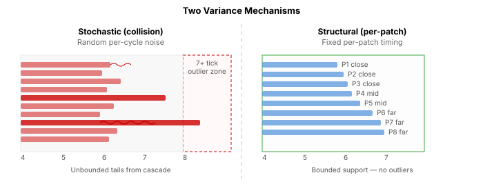

# Right Total, Wrong Shape

The emulated game's 12-worker mineral income was within 2% of SC2. The cycle mean was 5.39 ticks vs SC2's 5.28. By every aggregate metric, the economy was accurate.

Then I looked at the histogram.

SC2's cycle lengths cluster tightly: 61% at 5 ticks, 34% at 6, 6% at 4, and nothing else. Zero 7-tick cycles. Zero outliers. The standard deviation is 0.56 --- almost all workers completing their mining round trip in the same number of ticks, every time.

The emulator's histogram was wider. 54% at 5, 30% at 6, 9% at 4 --- similar enough in the centre. But 5% at 7 ticks, and a scattering at 8, 9, even 10. Cycles that SC2 never produces. σ=0.92 --- nearly twice SC2's variance.

The total was right. The shape was wrong.

## Investigating the outliers

I wrote a diagnostic that traced every 7+ tick cycle to its cause. Each outlier left a phase trace --- a string of characters showing what the worker was doing each tick. `R` for returning, `g` for walking to patch, `W` for waiting at an occupied patch, `R` for the return trip:

```
W07: ticks 133→140 (len=7) cause=WAITING_AT_PATCH
  phases: RRggWWgR
```

This worker spent two ticks waiting at a mineral patch that another worker was occupying. The wait pushed a normal 5-tick cycle to 7.

The cause breakdown across all 43 outlier cycles: 37% waiting at patches, 40% a mix of walking and brief waits, 23% long walks. The first hypothesis was worker distribution --- maybe too many workers were assigned to the same patch. Five workers on one far patch would explain the contention.

The data said otherwise. A diagnostic that traced actual `assignedPatch` references showed the distribution was balanced: four patches with two workers, four with one. The position-based matching in the original diagnostic had been grouping three spatially adjacent patches (within 11 degrees of each other) under a single label.

## The real mechanism

The problem wasn't which patches workers were on. It was that all patches had the same overhead.

The `approach_docking_loops` constant --- 24.5 loops, applied uniformly to every mineral patch --- absorbed both the approach animation and the path deviation that straight-line walks don't capture. Close patches (2.3 units edge-to-edge) and far patches (3.9 units) got identical overhead. This equalised cycle times across patches, making every worker's cycle the same length. When collision displacement randomly extended a walk by a few loops, it shifted arrival timing past the patch occupancy window --- converting a 3-loop walk extension into a 46-loop contention wait. Small cause, large discrete effect.

That's the contention cascade. It's why the outlier distribution is discontinuous --- there's nothing between a normal 5-6 tick cycle and a 7+ tick one. The cascade is all-or-nothing.



## Two kinds of variance

SC2 has σ=0.56, which means it does have cycle variance. But it's the right kind.

Each mineral patch has a fixed effective walk distance determined by the mineral line geometry. Workers assigned to close patches complete cycles in 5 ticks. Workers on far patches complete in 6. A few on very close patches manage 4. The variance comes from *different workers being in different tick buckets*, not from *individual workers jumping between buckets*. One worker's cycles are almost identical to each other. The standard deviation comes from the mix across workers.

This is structural variance --- deterministic, per-patch, bounded. No worker's characteristic cycle time is 7+ ticks because no patch is far enough.

The emulator's collision model adds stochastic variance --- random, per-cycle, unbounded. Each collision pushes a worker sideways by 0.3--0.5 units. The displacement is small, but it accumulates differently each cycle. Occasionally the cumulative effect crosses the contention threshold and triggers the cascade.



No tuning of the collision parameter can produce bounded [4,6] variance because the cascade mechanism is inherently unbounded. The shape is wrong at every scale factor.

## The fix

Two changes, targeting the two variance mechanisms independently.

**Per-patch approach docking.** Instead of a flat 24.5 loops for all patches, compute per-patch values from edge-to-edge distance. Close patches get more approach (compensating for shorter walks --- they're the ones where SC2 workers navigate around adjacent patches). Far patches get less (walks are already long, paths are more direct).

The formula: `approach[i] = base + (median_E2E - E2E[i]) × loops_per_unit × 0.4`. The 0.4 is the equalization scale --- SC2's path deviation compensates about 40% of the walk distance difference between close and far patches. The remaining 60% shows through as per-patch cycle time variation. Full equalization (scale=1.0) produced σ=0.50 --- too uniform. Zero equalization left too much structural spread. The 0.4 was found by sweep; at that value the EM's 4/5/6-tick percentages match SC2's within 1%.

**Contention-aware collision.** At two or fewer workers per patch (normal saturation at 12 workers), reduce the lateral displacement to 25% of its full value. This eliminates most contention cascades while preserving the collision physics at high saturation (3+ workers per patch, relevant at 24 workers) where workers genuinely jostle.

The combined result:

| Metric | SC2 | EM (before) | EM (after) |
|--------|-----|-------------|------------|
| σ | 0.56 | 0.92 | 0.57 |
| Mean | 5.28 | 5.39 | 5.29 |
| 7+ tick | 0% | 6.6% | 0.6% |
| 4-tick | 5.7% | 8.9% | 5.3% |
| 5-tick | 60.7% | 54.4% | 61.1% |
| 6-tick | 33.6% | 30.1% | 33.1% |

The residual 0.6% (four cycles out of 665) are from the collision displacement occasionally shifting arrival timing past the contention threshold. Setting the displacement to zero eliminates them --- but it also drops the mean to 4.99, because the displacement is load-bearing for cycle *time*, not just variance. The displacement adds walk distance that the approach constant was calibrated to expect.

## The principle

Matching aggregate accuracy is necessary but not sufficient. A simulation that produces the right total by the wrong mechanism will diverge at a different operating point, a different timescale, or a different saturation level. The histogram is a stronger test than the total because it constrains the *mechanism*, not just the *output*.

For this simulation, that meant understanding that SC2's cycle variance is structural --- a physical property of the mineral line geometry --- and modelling it structurally, not stochastically. The collision model was adding the right amount of aggregate variance through the wrong mechanism: unbounded random noise instead of bounded per-patch timing.

The diagnostic that broke the illusion was the same one that broke the compensating-bugs illusion in the previous round: look at the distribution, not the mean.
