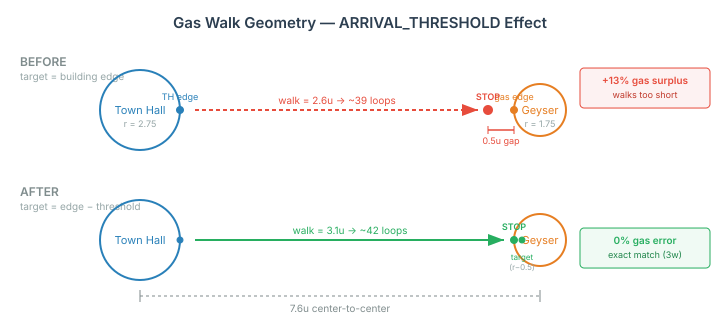

# The Half-Unit That Halved the Walk

The emulated game's mineral income has been within 3% of SC2 for weeks. Gas income was 13% too high. Same workers, same movement physics, same acceleration model. Minerals accurate, gas wrong. The question was straightforward: why do gas workers produce more than they should?

## The Walk That Was Too Short

Gas workers shuttle between the town hall and a geyser. Each leg of that trip determines how fast gas accumulates. The walk distance in the emulator is calculated edge-to-edge: center-to-center distance minus the town hall radius minus the geyser radius. For a 7.6-unit center-to-center distance, that's 7.6 − 2.75 − 1.75 = 3.1 units.

But there's a movement system constant called ARRIVAL_THRESHOLD. When a worker gets within 0.5 units of its target, the movement code snaps it to the destination and stops. It's a practical necessity — floating-point movement in discrete game loops rarely lands a worker at exactly zero distance from the target. The threshold prevents workers from orbiting their destination at sub-pixel distances, overshooting and re-approaching forever.

For minerals, this 0.5-unit shortcut was invisible. The mineral approach docking constant (24.5 loops of overhead per mining cycle) was calibrated from SC2 cadence data that already included this effect. The docking constant absorbed the walk shortening.

Gas didn't have that luxury. The gas approach docking was calibrated independently, and the walk:harvest ratio was wrong. Each gas walk was 0.5 units shorter than it should have been — per leg, per trip, every cycle. At two legs per cycle and three workers per geyser, those missing half-units compound fast.



## The Geometric Fix

The fix is satisfyingly literal. Instead of walking to the geyser's surface and stopping 0.5 units short, the target is set 0.5 units _inside_ the geyser's surface. The worker walks until it's 0.5 units from that interior target — which puts it exactly at the actual building edge. Same arrival threshold, correct stopping point.

```java
private Point2d gasTarget(GasSlot slot) {
    if (!useEdgeToEdge) {return slot.position;}
    return edgePoint(slot.position,
                     bases.get(slot.baseIndex).position(),
                     GAS_BUILDING_RADIUS - (float) ARRIVAL_THRESHOLD);
}
```

The same adjustment applies to the return walk — the town hall target is shifted inward by the same amount.

## The Numbers

After extending gas walks and recalibrating the approach docking constant (11.5 → 15.8 loops):

| Scenario | Before | After |
|----------|--------|-------|
| 3w gas (1 geyser) | +13.0% | **0.0%** |
| 6w gas (2 geysers) | +21.3% | +6.7% |

The 3w result is exact — 552 vespene from SC2, 552 from the emulator, at tick 304. The 6w surplus is a separate issue: both geysers are symmetric (I checked), so it's a multi-geyser contention or assignment timing problem. Not the walk geometry.

## Why This Matters

Mineral calibration got months of attention. Each constant was measured, swept, and validated against dual-run baselines. Gas calibration piggybacked on the same movement system and inherited an assumption that was never tested: that the arrival threshold affects gas walks the same way it affects mineral walks. It doesn't.

The difference is subtle: mineral approach docking was calibrated empirically against SC2 cadence data. That calibration baked in the walk shortening without anyone noticing. Gas approach docking was calibrated against a different baseline (oracle MAPE), where the walk shortening was one error among many. When other errors were fixed, the walk shortening remained.

The broader lesson from this calibration campaign: a simulation that gets the right totals isn't necessarily getting the right decomposition. The gas cycle produced roughly the right amount of gas, but the walk was too short and the docking compensated. Fixing the walk and recalibrating the docking gives the same total — but now the _phases_ are right, which means changing geyser distances on different maps will produce the correct cross-map behaviour.
