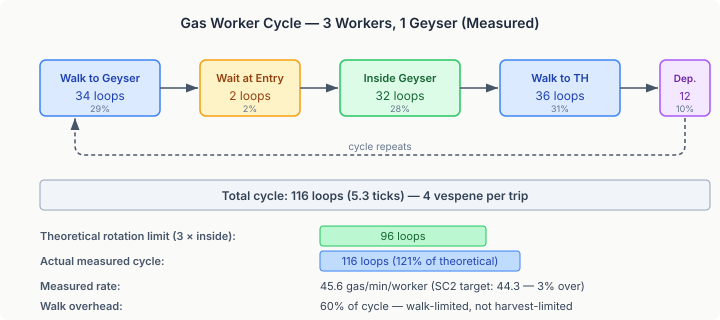

# Stop Guessing, Start Counting

Analytical calculations of gas worker cycle timing gave inconsistent results. Walk time estimates ranged from 17 to 46 loops depending on which formula was used — continuous kinematics, discrete-loop stepping, acceleration curves with or without deceleration. Three formulas, three answers, no way to tell which one the simulation actually produces.

The problem isn't that the formulas are wrong. It's that they model a different system. A kinematic equation computes the trajectory of a single point mass in continuous time. The emulator runs three workers with acceleration, deceleration, arrival thresholds, serial geyser access, deposit locks, and 22-loop tick boundaries — all interacting per game loop. The formula doesn't know about any of that. It can't tell you how long a worker waits outside the geyser because two others are ahead of it. It can't account for the tick where the deposit phase ends and the walk phase begins in the same 22-loop window. It models what should happen in theory; the simulation produces what actually happens in practice.

## Instrument the Mechanism

The solution is obvious in hindsight: stop computing what should happen and measure what does happen. The diagnostic test instruments each gas worker through its full cycle, classifying its state after every tick into five phases:

- **Walk to geyser** — task is HARVESTING_GAS, not inside the building, not at the target
- **Wait at entry** — at the target, waiting for serial access (MAX_INSIDE=1)
- **Inside geyser** — inside the building, harvesting
- **Walk to town hall** — task is RETURNING_GAS
- **Deposit** — task is DEPOSITING_GAS

A cycle boundary fires when the worker transitions from a deposit-related state back to walking. The first cycle is discarded (ramp-up from base position). Everything after that is steady-state.

## What the Numbers Show

Three workers on one geyser, 300 ticks, steady-state averages:

| Phase | Ticks | Loops | % of cycle |
|-------|-------|-------|------------|
| Walk to geyser | 1.5 | 34 | 29% |
| Wait at entry | 0.1 | 2 | 2% |
| Inside geyser | 1.5 | 32 | 28% |
| Walk to TH | 1.6 | 36 | 31% |
| Deposit | 0.5 | 12 | 10% |
| **Total** | **5.3** | **116** | **100%** |

The theoretical rotation-limited cycle — where each worker enters immediately after the previous one exits — is 3 × 32 = 96 loops. The actual cycle is 116 loops, 121% of theoretical. The 20% overhead is walk plus deposit exceeding the harvest duration.

This matters because it tells you exactly where time is spent. Walk dominates (60% of the cycle). Inside-geyser time is a fixed 32 loops — there's nothing to tune there. Wait-at-entry averages 2 loops — serial access imposes almost no queuing penalty at 3 workers. The cycle is walk-limited, not harvest-limited.

## What the Formulas Missed

The analytical approach overestimated walk time. Continuous kinematics predicted 42 loops per leg (84 round trip). The measured walk is 34+36 = 70 loops — 17% less. The gap comes from sub-tick phase chaining: when the deposit phase ends mid-tick, the remaining loops in that tick begin the walk immediately. The worker gets a head start that no formula accounts for.

The formulas also couldn't predict the wait-at-entry distribution. At 3 workers with a 32-loop inside duration and a 116-loop cycle, workers arrive at the geyser well-spaced. The serial access queue almost never has a waiting worker — the rotation is naturally staggered by the walk time. This was a contested question before the diagnostic: would serial access create contention? The answer is no, not at 3 workers per geyser. The walk time is the spacer.

## From Measurement to Calibration

The measured rate is 45.6 gas/min/worker against SC2's 44.3. That's 3% over, consistent across both single-geyser (3 workers) and dual-geyser (6 workers) configurations. The over-production source is clear from the phase breakdown: walk time is too short. The emulator uses straight-line paths; SC2 workers deviate around mineral patches and other workers on their way to the geyser. That path deviation adds a few loops per leg — enough to account for the 3% gap.

This is the kind of structural insight that formulas cannot produce. A formula tells you what a system should do given its parameters. A diagnostic test tells you what the system actually does — and when those disagree, it tells you where to look.

The diagnostic runs with the other calibration tests under `mvn test -Pdiagnostic`, producing a full per-worker cycle table every time the physics change. No more guessing.
