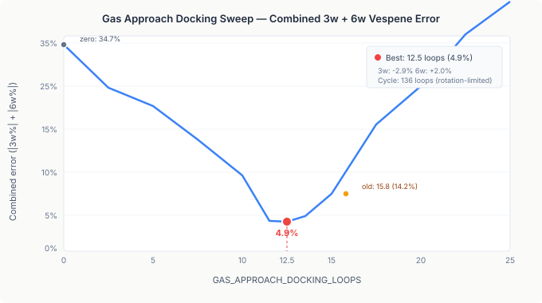

# The Constant the Model Forgot

Changing a model's structure doesn't just change its behaviour. It invalidates every constant that was calibrated for the old structure. We learned this the expensive way.

## The Structural Change

The emulated game's gas geyser previously allowed all three workers inside simultaneously. Liquipedia is unambiguous: "Only one worker can be inside the building collecting at any one time." So we fixed it — serial access, one worker inside, the other two queue outside.

The old model had a 15.8-loop approach docking constant. This absorbed real per-trip overhead: the entry animation, path deviation on approach, the brief pause as a worker docks with the building entrance. When we switched to serial access, the assumption was that the rotation wait — workers queuing to enter — would absorb this overhead naturally. If the worker has to wait anyway, the docking time is hidden inside the wait.

The assumption was wrong. The diagnostic test showed wait-at-entry averaged just 2 loops. Three workers rotating through a 32-loop harvest cycle with 70 loops of walk time are naturally staggered. They rarely arrive at the same time. The queue barely exists.

So we zeroed the approach docking constant. And gas over-production spiked to +14% on a single geyser, +20% on dual geysers.

## Why the Handoff Lied

The handoff from the previous session reported 0% gas error for single-geyser. Those numbers were from before the serial access change — calibrated against the concurrent model with 15.8 loops of docking. Nobody re-ran the dual-run baselines after the structural change. The handoff was stale and nobody caught it until a fresh session ran the actual calibration.

This is a general hazard with any simulation that carries state across sessions. The handoff says what was true when it was written. It doesn't say whether the commits after it changed the foundation those numbers stood on. The dual-run calibration is the authority; the handoff is a memo.

## The Sweep

A sweep from 0 to 25 loops against the recorded SC2 baselines showed a clean minimum at 12.5 loops:

| Docking | 3w vespene | 6w vespene | Combined |
|---------|-----------|-----------|----------|
| 0 (broken) | +14.5% | +20.2% | 34.7% |
| 11.5 | -0.7% | +4.3% | 5.1% |
| **12.5** | **-2.9%** | **+2.0%** | **4.9%** |
| 15.8 (old) | -9.4% | -4.7% | 14.2% |

The 12.5 value is close to the old 15.8 — close enough to confirm the same physical overhead was always present. The model changed; the physics didn't.

## Rotation-Limited

With 12.5 loops of docking, the gas cycle becomes rotation-limited. The inside time (harvest + docking) is 44.2 loops. Three workers rotating: theoretical minimum cycle is 3 × 44.2 = 132.6 loops. Measured cycle: 136 loops. That's 100.7% of theoretical — the walk and deposit phases fit neatly inside the gaps between workers.

This matters because it tells us the serial access model is working correctly. The geyser is the bottleneck, not the walks. The cycle length is determined by the inside time and the number of workers — exactly what the physics should predict.

## The Principle

When you change a model's structure, re-sweep every constant. Constants aren't properties of the system being modeled — they're properties of the specific model structure used to approximate it. A constant calibrated for a concurrent access model absorbs a different mix of real-world overhead than the same constant in a serial access model. The number 15.8 wasn't "wrong" in the concurrent model. It's wrong in the serial model for a different reason: it over-compensates because the serial wait already absorbs part of what the concurrent constant was doing. The correct value for the new model is 12.5 — close, but not the same, because the structural change redistributed what each parameter absorbs.

Setting any constant to zero is an assertion: "this overhead doesn't exist." That's almost never true. The overhead exists in the real system; the question is which part of the model carries it. Zero means you've decided it's somewhere else. If you're right, the calibration confirms it. If you're wrong, the calibration catches it. The sweep is cheap. The assumption is not.
