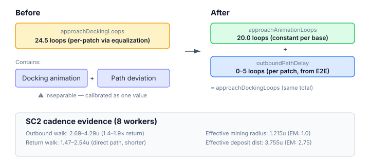

# Two Walks, One Constant

A worker mining minerals makes two walks per cycle: outbound to the patch, return to the town hall. The emulator treats them as symmetric — same distance, same physics, same time. SC2 does not.

The 8-worker cadence baseline makes this unambiguous. For every worker at every patch, the outbound walk is 1.4 to 1.9 times the return walk. Not close, not marginal — structurally different paths.

## Why the Walks Are Different

StarCraft II mineral patches form an arc around the town hall. Workers walking outbound have to navigate around the formation — close patches sit behind other patches, so the outbound path curves. Workers returning carry minerals and take the direct path home.

The cadence data quantifies this. Edge-to-edge straight-line distances to the 8 patches range from 2.27 to 3.88 units. Actual outbound walks range from 2.69 to 4.29 units. Actual return walks range from 1.47 to 2.54 units. The outbound walk sometimes exceeds the straight line; the return walk is always shorter.

The return walk being shorter is not a path effect. Workers stop at an effective mining radius of 1.215 units from the patch center (the emulator uses 1.0) and an effective deposit distance of 3.755 units from the town hall (the emulator uses 2.75). Both end points are further from the buildings than the edge-to-edge model assumes, which shortens the actual walk.

## What the Constant Was Absorbing

The emulator's approach docking constant — 24.5 loops, applied at the patch — was calibrated from cadence data to produce the right total cycle time. It was doing its job. But it was absorbing two distinct things:

1. The docking animation at the patch. The worker arrives at the mineral field and docks — a positioning overhead that takes real time regardless of which patch it mines at.

2. The outbound path deviation. Workers don't walk in straight lines outbound. The extra time from navigating around the mineral formation was baked into the same constant.

These two phenomena have different dependencies. The animation is constant per base. The path deviation varies per patch — close patches need more navigation around neighbours, far patches have direct lines of approach.

The existing per-patch equalization formula partially captured this:

```
approach[i] = 24.5 + (medianE2E - E2E[i]) × 5.69 × 0.4
```

Close patches got more approach. Far patches got less. But conceptually, the base value and the adjustment were inseparable — both part of "approach docking." That made the constant hard to reason about and harder to calibrate independently.

## The Decomposition

We split `approachDockingLoops` into two components:

- **Approach animation** — 20 loops, constant for all patches at a base. The docking overhead only.
- **Outbound path delay** — per patch, 0–5 loops. Computed from E2E distance: `max(0, (medianE2E - E2E[i]) × loopsPerUnit × 0.4 + 4.5)`.

The total — animation plus path delay — produces exactly the same per-patch values as the old formula. Identical mineral income. Identical cycle distribution. This was a pure refactoring.



## What This Opens Up

Separating the animation from the path deviation means each can now be calibrated against different evidence. The animation is a base-level constant — independent of patch layout, testable against any map. The path delay is a geometry parameter — it scales with mineral line shape and can be refined with angular position data beyond the linear E2E fit.

More immediately, the return walk is the other half of the asymmetry. The cadence data shows workers stopping at 3.755 units from the town hall, not the 2.75 edge-to-edge target the emulator uses. That's a 1-unit discrepancy in the effective radius — which explains nearly all the return walk "shortening." Fixing those radii is a separate change, but the decomposition makes it safe to pursue. The path delay absorbs outbound variance; the radii fix can shorten the return walk without destabilising the cycle time.

The approach constant has been carrying two loads. Now each load has its own shoulder.e 
