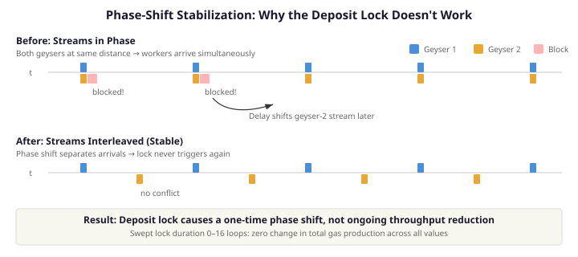

# The Lock That Couldn't Lock

The gas economy had a sign problem. Single-geyser gas production was 3.6% too low. Dual-geyser was 2.8% too high. Same docking constant, opposite errors. The sign flip was the tell — it meant the EM wasn't just miscalibrated on gas timing. It was structurally wrong about what happens when two geysers share a town hall.

The obvious candidate was the deposit lock. SC2 serialises gas deposits at the town hall — only one worker can deposit at a time. The EM models this with an 8-loop lock: when a worker deposits, the lock prevents the next worker from depositing for 8 game loops. With six workers on two geysers, there should be more lock contention than with three on one. That contention should reduce dual-geyser throughput. It didn't.

I swept the lock duration from 0 to 16 loops. Zero throughput change at every value. Not diminishing returns — zero. No effect at all.

## Why the Lock is Structurally Ineffective

The diagnosis came down to two regimes that any gas worker cycle can be in, depending on how the inside time (harvest + docking overhead) relates to the walk time.

A gas worker cycle has four phases: walk to geyser, harvest inside the geyser, walk back to the town hall, deposit. With three workers sharing one geyser and `MAX_INSIDE=1` (serial access), the geyser becomes available once every rotation period — three times the inside time. The question is whether the worker returns before or after the geyser opens.

**Walk-limited** (SC2's regime): the worker's walk + deposit takes longer than two inside-times. The worker arrives late — the geyser has been free for a while. Any delay at the deposit directly extends the cycle. Inside time is 32 loops. Walk + deposit is roughly 90 loops. 90 > 2×32 = 64, so the walk governs.

**Geyser-limited** (the EM's regime): the worker's walk + deposit is shorter than two inside-times. The worker arrives early and waits at the geyser entrance for the previous worker to exit. Any delay at the deposit just reduces the wait time — the total cycle doesn't change. The EM's inside time was 44.2 loops (31.7 harvest + 12.5 docking). Walk + deposit was 82 loops. 82 < 2×44.2 = 88.4. The geyser governs.

That 6.4-loop slack — the gap between 88.4 and 82 — was absorbing every deposit delay I threw at it. Even 16 loops of lock duration couldn't overcome the slack because of a second effect: phase-shift stabilization.

## Phase-Shift Stabilization

The deposit lock doesn't just delay a worker — it delays one stream relative to the other. When workers from geyser-1 and geyser-2 arrive at the town hall simultaneously, the lock blocks one of them. That worker's entire cycle shifts later. On the next cycle, the two streams no longer coincide. The lock never triggers again.

I confirmed this empirically. Over 6710 loops (305 ticks), the lock triggered exactly 22 times — all in transient clusters of 4–6 events, spaced 500+ loops apart. Each cluster was the two streams drifting back into phase due to random processing order, triggering a few blocks, then phase-shifting apart again. Total blocked time: roughly 71 loops across all workers. On a 6710-loop test, that's noise.

The deposit lock creates a one-time phase shift, not ongoing contention. It is structurally incapable of producing a sustained throughput penalty, regardless of its duration, in a geyser-limited cycle.

## What SC2 Actually Does

Liquipedia lists 2×3w gas income at 325 gas/min — exactly double the single-geyser rate. No dual-geyser penalty in theory. But our SC2 calibration recordings tell a different story. Accounting for the second-assimilator build stagger, the empirical dual-geyser rate is roughly 6% below what 2× the single-geyser rate predicts. That penalty is real and consistent across recordings. Liquipedia's figure is theoretical; SC2's engine applies real-world contention.

I tried modelling walk-path collision — the same lateral displacement model the EM uses for mineral workers. The idea: workers from different geysers share the approach path near the town hall and physically interfere with each other. The collision model worked beautifully for same-geyser workers (reducing 3w throughput by 20 gas), but cross-geyser workers walk along paths that are 1.78u apart at their closest point. The collision diameter is 1.5u. On this map geometry, they never touch.

The same-geyser collision gave the right 6w total — 1012, matching SC2 exactly — but only because the per-geyser penalty was similar to the dual-geyser penalty. It wrecked the 3w result, pushing it from -3.6% to -7.2%. Wrong mechanism, right accident.

## The Fix: TH Deposit Congestion

The mechanism that works is simpler and more directly physical. When more than three gas workers share a town hall — the threshold where a second geyser is in play — each deposit takes longer. The workers approaching the deposit point share a congested approach path, and the more workers using it, the more time each spends navigating around each other.

The model: when a gas worker transitions from `RETURNING_GAS` to `DEPOSITING_GAS`, the deposit phase extends by 4.0 loops for each worker beyond three at the base. For single-geyser (three workers), extra workers = 0, extra deposit = 0. For dual-geyser (six workers), extra workers = 3, extra deposit = 12 loops per deposit.

This is constant per-cycle delay, not a lock that phase-shifts away. It doesn't depend on whether two workers happen to arrive simultaneously. It's proportional to the structural congestion — how many workers are sharing the same TH approach path.

Combined with reducing the docking constant from 12.5 to 11.5 (the congestion model now handles part of the cycle overhead the docking previously absorbed), the results:

| Metric | Before | After |
|--------|--------|-------|
| 3w gas error | -3.6% | -1.4% |
| 6w gas error | +2.8% | +0.4% |
| Combined | 6.4% | 1.8% |

The two-parameter sweep (docking × congestion) found several combinations meeting the ≤3% acceptance threshold. The sweet spot at docking=11.5, congestion=4.0 gives 1.8% combined — well inside tolerance.

The investigation took longer than the fix. The fix is two lines of production code and a constant change. But those two lines only make sense once you understand why the deposit lock — the obvious mechanism, the one that should work, the one that every queueing theory textbook would recommend — can't work here. The geyser-limited regime absorbs contention. Phase-shift stabilization prevents recurring contention. Both effects must be absent for a lock-based mechanism to produce sustained throughput reduction. In the EM's gas cycle, both are present.

Sometimes the right fix isn't making the obvious mechanism stronger. It's recognising that the obvious mechanism operates in a regime where it has no power, and finding a different lever entirely
